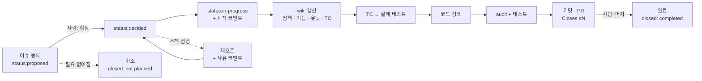

# bab

> **코드는 문서와 싱크를 맞춥니다.**
> 스펙은 이슈에 기록하고, 명세는 wiki에 쓰고, 구현은 PR로 남깁니다. AI는 그 명세를 따라 코드를 맞춥니다.

bab은 SDD(Spec-Driven Development)와 AIDD(AI-Driven Development)를 묶은 에이전트 플러그인입니다. Claude Code가 주 대상이지만, 스킬 문서와 스크립트는 다른 에이전트에서도 쓸 수 있습니다.

<br>

## 목차

1. [왜 만들었나](#왜-만들었나)
2. [세 가지 도구](#세-가지-도구)
3. [방향과 승인 게이트](#방향과-승인-게이트)
4. [전체 흐름](#전체-흐름)
5. [스킬](#스킬)
6. [빠른 시작](#빠른-시작)
7. [wiki 구조](#wiki-구조)
8. [이슈 상태와 라벨](#이슈-상태와-라벨)
9. [다른 에이전트에서 쓰기](#다른-에이전트에서-쓰기)
10. [저장소 구조](#저장소-구조)
11. [자주 묻는 질문](#자주-묻는-질문)
12. [로드맵](#로드맵)

<br>

## 왜 만들었나

AI에게 코드를 맡기면 빠르게 만들어집니다. 그런데 시간이 지나면 이런 질문에 답하기 어려워집니다.

| 질문 | 흔한 현실 |
| --- | --- |
| 이 기능은 **왜** 이렇게 만들었나? | 근거가 끝난 대화 안에만 있습니다 |
| 이 함수는 **원래 어떻게** 동작해야 하나? | 코드가 곧 정답이라, 버그도 정답처럼 보입니다 |
| 이 변경은 **어떤 스펙**을 구현했나? | PR과 요구사항이 연결되어 있지 않습니다 |
| 스펙이 **바뀌거나 취소된 이력**은? | 아무 데도 남지 않습니다 |

bab은 이 정보를 각자 맞는 자리에 기록으로 남깁니다. AI는 기록된 명세를 기준으로 일합니다. 사람은 무엇을 만들지 결정하고, 결과를 승인합니다.

<br>

## 세 가지 도구

| 도구 | 역할 | 담는 것 |
| --- | --- | --- |
| 📌 **Git 이슈** | 스펙을 **정의하고 기록**합니다 | 왜 · 무엇을 · 어떻게, 중요도, 현재 상태, 논의 코멘트, 확정 · 재오픈 · 취소 이력 |
| 🔀 **Git PR** | 스펙의 **구현 기록**입니다 | 코드 리뷰, 안정성 가드레일, 이슈 연결(`Closes #N`), 커밋으로 남는 구현 단계 |
| 📚 **LLM Wiki** | 코드가 따라야 하는 **명세**입니다 | 정책 · 기능 · 유닛 문서, 기능과 유닛의 TC, 함수 시그니처와 내부 로직 |

한 문장으로 줄이면 이렇습니다. **이슈는 "무엇을 왜", wiki는 "정확히 어떻게", PR은 "실제로 무엇을 했나"를 맡습니다.**

<br>

## 방향과 승인 게이트

### 방향은 한 가지입니다

```text
이슈 (스펙)  ──▶  wiki (명세)  ──▶  코드 (구현)
```

- wiki와 코드가 다르면 **코드를 고칩니다.** wiki는 코드를 설명하는 문서가 아닙니다.
- 예외는 하나입니다. bab을 처음 적용할 때, 기존 코드를 wiki로 옮기는 일은 한 번만 반대 방향으로 합니다. 자세한 내용은 [FAQ](#자주-묻는-질문)에 있습니다.

### 사람이 결정하는 곳은 두 곳뿐입니다

| 게이트 | 누가 | 방법 |
| --- | --- | --- |
| ① **스펙 확정** | 사람 | 이슈에 `status:decided` 라벨을 붙입니다 |
| ② **구현 승인** | 사람 | PR을 리뷰하고 머지합니다 |

두 게이트 사이의 일은 AI가 멈추지 않고 진행합니다. wiki 갱신, 테스트 작성, 코드 싱크, 검증, 커밋, PR 생성이 여기에 해당합니다. AI는 `status:decided` 라벨을 **절대 붙이지 않습니다.**

<br>

## 전체 흐름



- 상태가 바뀔 때마다 **사유를 코멘트로** 남깁니다. 이슈 타임라인만 읽어도 스펙의 역사를 알 수 있습니다.
- 커밋 순서는 **wiki → 실패 테스트 → 코드**입니다. 리뷰어가 커밋을 차례로 읽으면 "명세 → 검증 기준 → 구현"이 보입니다.

<br>

## 스킬

| 스킬 | 하는 일 | 호출 | 예시 |
| --- | --- | --- | --- |
| `/bab:setup` | 저장소에 이슈 폼, PR 템플릿, 라벨, wiki 골격, 로컬 지침을 설치합니다 | 직접 호출만 | `/bab:setup` |
| `/bab:spec` | 스펙 이슈를 쓰고, 등록된 이슈를 점검하고, 상태를 바꿉니다 | 자동 · 직접 | `로그인 유지 기능 스펙 등록해줘`, `스펙 현황 보여줘`, `#15 취소해줘` |
| `/bab:wiki` | 정책 · 기능 · 유닛 페이지를 쓰고 index와 log를 관리합니다 | 자동 · 직접 | `#12 기준으로 wiki 갱신해줘`, `src/page 기존 코드 문서화해줘` |
| `/bab:sync` | 확정된 이슈 하나를 wiki → 코드 → PR까지 진행합니다 | 직접 호출만 | `/bab:sync 12` |
| `/bab:audit` | 컨벤션, wiki와 코드의 일치, 이슈와 PR의 연결을 검사합니다(읽기 전용) | 자동 · 직접 | `wiki 일치 검사해줘`, `/bab:audit src/` |
| `/bab:simple-english` | 문서를 쉬운 영어 규칙(ASD-STE100 기반)으로 씁니다 | 자동 · 직접 | `README를 plain English로 다듬어줘` |

> **자동 · 직접**은 에이전트가 대화 내용을 보고 스스로 꺼내 쓸 수도 있다는 뜻입니다. **직접 호출만**인 스킬은 파일이나 GitHub을 바꾸므로, 사용자가 명령을 입력할 때만 실행됩니다.

<br>

## 빠른 시작

### 1. 설치 (한 번)

```bash
claude plugin marketplace add freevue/bab-skill
```

```bash
claude plugin install bab@bab-skill
```

user scope로 설치되어 모든 프로젝트에서 쓸 수 있습니다.

### 2. 저장소 셋업 (저장소마다 한 번)

```text
/bab:setup
```

| 생기는 것 | 위치 |
| --- | --- |
| 스펙 이슈 폼 | `.github/ISSUE_TEMPLATE/spec.yml` |
| PR 템플릿 | `.github/pull_request_template.md` |
| 라벨 7개 | GitHub (`status:*` 3개, `P0`~`P3`) |
| wiki 골격 | `wiki/index.md`, `wiki/log.md`, `wiki/{policy,feature,unit}/` |
| 로컬 지침 | `CLAUDE.md` 끝에 `## bab (SDD/AIDD)` 섹션 |

이미 있는 파일은 덮어쓰지 않습니다. 몇 번을 실행해도 결과가 같습니다.

### 3. 스펙 등록

GitHub에서 **스펙** 폼으로 이슈를 열거나, 에이전트에게 부탁합니다.

```text
목록 화면에서 페이지 번호가 범위를 넘으면 마지막 페이지로 보내는 스펙 등록해줘
```

에이전트가 왜 · 무엇을 · 어떻게를 질문으로 채우고, 초안을 보여 준 뒤 이슈를 등록합니다. 새 이슈는 `status:proposed` 상태입니다.

### 4. 사람이 확정

이슈 코멘트로 논의하고, 결론이 나면 **직접** `status:decided` 라벨을 붙입니다.

### 5. 구현

```text
/bab:sync 12
```

에이전트는 다음 순서로 진행합니다.

1. 이슈 게이트를 확인합니다. 확정 라벨이 있는지, 필수 항목이 다 있는지, 작업 트리가 깨끗한지 봅니다.
2. 브랜치(`feat/12-clamp-page`)를 만들고, 상태를 `in-progress`로 바꾸고, 시작 코멘트를 남깁니다.
3. wiki를 갱신합니다. 예: `wiki/unit/page/clampPage.md`에 시그니처와 TC를 적습니다.
4. TC마다 테스트를 쓰고 **실패하는지 먼저 확인**합니다.
5. wiki대로 코드를 맞춥니다.
6. 테스트와 `/bab:audit`로 검증합니다.
7. 커밋하고 PR(`Closes #12`)을 열고, 이슈에 PR 링크를 코멘트로 남깁니다.

### 6. 머지

PR을 리뷰하고 머지하면 이슈가 자동으로 **완료** 처리됩니다.

<br>

## wiki 구조

```text
wiki/
├── index.md                     # 모든 페이지의 목록 (분류별 표)
├── log.md                       # 변경 기록 (아래에 계속 추가)
├── policy/{name}.md             # 정책
├── feature/{name}.md            # 기능
└── unit/{module}/{function}.md  # 유닛 (함수 하나)
```

### 세 분류

| 분류 | 담는 것 | 필수 섹션 | TC |
| --- | --- | --- | --- |
| **정책** | 제품과 시스템이 지켜야 할 규칙, 제약, 결정 | 규칙, 적용 기능 | 없음. 규칙 ID(`POL-*`)를 기능 TC가 참조합니다 |
| **기능** | 사용자가 쓰는 동작. 유닛을 조합해 만듭니다 | 구성 유닛, 흐름, 관련 정책, TC | `FT-{기능}-NN` |
| **유닛** | 함수 하나의 정확한 명세 | 시그니처, 내부 로직, 사용법, 사용처, TC | `UT-{함수}-NN` |

### 유닛 페이지 예시

유닛 페이지는 **문서만 보고 코드와 테스트를 쓸 수 있을 만큼** 정확해야 합니다.

````markdown
---
name: clampPage
type: unit
module: src/page
issues: [12]
code: [src/page/clampPage.ts]
---

# clampPage

페이지 번호를 1부터 전체 페이지 수 사이로 맞춥니다.

## 시그니처

```typescript
export function clampPage(page: number, totalPages: number): number
```

## 내부 로직

1. `totalPages`가 1보다 작으면 1을 돌려줍니다.
2. `page`가 1보다 작으면 1을 돌려줍니다.
3. `page`가 `totalPages`보다 크면 `totalPages`를 돌려줍니다.
4. 나머지는 `page`를 그대로 돌려줍니다.

## TC

| ID | 입력 | 기대 결과 |
| --- | --- | --- |
| UT-clampPage-01 | (0, 10) | 1 |
| UT-clampPage-02 | (11, 10) | 10 |
| UT-clampPage-03 | (5, 0) | 1 |
````

### 코드 쪽 JSDoc

상세 설명의 원본은 wiki입니다. 코드에는 한 줄 요약과 경로만 둡니다. 같은 내용을 두 곳에서 관리하지 않기 위해서입니다.

```typescript
/** 페이지 번호를 범위 안으로 맞춥니다. @see wiki/unit/page/clampPage.md */
export function clampPage(page: number, totalPages: number): number {
```

### TC ID 규칙

- 형식은 `UT-{함수}-NN`, `FT-{기능}-NN`, `POL-{정책}-NN`입니다.
- wiki 전체에서 하나뿐이어야 합니다. 지운 ID는 다시 쓰지 않습니다.
- 테스트 이름에 TC ID를 넣습니다. `audit`가 이 이름으로 wiki와 테스트를 짝짓습니다.

<br>

## 이슈 상태와 라벨

| 상태 | GitHub 표현 | 누가 바꾸나 |
| --- | --- | --- |
| 등록 | Open + `status:proposed` | AI · 사람 |
| 확정 | Open + `status:decided` | **사람만** |
| 진행 | Open + `status:in-progress` | `/bab:sync` |
| 완료 | Closed as **completed** | PR 머지 (`Closes #N`) |
| 재오픈 | Reopen → 사람이 다시 `status:decided` | 사람의 요청 |
| 취소 | Closed as **not planned** | 사람의 요청 |

| 중요도 | 의미 |
| --- | --- |
| `P0` | 즉시 |
| `P1` | 이번 주기 |
| `P2` | 다음 주기 |
| `P3` | 여유 있을 때 |

<br>

## 다른 에이전트에서 쓰기

bab의 핵심은 Claude 전용 기능이 아니라 **마크다운 문서와 Node 스크립트**입니다.

| 쓰고 싶은 것 | 방법 |
| --- | --- |
| 저장소 셋업 | `node plugins/bab/skills/setup/scripts/setup.mjs <저장소 루트>`<br/>옵션: `--dry-run`(미리 보기), `--skip-labels`(라벨 생략) |
| wiki 구조 검사 | `node plugins/bab/skills/audit/scripts/wiki-check.mjs <wiki 폴더>`<br/>깨진 링크, index 누락, 필수 섹션 누락, TC ID 중복을 찾습니다 |
| 작업 절차 | `plugins/bab/skills/*/SKILL.md`는 일반 마크다운입니다. 다른 에이전트의 지침 파일(`AGENTS.md` 등)에서 경로로 연결해 읽게 하면 됩니다 |

두 스크립트 모두 Node 18 이상에서 의존성 없이 동작합니다. 셋업에 GitHub 라벨까지 포함하려면 `gh` CLI가 필요합니다.

<br>

## 저장소 구조

```text
bab-skill/
├── .claude-plugin/
│   └── marketplace.json          # 마켓플레이스 정의
└── plugins/bab/
    ├── .claude-plugin/plugin.json
    └── skills/
        ├── setup/
        │   ├── SKILL.md
        │   ├── scripts/          # setup.mjs(진입점), steps.mjs(설치 단계)
        │   └── assets/           # 이슈 폼, PR 템플릿, 라벨, wiki 골격, 지침 섹션
        ├── spec/SKILL.md         # 이슈 등록 · 점검 · 상태 전이
        ├── wiki/
        │   ├── SKILL.md
        │   └── templates/        # policy.md, feature.md, unit.md
        ├── sync/
        │   ├── SKILL.md          # 이슈 → wiki → 코드 → PR
        │   └── references/principles.md
        ├── audit/
        │   ├── SKILL.md
        │   └── scripts/wiki-check.mjs
        └── simple-english/       # 쉬운 영어 작성 규칙
```

<br>

## 자주 묻는 질문

<details>
<summary><b>이미 코드가 많은 프로젝트에도 적용할 수 있나요?</b></summary>

네. `/bab:setup` 후 `/bab:wiki`의 **ingest 모드**로 기존 코드를 처음 한 번 문서화합니다. 예를 들어 `src/page 기존 코드 문서화해줘`라고 요청합니다. 이때만 코드 → wiki 방향입니다. 기존 테스트가 없는 함수는 `TC 미정`으로 표시하고, 코드에서 드러난 규칙은 정책 **후보**로만 남깁니다. 정책 확정은 사람이 합니다. ingest가 끝난 범위부터는 이슈 → wiki → 코드 방향만 씁니다.

</details>

<details>
<summary><b>PR 리뷰 중에 스펙이 바뀌면요?</b></summary>

AI는 스펙을 스스로 고치지 않습니다. 사람이 이슈 본문이나 코멘트로 스펙을 고치고 `status:decided`를 다시 확인합니다. 그다음 `/bab:sync`를 다시 실행하면 같은 브랜치에서 wiki 갱신부터 다시 진행합니다. 이미 닫힌 이슈라면 재오픈하고 사유를 코멘트로 남깁니다.

</details>

<details>
<summary><b>테스트 도구가 없는 저장소는요?</b></summary>

실패 테스트 단계를 `건너뜀`으로 기록하고, 검증 단계에서 wiki의 TC를 직접 실행해 확인합니다. 결과는 PR의 Verification 표에 TC ID별로 남깁니다.

</details>

<details>
<summary><b>오타 수정 같은 작은 일도 이슈부터 만들어야 하나요?</b></summary>

아닙니다. 이슈 없는 요청은 평소처럼 진행합니다. bab의 절차는 **스펙이 있는 작업**에만 적용됩니다. 다만 동작이 바뀌는 수정이라면 이슈로 남기는 것이 좋습니다. 나중에 "왜 바뀌었나"를 찾을 수 있습니다.

</details>

<details>
<summary><b>AI가 어디까지 마음대로 하나요?</b></summary>

확정된 이슈의 범위 안에서는 브랜치, 커밋, 푸시, PR 생성, 해당 이슈의 라벨과 코멘트까지 묻지 않고 진행합니다. 다음은 하지 않습니다.

- 머지
- force-push
- 다른 이슈 변경
- `status:decided` 부착
- 기본 브랜치에 직접 커밋

이슈 범위 밖에서 필요한 일을 발견하면 PR과 보고에 적기만 합니다.

</details>

<br>

## 로드맵

- [ ] `npx` 설치기: `setup.mjs`를 감싸 npm으로 배포합니다. Claude Code 밖에서도 한 줄로 셋업할 수 있게 합니다.
- [ ] 다른 에이전트용 지침 파일 생성: Codex, Gemini 등에 맞는 지침 파일을 셋업이 함께 만듭니다.

<br>

## 라이선스

MIT. `sync/references/principles.md`의 원칙 요약은 [pstack](https://github.com/cursor/plugins/tree/main/pstack)(MIT, Lauren Tan)을 참고했습니다.
