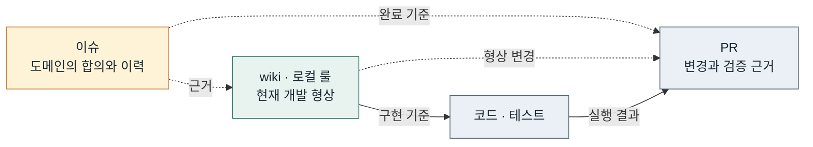

<div align="center">
  
  <h1>bab</h1>
  <p>도메인의 발자취를 남기고, 문서로 개발 형상을 재현합니다.</p>
  <p><sub>Claude Code · Codex · GitHub Actions</sub></p>
  <p>
    <a href="#설치">설치</a>
    · <a href="#빠른-시작">빠른 시작</a>
    · <a href="docs/workflow.md">전체 흐름</a>
    · <a href="docs/guide.md">상세 가이드</a>
  </p>
  <p>
    <a href="https://github.com/freevue/bab-skill/actions/workflows/test.yml">
      
    </a>
  </p>
  <p>
    <a href="https://github.com/freevue/bab-skill/releases/tag/v0.7.7">v0.7.7 릴리스</a>
    · <a href="docs/guide.md#라이선스">MIT</a>
  </p>
</div>

---

## bab은 무엇인가요?

bab은 이슈의 합의, 현재 명세, 구현의 검증 기록을 연결하는 에이전트 스킬 모음입니다. Claude Code와 Codex에서 같은 스킬, 템플릿과 검사기를 사용합니다.

| 이슈 | wiki와 로컬 룰 | PR |
| --- | --- | --- |
| 도메인의 발자취 | 개발 형상의 기준 | 검증 창구 |
| 무엇을 왜 바꾸기로 했는지 기록합니다 | 이름, 타입, 동작과 유닛 관계를 정합니다 | 실제 추가·변경·삭제와 검증 근거를 모읍니다 |
| 영향받는 명세와 결과 PR을 연결합니다 | 과거 이슈나 코드 없이도 형상을 재현할 수 있어야 합니다 | 계속 적용할 결정을 반영한 문서로 연결합니다 |

개발 형상은 함수 이름, 타입, 동작과 유닛 관계를 뜻합니다. 이슈는 변경의 이유를 보존합니다. 현재 구현은 wiki와 로컬 룰을 따릅니다.

## 전체 흐름



예를 들어 전체가 3페이지일 때 `?page=9`로 접속하면 3페이지를 보여 주기로 합의합니다. wiki에는 보정 함수의 입력, 분기 순서와 테스트 케이스(TC)를 적습니다. PR에는 실제 변경과 TC 실행 결과를 남깁니다.

기존 프로젝트에 처음 도입할 때는 [코드에서 wiki를 시작할 수 있습니다](docs/guide.md#이미-코드가-많은-프로젝트에도-적용할-수-있나요). 이후 코드가 명세와 어긋나면 합의된 기준에 맞춰 수정합니다.

## 설치

Git과 Node 18 이상이 필요합니다. GitHub에서 이슈나 PR을 읽으려면 인증된 `gh` CLI가 필요합니다. 이슈, 라벨, PR을 바꾸려면 대상 저장소의 쓰기 권한도 필요합니다.

### Claude Code

```bash
claude plugin marketplace add freevue/bab-skill
claude plugin install bab@bab-skill
```

대상 저장소에서 Claude Code를 열고 `/bab:setup`을 실행합니다. 셋업은 기존 지침 파일을 사용합니다. 지침 파일이 없으면 `CLAUDE.md`를 만듭니다.

### Codex

플러그인 명령을 지원하는 Codex CLI에서 실행합니다.

```bash
codex plugin marketplace add freevue/bab-skill
codex plugin add bab@bab-skill
```

대상 저장소에서 새 Codex 채팅을 열고 스킬 선택기에서 `bab:setup`을 고릅니다. 셋업은 `AGENTS.md`에 bab 지침을 추가합니다. 목록에 나타나지 않으면 Codex를 다시 시작합니다.

<details>
<summary>로컬 체크아웃이나 다른 에이전트에서 설치하기</summary>

Codex 지원이 포함된 체크아웃의 루트에서 첫 명령을 `codex plugin marketplace add "$PWD"`로 바꿉니다. 스킬, 템플릿, 검사기가 함께 설치됩니다. 태그로 고정할 때는 Codex 마켓플레이스가 들어 있는 태그를 선택합니다.

다른 에이전트에서는 [Node 스크립트와 스킬 문서를 직접 사용합니다](docs/guide.md#다른-에이전트에서-쓰기).

</details>

## 빠른 시작

| 단계 | 할 일 | 남는 기록 |
| --- | --- | --- |
| 준비 | `bab:setup`으로 대상 저장소를 준비합니다 | wiki 골격, 템플릿과 CI |
| 합의 | `bab:spec`에 변경을 요청하고 근거를 남겨 확정합니다 | `status:decided` 이슈 |
| 구현 | `bab:sync`에 이슈 번호를 전달합니다 | wiki, 실패 테스트, 구현과 검증 결과 |
| 검토 | PR에서 실제 변경과 완료 기준별 근거를 확인합니다 | 리뷰와 정책·문서의 변경 기록 |

GitHub 라벨 설치나 푸시·PR 생성이 필요하면 요청에 포함합니다. `Closes #12`를 적은 PR이 기본 브랜치에 머지되면 이슈가 완료됩니다. 머지는 저장소의 리뷰와 권한 규칙을 따릅니다.

Claude Code에서는 `/bab:sync 12`를 입력합니다. Codex에서는 `bab:sync`를 선택하고 “이슈 #12를 검증하고 PR까지 올려 줘”라고 요청합니다. 다음 확정 이슈를 고르려면 이슈 번호 대신 `next`를 사용합니다.

## 스킬

| 스킬 | 역할 |
| --- | --- |
| [setup](plugins/bab/skills/setup/SKILL.md) | 저장소에 wiki 골격과 작업 규칙을 준비합니다 |
| [spec](plugins/bab/skills/spec/SKILL.md) | 도메인 변경의 합의와 이력을 이슈에 남깁니다 |
| [wiki](plugins/bab/skills/wiki/SKILL.md) | 정책, 기능, 유닛, 타입과 TC의 명세를 작성합니다 |
| [sync](plugins/bab/skills/sync/SKILL.md) | 확정한 이슈를 wiki, 테스트, 구현, 검증 순서로 진행합니다 |
| [audit](plugins/bab/skills/audit/SKILL.md) | 합의와 실제 변경, 검증 근거를 양방향으로 대조합니다 |
| [simple-english](plugins/bab/skills/simple-english/SKILL.md) | 영문 문서를 짧고 분명하게 다듬습니다 |

요청하면 `audit`은 wiki와 로컬 룰만으로 유닛 하나를 재현합니다. 자세한 절차는 [스킬과 흐름도](docs/workflow.md)에서 확인합니다.

bab 자체의 [parsePriority 명세](wiki/unit/issue/parsePriority.md)와 [JavaScript·Python 재현 검증 기록](docs/verification/parse-priority.md)도 볼 수 있습니다.

## 문서와 브리핑

문서는 `simple-english`의 원칙을 한글에 맞게 적용합니다. 한 문장에는 한 지시나 사실을 담고, 같은 용어는 같은 뜻으로 씁니다. 이슈·PR·wiki의 템플릿은 기록할 항목을 정합니다.

에이전트는 결과를 먼저 전합니다. 변경 이유와 검증 결과를 짧은 문단으로 설명하고, 마지막에 미검증 범위와 남은 위험을 밝힙니다. 자세한 변경 표와 TC 결과는 PR에 둡니다.

[문서 작성 규칙](plugins/bab/skills/wiki/references/writing-rules.md) · [브리핑 규칙과 예시](plugins/bab/skills/setup/assets/claude-section.md#최종-브리핑)

## CI 가드레일

GitHub Actions가 PR의 이슈 연결과 명세의 불일치를 검사합니다. 드리프트는 wiki와 코드가 어긋난 상태를 뜻합니다.

| 기능 | 검사하거나 기록하는 것 |
| --- | --- |
| PR 검사 | 연결한 이슈의 존재와 확정 상태, 이번 PR에서 새로 생긴 명세의 누락이나 불일치 |
| 이슈 라벨 | 이슈 본문의 중요도, 닫힌 이슈의 상태 라벨 정리 |
| 드리프트 감시 | 기본 브랜치 푸시 뒤와 매일 발견한 wiki·코드 불일치 |

[문서 완결성](docs/guide.md#문서-완결성)은 문서만으로 형상을 재현할 만큼 명세가 갖춰진 상태입니다. 검사기는 매개변수나 반환 타입의 누락과 선언 불일치를 찾습니다. 동작과 분기 순서는 에이전트의 확인과 대상 저장소의 테스트로 검증합니다.

[가드레일 설정](docs/guide.md#ci-가드레일) · [드리프트 감시](docs/guide.md#드리프트-감시) · [스펙 큐](docs/guide.md#스펙-큐) · [현재 한계](docs/guide.md#현재-한계)

## 업데이트

<details>
<summary>Claude Code와 Codex의 업데이트 명령</summary>

Claude Code는 `claude plugin list --json`으로 설치 범위(`scope`)를 먼저 확인합니다. 아래는 사용자 전체(`user`) 범위의 예시입니다.

```bash
claude plugin marketplace update bab-skill
claude plugin update bab@bab-skill --scope user
```

프로젝트(`project`)나 로컬(`local`) 범위라면 대상 저장소 루트에서 같은 명령의 `--scope` 값을 바꿉니다.

마켓플레이스를 이전 태그에 고정했다면 `update`만으로 새 태그로 이동하지 않습니다. 먼저 고정 태그를 바꾸고 플러그인을 갱신합니다. 마켓플레이스의 등록 범위도 기존 값으로 지정합니다.

```bash
claude plugin marketplace add 'freevue/bab-skill#v0.7.7' --scope local
claude plugin update bab@bab-skill --scope local
```

위 예시는 로컬 범위입니다. 사용자 전체나 프로젝트 범위라면 각각 `user`나 `project`를 사용합니다.

Codex의 Git 마켓플레이스:

```bash
codex plugin marketplace upgrade bab-skill
codex plugin add bab@bab-skill
```

이전 태그에 고정했다면 기존 마켓플레이스 등록을 제거하고 원하는 태그로 다시 등록합니다. 아래는 사용자가 등록한 Git 마켓플레이스의 예시입니다.

```bash
codex plugin marketplace remove bab-skill
codex plugin marketplace add freevue/bab-skill --ref v0.7.7
codex plugin add bab@bab-skill
```

로컬 마켓플레이스를 쓴다면 체크아웃을 갱신하고 `codex plugin add bab@bab-skill`을 다시 실행합니다.

마켓플레이스 명령은 [OpenAI 공식 문서](https://developers.openai.com/plugins/build/plugins#add-a-marketplace-from-the-cli)에서 확인할 수 있습니다.

</details>

플러그인과 GitHub Actions는 각각 업데이트합니다. 기존 저장소의 `.github/workflows/bab.yml`에서 `uses`와 `bab-ref`를 모두 `v0.7.7`으로 맞춥니다. v0.7.3 이하에서 올릴 때는 [설치 템플릿](plugins/bab/skills/setup/assets/workflows/bab.yml)의 이벤트와 권한도 반영합니다.

셋업은 기존 템플릿과 지침을 덮어쓰지 않습니다. 새 템플릿과 브리핑 규칙은 기존 파일과 비교해 반영합니다.

bab 자체를 개발한다면 [코드 컨벤션 적용 기준](docs/guide.md#코드-컨벤션-적용-기준)을 읽습니다. 저장소 루트에서 Node 20으로 `node --test`를 실행합니다.
