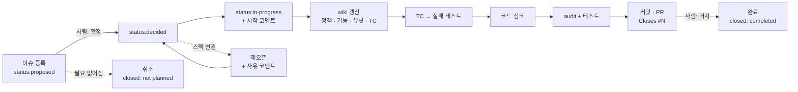
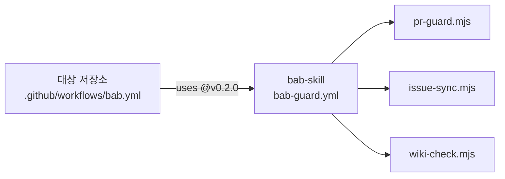

# bab

이슈 · PR · LLM Wiki로 스펙을 기록하고, 코드를 wiki에 맞추는 SDD/AIDD 에이전트 플러그인입니다.

> [!NOTE]
> **코드는 문서와 싱크를 맞춥니다.**
> 스펙은 이슈에 기록하고, 명세는 wiki에 쓰고, 구현은 PR로 남깁니다. AI는 wiki를 기준으로 코드를 맞춥니다.

| 항목 | 내용 |
| --- | --- |
| 대상 | Claude Code (주 대상), 그 밖의 코딩 에이전트 |
| 구성 | 스킬 6개, CI 가드레일, 셋업 스크립트, wiki 검사 스크립트, 이슈 폼, PR 템플릿 |
| 의존성 | Node 18 이상, `gh` CLI |
| 라이선스 | MIT |

---

## 목차

1. [왜 만들었나](#왜-만들었나)
2. [핵심 개념](#핵심-개념)
3. [방향과 승인 게이트](#방향과-승인-게이트)
4. [전체 흐름](#전체-흐름)
5. [요구 사항](#요구-사항)
6. [설치](#설치)
7. [빠른 시작](#빠른-시작)
8. [스킬](#스킬)
9. [wiki 구조](#wiki-구조)
10. [CI 가드레일](#ci-가드레일)
11. [최종 브리핑 규칙](#최종-브리핑-규칙)
12. [전역 설정](#전역-설정)
13. [다른 에이전트에서 쓰기](#다른-에이전트에서-쓰기)
14. [현재 한계](#현재-한계)
15. [저장소 구조](#저장소-구조)
16. [자주 묻는 질문](#자주-묻는-질문)
17. [로드맵](#로드맵)
18. [라이선스](#라이선스)

---

## 왜 만들었나

AI에게 코드를 맡기면 빠르게 만들어집니다. 그런데 시간이 지나면 아래 질문에 답하기 어려워집니다.

| 질문 | 흔한 현실 |
| --- | --- |
| 이 기능은 왜 이렇게 만들었나? | 근거가 끝난 대화 안에만 있습니다 |
| 이 함수는 원래 어떻게 동작해야 하나? | 코드가 곧 정답이라, 버그도 정답처럼 보입니다 |
| 이 변경은 어떤 스펙을 구현했나? | PR과 요구사항이 연결되어 있지 않습니다 |
| 스펙이 바뀌거나 취소된 이력은? | 아무 데도 남지 않습니다 |

bab은 이 정보를 각자 맞는 자리에 기록으로 남깁니다. AI는 기록된 명세를 기준으로 일합니다. 사람은 무엇을 만들지 결정하고, 결과를 승인합니다.

---

## 핵심 개념

### 세 가지 도구

| 도구 | 역할 | 담는 것 |
| --- | --- | --- |
| Git 이슈 | 스펙을 정의하고 기록합니다 | 왜 · 무엇을 · 어떻게, 중요도, 상태, 논의 코멘트, 확정 · 재오픈 · 취소 이력 |
| Git PR | 스펙의 구현 기록입니다 | 코드 리뷰, 안정성 가드레일, 이슈 연결(`Closes #N`), 구현 단계를 남기는 커밋 |
| LLM Wiki | 코드가 따라야 하는 명세입니다 | 정책 · 기능 · 유닛 문서, 기능과 유닛의 TC, 함수 시그니처와 내부 로직 |

한 문장으로 줄이면 이렇습니다. 이슈는 **무엇을 왜**, wiki는 **정확히 어떻게**, PR은 **실제로 무엇을 했나**를 맡습니다.

### 용어

| 용어 | 뜻 |
| --- | --- |
| 스펙 | 만들거나 바꿀 것에 대한 합의입니다. 이슈에 왜 · 무엇을 · 어떻게로 적습니다 |
| 명세 | 스펙을 코드로 옮길 수 있을 만큼 정확하게 풀어 쓴 문서입니다. wiki에 있습니다 |
| 정책 | 제품이 지켜야 할 규칙입니다. 예: 페이지 번호는 1보다 작을 수 없다 |
| 기능 | 사용자가 쓰는 동작입니다. 유닛 여러 개를 조합해 만듭니다 |
| 유닛 | 함수 하나입니다. 이름, 매개변수, 타입, 내부 로직, TC를 가집니다 |
| TC | 테스트 케이스입니다. 입력과 기대 결과를 표로 적고, ID로 테스트와 짝짓습니다 |
| 게이트 | 사람이 결정해야 다음으로 넘어가는 지점입니다. 스펙 확정과 PR 머지 두 곳입니다 |
| 싱크 | 코드를 wiki에 맞추는 일입니다. 반대 방향은 하지 않습니다 |
| ingest | 기존 코드를 처음 한 번 wiki로 옮기는 예외 절차입니다 |

---

## 방향과 승인 게이트

### 방향은 한 가지입니다

```text
이슈 (스펙)  ──▶  wiki (명세)  ──▶  코드 (구현)
```

- wiki와 코드가 다르면 **코드를 고칩니다.** wiki는 코드를 설명하는 문서가 아닙니다.
- 예외는 하나입니다. bab을 처음 적용할 때 기존 코드를 wiki로 옮기는 일(ingest)만 반대 방향입니다.

### 사람이 결정하는 곳은 두 곳입니다

| 게이트 | 누가 | 방법 |
| --- | --- | --- |
| 스펙 확정 | 사람 | 이슈에 `status:decided` 라벨을 붙입니다 |
| 구현 승인 | 사람 | PR을 리뷰하고 머지합니다 |

두 게이트 사이의 일은 AI가 멈추지 않고 진행합니다. wiki 갱신, 테스트 작성, 코드 싱크, 검증, 커밋, 푸시, PR 생성이 여기에 해당합니다.

> [!IMPORTANT]
> AI는 다음 일을 하지 않습니다.
>
> - `status:decided` 라벨 부착
> - PR 머지
> - force-push, 기본 브랜치에 직접 커밋
> - 다른 이슈 변경
> - 이슈 범위 밖의 수정. 발견하면 PR과 보고에 적기만 합니다

---

## 전체 흐름



### 상태와 라벨

| 상태 | GitHub 표현 | 누가 바꾸나 |
| --- | --- | --- |
| 등록 | Open + `status:proposed` | AI · 사람 |
| 확정 | Open + `status:decided` | 사람만 |
| 진행 | Open + `status:in-progress` | `/bab:sync` |
| 완료 | Closed as completed | PR 머지 (`Closes #N`) |
| 재오픈 | Reopen 후 사람이 다시 `status:decided` | 사람의 요청 |
| 취소 | Closed as not planned | 사람의 요청 |

| 중요도 | 의미 |
| --- | --- |
| `P0` | 즉시 |
| `P1` | 이번 주기 |
| `P2` | 다음 주기 |
| `P3` | 여유 있을 때 |

중요도 라벨은 CI가 이슈 본문의 `### 중요도` 값으로 자동으로 맞춥니다. 이슈가 닫히면 CI가 `status:*` 라벨을 뗍니다.

| 기타 라벨 | 의미 |
| --- | --- |
| `no-spec` | 이슈 없이 하는 작은 수정(오타, 문서 정리)의 PR. CI의 이슈 연결 검사를 건너뜁니다 |

### 기록 규칙

- 상태가 바뀔 때마다 사유를 코멘트로 남깁니다. 이슈 타임라인만 읽어도 스펙의 역사를 알 수 있습니다.
- 커밋 순서는 **wiki → 실패 테스트 → 코드**입니다. 커밋을 차례로 읽으면 명세, 검증 기준, 구현이 순서대로 보입니다.

---

## 요구 사항

| 항목 | 필요한 곳 |
| --- | --- |
| Claude Code | 스킬 실행. 다른 에이전트는 [다른 에이전트에서 쓰기](#다른-에이전트에서-쓰기)를 봅니다 |
| Node 18 이상 | `setup.mjs`, `wiki-check.mjs` 실행 |
| `gh` CLI | 라벨 생성, 이슈 읽기 · 쓰기, PR 생성 |
| 저장소 쓰기 권한 | 라벨 생성, 푸시, PR 생성 |

---

## 설치

### GitHub에서 설치

```bash
claude plugin marketplace add freevue/bab-skill
```

```bash
claude plugin install bab@bab-skill
```

user scope로 설치되어 모든 프로젝트에서 쓸 수 있습니다.

### 로컬에서 개발하며 설치

저장소를 내려받은 경로를 마켓플레이스로 등록합니다. 플러그인이 이 경로를 직접 읽으므로, 파일을 고치면 바로 반영됩니다.

```bash
claude plugin marketplace add ~/path/to/bab-skill
```

```bash
claude plugin install bab@bab-skill
```

### 업데이트와 제거

```bash
claude plugin marketplace update bab-skill
```

```bash
claude plugin update bab@bab-skill
```

```bash
claude plugin uninstall bab@bab-skill
```

---

## 빠른 시작

### 1. 저장소 셋업

저장소마다 한 번 실행합니다.

```text
/bab:setup
```

| 생기는 것 | 위치 |
| --- | --- |
| 스펙 이슈 폼 | `.github/ISSUE_TEMPLATE/spec.yml` |
| PR 템플릿 | `.github/pull_request_template.md` |
| CI 가드레일 | `.github/workflows/bab.yml` |
| 라벨 8개 | GitHub (`status:*` 3개, `P0`~`P3`, `no-spec`) |
| wiki 골격 | `wiki/index.md`, `wiki/log.md`, `wiki/{policy,feature,unit}/` |
| 로컬 지침 | `CLAUDE.md` 끝에 `## bab (SDD/AIDD)` 섹션과 최종 브리핑 규칙 |

이미 있는 파일은 덮어쓰지 않습니다. 몇 번을 실행해도 결과가 같습니다.

### 2. 스펙 등록

GitHub에서 **스펙** 폼으로 이슈를 열거나, 에이전트에게 부탁합니다.

```text
목록 화면에서 페이지 번호가 범위를 넘으면 마지막 페이지로 보내는 스펙 등록해줘
```

에이전트가 빈 항목을 질문으로 채우고, 초안을 보여 준 뒤 이슈를 등록합니다. 새 이슈는 `status:proposed` 상태입니다. 등록된 이슈 본문은 이런 모양입니다.

```markdown
### 종류
기능

### 왜
목록에서 마지막 페이지보다 큰 번호로 이동하면 빈 화면이 나옵니다.
공유된 오래된 링크로 들어온 사용자가 이 화면을 봅니다.

### 무엇을
페이지 번호가 범위를 벗어나면 가장 가까운 유효 페이지를 보여 줍니다.

### 어떻게
- [ ] 페이지 번호 보정 유닛 clampPage 추가
- [ ] 목록 기능에서 조회 전에 보정

### 중요도
P1 (이번 주기)

### 관련 wiki
wiki/unit/page/clampPage.md
wiki/feature/list.md

### 검증 기준
UT-clampPage-01~03, FT-list-04 통과
```

### 3. 사람이 확정

이슈 코멘트로 논의합니다. 결론이 나면 **사람이 직접** `status:decided` 라벨을 붙입니다.

### 4. 구현

```text
/bab:sync 12
```

| 단계 | 에이전트가 하는 일 |
| --- | --- |
| 1 | 이슈 게이트를 확인합니다. 확정 라벨, 필수 항목, 깨끗한 작업 트리를 봅니다 |
| 2 | 브랜치(`feat/12-clamp-page`)를 만들고, `in-progress`로 바꾸고, 시작 코멘트를 남깁니다 |
| 3 | wiki를 갱신합니다. 예: `wiki/unit/page/clampPage.md`에 시그니처와 TC를 적습니다 |
| 4 | TC마다 테스트를 쓰고, 실패하는지 먼저 확인합니다 |
| 5 | wiki대로 코드를 맞춥니다 |
| 6 | 테스트와 `/bab:audit`로 검증합니다 |
| 7 | 커밋하고 PR(`Closes #12`)을 열고, 이슈에 PR 링크를 남기고, 최종 브리핑으로 보고합니다 |

### 5. 머지

PR을 리뷰하고 머지하면 이슈가 자동으로 완료 처리됩니다.

---

## 스킬

| 스킬 | 호출 | 하는 일 |
| --- | --- | --- |
| `/bab:setup` | 직접 호출만 | 저장소에 이슈 폼, PR 템플릿, 라벨, wiki 골격, 로컬 지침을 설치합니다 |
| `/bab:spec` | 자동 · 직접 | 스펙 이슈를 쓰고, 등록된 이슈를 점검하고, 상태를 바꿉니다 |
| `/bab:wiki` | 자동 · 직접 | 정책 · 기능 · 유닛 페이지를 쓰고 index와 log를 관리합니다 |
| `/bab:sync` | 직접 호출만 | 확정된 이슈 하나를 wiki → 코드 → PR까지 진행합니다 |
| `/bab:audit` | 자동 · 직접 | 컨벤션, wiki와 코드의 일치, 이슈와 PR의 연결을 검사합니다. 읽기 전용입니다 |
| `/bab:simple-english` | 자동 · 직접 | 문서를 쉬운 영어 규칙(ASD-STE100 기반)으로 씁니다 |

> [!NOTE]
> **자동 · 직접**은 에이전트가 대화를 보고 스스로 꺼내 쓸 수도 있다는 뜻입니다. **직접 호출만**인 스킬은 파일이나 GitHub을 바꾸므로, 사용자가 명령을 입력할 때만 실행됩니다.

### 언제 쓰나

| 스킬 | 이럴 때 | 예시 |
| --- | --- | --- |
| `setup` | 새 저장소에 bab을 처음 적용할 때 | `/bab:setup` |
| `spec` | 스펙을 등록하거나, 현황을 보거나, 이슈를 닫고 열 때 | `스펙 현황 보여줘`, `#15 취소해줘. 다른 이슈로 합쳐짐` |
| `wiki` | 명세를 쓰거나, 기존 코드를 처음 문서화할 때 | `src/page 기존 코드 문서화해줘` |
| `sync` | 확정된 스펙을 구현할 때 | `/bab:sync 12` |
| `audit` | 코드가 규칙과 명세를 지키는지 확인할 때 | `wiki 일치 검사해줘`, `/bab:audit src/` |
| `simple-english` | 영어 문서를 쉽게 다듬을 때 | `README를 plain English로 다듬어줘` |

---

## wiki 구조

```text
wiki/
├── index.md                     # 모든 페이지의 목록 (분류별 표)
├── log.md                       # 변경 기록 (아래에 계속 추가)
├── policy/{name}.md             # 정책
├── feature/{name}.md            # 기능
└── unit/{module}/{function}.md  # 유닛 (함수 하나)
```

### 세 분류

| 분류 | 담는 것 | 필수 섹션 | TC ID |
| --- | --- | --- | --- |
| 정책 | 제품과 시스템이 지켜야 할 규칙, 제약, 결정 | 규칙, 적용 기능 | `POL-{정책}-NN` (기능 TC가 참조) |
| 기능 | 사용자가 쓰는 동작. 유닛을 조합해 만듭니다 | 구성 유닛, 흐름, 관련 정책, TC | `FT-{기능}-NN` |
| 유닛 | 함수 하나의 정확한 명세 | 시그니처, 내부 로직, 사용법, 사용처, TC | `UT-{함수}-NN` |

### 정책 페이지 예시

```markdown
# 페이지 범위

## 규칙

| ID | 규칙 | 근거 |
| --- | --- | --- |
| POL-paging-01 | 페이지 번호는 1 이상, 전체 페이지 수 이하입니다 | #12 |

## 적용 기능

| 기능 | 적용 규칙 |
| --- | --- |
| [목록](../feature/list.md) | POL-paging-01 |
```

### 기능 페이지 예시

```markdown
# 목록

사용자가 항목을 페이지 단위로 넘겨 봅니다.

## 구성 유닛

| 유닛 | 역할 |
| --- | --- |
| [clampPage](../unit/page/clampPage.md) | 요청한 페이지 번호를 범위 안으로 맞춤 |

## TC

| ID | 조건 | 동작 | 기대 결과 |
| --- | --- | --- | --- |
| FT-list-04 | 전체 3페이지 | `?page=9`로 진입 | 3페이지를 보여 줌 |
```

### 유닛 페이지 예시

유닛 페이지는 문서만 보고 코드와 테스트를 쓸 수 있을 만큼 정확해야 합니다.

````markdown
---
name: clampPage
type: unit
module: src/page
issues: [12]
code: [src/page/clampPage.ts]
---

# clampPage

페이지 번호를 1부터 전체 페이지 수 사이로 맞춥니다.

## 시그니처

```typescript
export function clampPage(page: number, totalPages: number): number
```

## 내부 로직

1. `totalPages`가 1보다 작으면 1을 돌려줍니다.
2. `page`가 1보다 작으면 1을 돌려줍니다.
3. `page`가 `totalPages`보다 크면 `totalPages`를 돌려줍니다.
4. 나머지는 `page`를 그대로 돌려줍니다.

## TC

| ID | 입력 | 기대 결과 |
| --- | --- | --- |
| UT-clampPage-01 | (0, 10) | 1 |
| UT-clampPage-02 | (11, 10) | 10 |
| UT-clampPage-03 | (5, 0) | 1 |
````

### 코드 쪽 JSDoc

상세 설명의 원본은 wiki입니다. 같은 내용을 두 곳에서 관리하지 않도록 코드에는 한 줄 요약과 경로만 둡니다.

```typescript
/** 페이지 번호를 범위 안으로 맞춥니다. @see wiki/unit/page/clampPage.md */
export function clampPage(page: number, totalPages: number): number {
```

### TC ID 규칙

- 형식은 `UT-{함수}-NN`, `FT-{기능}-NN`, `POL-{정책}-NN`입니다.
- wiki 전체에서 하나뿐이어야 합니다. 지운 ID는 다시 쓰지 않습니다.
- 테스트 이름에 TC ID를 넣습니다. `audit`가 이 이름으로 wiki와 테스트를 짝짓습니다.

---

## CI 가드레일

에이전트가 검사를 건너뛰거나 사람이 직접 PR을 열어도, 같은 규칙이 GitHub Actions에서 자동으로 돕니다. `/bab:setup`이 `.github/workflows/bab.yml`을 설치합니다.

| 이벤트 | 검사 · 동작 | 실패 조건 · 결과 |
| --- | --- | --- |
| PR 열림 · 수정 · 푸시 · 라벨 변경 | 이슈 연결 | 본문에 `Closes #N`이나 `Refs #N`이 없고 `no-spec` 라벨도 없으면 실패합니다 |
| 〃 | 확정 게이트 | `Closes`로 연결한 이슈가 열려 있고 `status:decided`나 `status:in-progress`가 아니면 실패합니다 |
| 〃 | wiki 구조 | `wiki/`가 있으면 `wiki-check.mjs`를 실행하고, 위반이 있으면 실패합니다 |
| 이슈 열림 · 수정 | 중요도 동기화 | 본문 `### 중요도` 값으로 `P0`~`P3` 라벨을 맞춥니다 |
| 이슈 닫힘 | 상태 정리 | `status:*` 라벨을 뗍니다 |

실패하면 Actions 실행 요약에 **규칙 · 문제 · 고치는 법** 표가 남습니다.

### 동작 방식

검사 로직은 이 저장소 한 곳에만 있습니다. 각 저장소는 재사용 워크플로를 호출하는 짧은 파일만 가집니다. 규칙을 고치면 새 태그를 만들고, 각 저장소의 참조를 올려 반영합니다.



```yaml
jobs:
  guard:
    uses: freevue/bab-skill/.github/workflows/bab-guard.yml@v0.2.0
    with:
      bab-ref: v0.2.0
```

> [!TIP]
> 실패한 PR의 머지를 실제로 막으려면 저장소 설정의 브랜치 보호 규칙에서 `guard / pr` 검사를 필수로 지정합니다. 지정하지 않으면 실패를 표시만 합니다.

---

## 최종 브리핑 규칙

에이전트가 작업을 마치고 보고하는 형식입니다. 스킬이 아니라 **답변 규칙**이므로, 어떤 작업이든 보고할 때 항상 적용됩니다. `/bab:setup`이 로컬 `CLAUDE.md`에 넣어 줍니다.

| 순서 | 블록 | 내용 |
| --- | --- | --- |
| 1 | 결론 | 지금 무엇이 사실인지 1~2문장. 실패나 미검증은 첫 문장에 |
| 2 | 변경 | `파일 \| 무엇을` 표. 파일은 링크 |
| 3 | 검증 | 실행한 검사와 결과. 못 한 것은 `미검증` |
| 4 | 남은 일·주의 | 목록 |
| 5 | 결정할 것 | 사용자가 답할 질문을 맨 끝에 |

형식 규칙은 다음과 같습니다.

- 해당 없는 블록은 뺍니다.
- 3개 이상을 비교하거나 나열하면 표로 씁니다.
- 추측은 `추측`이라고 표시합니다.
- 이슈와 PR은 전체 URL로 링크합니다.

전체 규칙과 예시는 [`claude-section.md`](plugins/bab/skills/setup/assets/claude-section.md)에 있습니다.

---

## 전역 설정

플러그인을 설치하면 스킬은 모든 프로젝트에서 쓸 수 있습니다. 하지만 **에이전트의 기본 규칙까지 바뀌지는 않습니다.** 아래 내용을 전역 지침 파일(Claude Code는 `~/.claude/CLAUDE.md`)에 넣으면 저장소에 셋업하지 않아도 같은 기준으로 일합니다. 선택 사항입니다.

| 규칙 | 넣는 이유 |
| --- | --- |
| 실행 범위 예외 | 확정된 이슈로 `bab:sync`를 실행하면, 단계마다 묻지 않아도 되도록 합니다 |
| JSDoc 규칙 | wiki가 원본이므로 JSDoc을 짧게 유지합니다 |
| 커밋 예외 | `bab:sync` 안에서 이슈 관련 파일을 스테이징하고 이슈 번호를 남기게 합니다 |
| 최종 브리핑 | 모든 작업 보고를 같은 형식으로 받습니다 |

```markdown
## AIDD (bab)

- 사용자가 `status:decided` 이슈로 `bab:sync`를 실행하면 그 이슈의 범위가 요청 범위입니다. 범위 안의 단계는 `bab:sync` 절차대로 확인 없이 진행합니다.
- JSDoc에는 한 줄 요약과 wiki 유닛 경로(`@see wiki/unit/...`)만 적습니다. 상세 설명의 원본은 wiki입니다.
- `bab:sync` 안에서는 해당 이슈로 변경한 파일만 스테이징할 수 있습니다. 커밋 본문 마지막 항목에 `#N`을 적습니다.
- 작업 보고는 bab의 최종 브리핑 규칙(결론 → 변경 → 검증 → 남은 일 → 결정할 것)을 따릅니다.
```

---

## 다른 에이전트에서 쓰기

bab의 핵심은 Claude 전용 기능이 아니라 **마크다운 문서와 Node 스크립트**입니다.

| 쓰고 싶은 것 | 방법 |
| --- | --- |
| 저장소 셋업 | `setup.mjs`를 직접 실행합니다. 아래 명령을 봅니다 |
| wiki 구조 검사 | `wiki-check.mjs`를 직접 실행합니다. 깨진 링크, index 누락, 필수 섹션 누락, TC ID 중복을 찾습니다 |
| 작업 절차 | `plugins/bab/skills/*/SKILL.md`는 일반 마크다운입니다. 다른 에이전트의 지침 파일(`AGENTS.md` 등)에서 경로로 연결해 읽게 합니다 |

```bash
node plugins/bab/skills/setup/scripts/setup.mjs <저장소 루트> --dry-run
```

```bash
node plugins/bab/skills/setup/scripts/setup.mjs <저장소 루트>
```

```bash
node plugins/bab/skills/audit/scripts/wiki-check.mjs <wiki 폴더>
```

| 옵션 · 종료 코드 | 뜻 |
| --- | --- |
| `--dry-run` | 바꾸지 않고 결과만 미리 봅니다 |
| `--skip-labels` | GitHub 라벨 생성을 건너뜁니다 |
| `0` | 성공 또는 위반 없음 |
| `1` | 일부 라벨 실패 또는 wiki 위반 있음 |
| `2` | 경로 오류 |

---

## 현재 한계

> [!WARNING]
> 아래 항목은 아직 자동화되지 않았거나 검증되지 않았습니다.

| 한계 | 영향 | 지금 할 수 있는 일 |
| --- | --- | --- |
| CI가 테스트와 시그니처는 검사하지 않음 | CI는 연결 · 확정 · wiki 구조만 봅니다. 테스트 실행은 각 저장소의 CI가 맡습니다 | 저장소의 기존 테스트 워크플로를 유지합니다 |
| 시그니처 비교가 에이전트 판단에 의존 | wiki와 코드의 시그니처 차이를 스크립트가 확정하지 않습니다 | `audit` 보고를 리뷰에서 확인합니다 |
| 컨벤션 검사가 `~/.claude/conventions/`에 의존 | 이 폴더가 없는 기기에서는 컨벤션 검사 범위가 줄어듭니다 | 저장소 로컬 규칙 파일을 둡니다 |
| setup이 기존 섹션을 갱신하지 않음 | 이미 셋업한 저장소에는 새 규칙(예: 최종 브리핑)이 들어가지 않습니다 | `claude-section.md`를 보고 직접 반영합니다 |
| `sync` 전체 흐름 미검증 | 실제 이슈로 등록부터 머지까지 끝까지 실행해 보지 않았습니다 | 작은 이슈로 먼저 시험합니다 |

---

## 저장소 구조

```text
bab-skill/
├── .claude-plugin/
│   └── marketplace.json          # 마켓플레이스 정의
├── .github/
│   ├── workflows/bab-guard.yml   # CI 가드레일 재사용 워크플로 (모든 저장소가 호출)
│   └── ...                       # 이 저장소에 적용한 이슈 폼, PR 템플릿, 호출 워크플로
├── wiki/                         # 이 저장소에 적용한 wiki 골격
├── CLAUDE.md                     # 이 저장소에 적용한 로컬 지침
└── plugins/bab/
    ├── .claude-plugin/plugin.json
    ├── ci/                       # pr-guard.mjs, issue-sync.mjs (CI가 실행)
    └── skills/
        ├── setup/
        │   ├── SKILL.md
        │   ├── scripts/          # setup.mjs (진입점), steps.mjs (설치 단계)
        │   └── assets/           # 이슈 폼, PR 템플릿, 호출 워크플로, 라벨, wiki 골격, 지침 섹션
        ├── spec/SKILL.md         # 이슈 등록 · 점검 · 상태 전이
        ├── wiki/
        │   ├── SKILL.md
        │   └── templates/        # policy.md, feature.md, unit.md
        ├── sync/
        │   ├── SKILL.md          # 이슈 → wiki → 코드 → PR
        │   └── references/principles.md
        ├── audit/
        │   ├── SKILL.md
        │   └── scripts/wiki-check.mjs
        └── simple-english/       # 쉬운 영어 작성 규칙
```

---

## 자주 묻는 질문

### 이미 코드가 많은 프로젝트에도 적용할 수 있나요?

네. `/bab:setup` 후 `/bab:wiki`의 ingest 모드로 기존 코드를 처음 한 번 문서화합니다. 예를 들어 `src/page 기존 코드 문서화해줘`라고 요청합니다.

- 이때만 코드 → wiki 방향입니다.
- 테스트가 없는 함수는 `TC 미정`으로 표시합니다.
- 코드에서 드러난 규칙은 정책 **후보**로만 남깁니다. 정책 확정은 사람이 합니다.
- ingest가 끝난 범위부터는 이슈 → wiki → 코드 방향만 씁니다.

### PR 리뷰 중에 스펙이 바뀌면요?

AI는 스펙을 스스로 고치지 않습니다.

1. 사람이 이슈 본문이나 코멘트로 스펙을 고칩니다.
2. `status:decided`를 다시 확인합니다.
3. `/bab:sync`를 다시 실행하면 같은 브랜치에서 wiki 갱신부터 다시 진행합니다.

이미 닫힌 이슈라면 재오픈하고 사유를 코멘트로 남깁니다.

### 스펙 업데이트는 PR에 어떻게 연결하나요?

| 상황 | PR 본문 | 결과 |
| --- | --- | --- |
| 스펙을 완성하는 PR | `Closes #N` | 머지되면 이슈가 닫힙니다 |
| 일부만 구현하거나 후속 수정인 PR | `Refs #N` | 이슈는 열린 채로 PR만 연결됩니다 |

커밋 본문 마지막 항목에도 `#N`을 적습니다. 이슈 타임라인에 PR과 커밋이 함께 쌓입니다.

> [!NOTE]
> 지금 `/bab:sync`는 `Closes #N`만 씁니다. `Refs #N` 흐름은 사람이 PR을 열 때 쓰는 규칙입니다.

### 테스트 도구가 없는 저장소는요?

실패 테스트 단계를 `건너뜀`으로 기록합니다. 검증 단계에서 wiki의 TC를 직접 실행해 확인하고, 결과는 PR의 Verification 표에 TC ID별로 남깁니다.

### 오타 수정 같은 작은 일도 이슈부터 만들어야 하나요?

아닙니다. 이슈 없는 요청은 평소처럼 진행합니다. bab의 절차는 스펙이 있는 작업에만 적용됩니다. PR에는 `no-spec` 라벨을 붙여 CI의 이슈 연결 검사를 건너뜁니다. 다만 동작이 바뀌는 수정이라면 이슈로 남기는 것이 좋습니다. 나중에 왜 바뀌었는지 찾을 수 있습니다.

---

## 로드맵

- [x] **CI 가드레일**: 이슈 연결, 확정 게이트, wiki 구조 검사, 중요도 라벨 동기화, 닫힌 이슈의 상태 정리 (v0.2.0)
- [ ] **npx 설치기**: `setup.mjs`를 감싸 npm으로 배포합니다.
- [ ] **다른 에이전트용 지침 파일**: Codex, Gemini 등에 맞는 지침 파일을 셋업이 함께 만듭니다.
- [ ] **자동화 loop** (아이디어 단계)
  - 드리프트 감시: `main`에서 wiki와 코드의 불일치를 찾아 `status:proposed` 이슈로 등록합니다.
  - 스펙 큐: 확정된 이슈를 중요도 순으로 하나씩 `/bab:sync`합니다.

---

## 라이선스

MIT. [`principles.md`](plugins/bab/skills/sync/references/principles.md)의 원칙 요약은 [pstack](https://github.com/cursor/plugins/tree/main/pstack)(MIT, Lauren Tan)을 참고했습니다.
