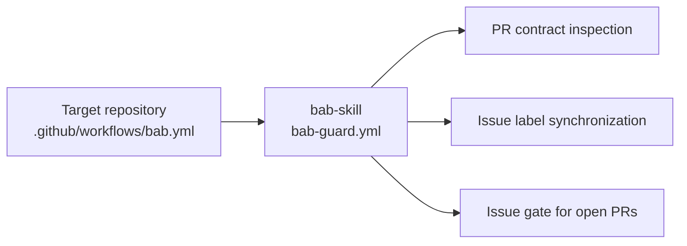
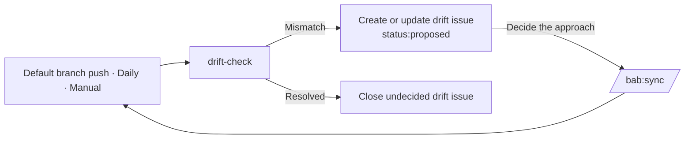
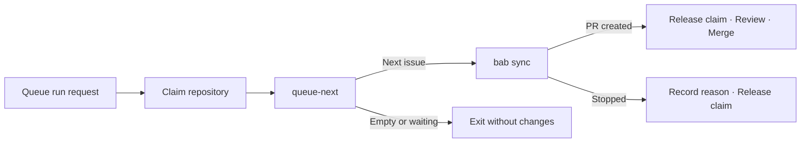

# bab detailed guide

[English](guide.md) · [한국어](guide.ko.md)

A spec records an agreed change.
This guide explains how to turn that spec into wiki contracts, then match the code to those contracts.
For your first task, start with the [quick start](../README.md#quick-start).

[Optional configuration](#optional-configuration) · [Updates](#plugin-and-ci-updates) · [Repository links](#repository-links) · [Visualization](#visualization) · [Skill index (Korean)](workflow.md#스킬-목록)

[Installation and updates](#installation-and-updates) · [Spec example](#spec-example) · [Wiki structure](#wiki-structure) · [Code conventions](#code-conventions)

[CI guards](#ci-guards) · [Drift monitoring](#drift-monitoring) · [Spec queue](#spec-queue) · [Limits](#current-limits) · [Change history](#change-history)

## Installation and updates

Choose Claude Code or Codex in the [installation instructions](../README.md#install).
Both marketplaces use the same `plugins/bab/` directory.

<a id="선택-설정"></a>

### Optional configuration

For Codex, setup adds instructions to `AGENTS.md`. For Claude Code, setup uses the existing instruction file.
If you do not specify a file for Claude Code, setup selects an existing `CLAUDE.md`, then an existing `AGENTS.md`.
If neither file exists, setup creates `CLAUDE.md`.
When you use both agents, point both files to the same project rules.
Setup does not create code conventions or `GEMINI.md`.

Setup installs GitHub labels within the scope of your request.
If you omit labels or cannot establish remote write access, use `--skip-labels`.
To link repositories, name them in your setup request or use [bab link](#repository-links) separately.

Husky manages Git hooks that run commands before commits and pushes.
The agent asks about installation when the repository has a root `package.json`, no Husky installation, and no conflicting Git hooks.
If Husky is already installed, the agent keeps its hooks.
If you approve installation, the agent connects suitable existing commands. If no command exists, the agent asks what to run.
The agent preserves the existing `prepare` script and Git hooks.
Read the [Husky procedure (Korean)](../plugins/bab/skills/setup/SKILL.md#선택-사항-husky-git-훅) for the conditions.

If you run `setup.mjs` directly, it does not ask about Husky or install packages.
The calling agent also handles repository links separately.

<a id="플러그인과-ci-업데이트"></a>

### Plugin and CI updates

For Claude Code, find the installation scope, then update within that scope. This example uses the `user` scope.
If your installation uses `project` or `local`, run the update in that project with the same scope.

```bash
claude plugin list --json
claude plugin marketplace update bab-skill
claude plugin update bab@bab-skill --scope user
```

For Codex, upgrade the marketplace and add the plugin again. Open a new chat after the update.

```bash
codex plugin marketplace upgrade bab-skill
codex plugin add bab@bab-skill
```

If you pinned the marketplace to an older tag, update that tag too.
For Claude Code, use the existing installation scope with `--scope`.

```bash
claude plugin marketplace add 'freevue/bab-skill#v1.0.2' --scope local
claude plugin update bab@bab-skill --scope local
```

```bash
codex plugin marketplace remove bab-skill
codex plugin marketplace add freevue/bab-skill --ref v1.0.2
codex plugin add bab@bab-skill
```

Update the plugin and GitHub Actions separately.
In the target repository's `.github/workflows/bab.yml`, set both `uses` and `bab-ref` to `v1.0.2`.
When you update from an older version, compare the events and permissions with the [installation template](../plugins/bab/skills/setup/assets/workflows/bab.yml).

Setup preserves existing instructions and templates.
From your local bab checkout, run this command to see the differences. Replace `/대상/저장소` with the target repository path.

```bash
node plugins/bab/skills/setup/scripts/setup.mjs /대상/저장소 --instructions AGENTS.md --skip-labels --dry-run
```

The result lists the plugin version, differences in existing files and instructions, and the CI versions in `uses` and `bab-ref`.
Read the differences, then apply the changes that you need.

### Compatibility and versions

Skill names, issue status labels, wiki document types and required sections, and inspection status codes are public contracts.
An incompatible change to these contracts requires a major version increase.
The [change history](#change-history) summarizes each version.
Read the [GitHub releases](https://github.com/freevue/bab-skill/releases) for release verification results and update steps.

### Install a local checkout for development

Run these commands from the bab repository root.

```bash
claude plugin marketplace add "$PWD"
claude plugin install bab@bab-skill
```

```bash
codex plugin marketplace add "$PWD"
codex plugin add bab@bab-skill
```

### Uninstall

```bash
claude plugin uninstall bab@bab-skill
```

```bash
codex plugin remove bab@bab-skill
```

<a id="저장소-연결"></a>

## Repository links

When you name related repositories, setup reuses [bab link (Korean)](../plugins/bab/skills/link/SKILL.md).
You can also run link in a repository that already uses bab. It does not reinstall setup files or GitHub labels.

```text
Set up bab in this repository and link example/api and example/cms.
```

```text
Use bab:link to apply the existing link configuration managed by example/api to this repository.
```

Link records ownership and public contract locations in `.bab/links.json`.
One existing repository owns the source document. Other repositories refer to that source.
If no public contract exists, link records the repositories and marks the contract as undecided.
It does not infer contracts by reading all of the code.

Spec reads only the necessary contract sections from registered candidates.
If the existing contract is sufficient, spec adds a reference.
If an external change is necessary, spec reuses an existing issue or prepares a proposal draft.
Remote issue creation follows the scope of your request.
Wiki `issues` fields keep internal issue numbers.
A separate table records external issues, contract sources, commits, and conditions.

Read the [shared protocol (Korean)](../plugins/bab/skills/link/references/protocol.md) for file formats and relationship tables.
Read [external contracts and issues (Korean)](../plugins/bab/skills/link/references/spec-links.md) for decisions and registration steps.
The reading tools return only the selected sections.
The agent's relationship decisions, remote changes, and integration verification each need separate evidence.

<a id="시각화"></a>

## Visualization

To inspect complex behavior or relationships, read the [visualization rules (Korean)](../plugins/bab/skills/wiki/references/visualization.md).
Choose only the perspectives that answer your question.

| Perspective | Information shown |
| --- | --- |
| Scenario | One path that fails, then succeeds after a retry |
| State transition | Conditions for moves between idle, loading, results, and error states |
| Code execution | Branches and processing order in a response handler |
| Interaction | Requests and responses between a screen, API, service, and database |
| Data | Transformations of a search query and its results |
| Structure and dependencies | Relationships between screens, functions, and types |
| Change impact | Functions, screens, and tests to inspect when a response type changes |
| Verification coverage | Results and unverified items for each test case (TC) |

```text
Use bab:wiki to write a state table and state diagram for the search feature.
Include retries, cancellation, and late responses. Link the responsible units and TCs.
```

Compare the inputs and outputs in [eight search examples (Korean)](../plugins/bab/skills/wiki/references/visualization-examples.md).

Each diagram states its subject, perspective, evidence, and scope.
Distinguish expected behavior in a spec, behavior read from code, and observed execution.
For UI behavior, put state tables and diagrams in the existing feature's `흐름` section. Link the responsible units and TCs.
Spec asks about missing decisions. Audit compares diagrams, tables, code, and verification evidence.
Rendering a diagram does not prove that the behavior works.
This approach needs no server, external dependency, or new document type.
The [application verification record (Korean)](verification/visualization.md) lists actual results and unverified items.

## Spec example

Open a GitHub issue with the spec template, or ask the agent to create one.

```text
Create a spec that sends users to the last page when the requested page number exceeds the list's page count.
```

The agent asks about missing fields, shows the draft, then creates the issue with `status:proposed`.
Issue sections use English h1 headings so that agents can identify them. The issue body uses Korean.
The parser also reads older Korean h3 headings as the same fields.

| Heading | Meaning |
| --- | --- |
| `# Type` | Kind of work: feature, policy, bug, or improvement |
| `# Why` | Reason for the work |
| `# What` | Target of the change and expected behavior |
| `# How` | Agreed approach and expected effects, as a checklist |
| `# Priority` | Work order, from `P0` to `P3` |
| `# Wiki` | Paths of affected wiki pages |
| `# Acceptance` | Completion criteria, with TC IDs when possible |

This example keeps the Korean issue text used by the workflow.
It specifies page clamping, empty results, and integer inputs.

```markdown
# Type

기능

# Why

목록에서 마지막 페이지보다 큰 번호로 이동하면 빈 화면이 나옵니다.
공유된 오래된 링크로 들어온 사용자가 이 화면을 봅니다.

# What

페이지 번호가 범위를 벗어나면 가장 가까운 유효 페이지를 보여 줍니다.

# How

- [ ] 목록을 조회하기 전에 범위를 벗어난 페이지 번호를 보정

# Priority

P1 (이번 주기)

# Wiki

wiki/unit/page/clampPage.md
wiki/feature/list.md
wiki/policy/paging.md

# Acceptance

- 범위를 벗어난 요청은 가장 가까운 페이지를 보여 줍니다. (FT-list-04, UT-clampPage-01~02)
- 조회할 페이지가 없으면 보정 결과는 1입니다. (UT-clampPage-03, UT-clampPage-07)
- 보정에는 정수만 사용합니다. (UT-clampPage-05~06)
```

## States and labels

| State | GitHub representation | Changed by |
| --- | --- | --- |
| Proposed | Open + `status:proposed` | Person or agent |
| Decided | Open + `status:decided` | Person or agent |
| In progress | Open + `status:in-progress` | `/bab:sync` |
| Completed | Closed as completed | PR merge with `Closes #N` |
| Reopened | Open + `status:proposed`, then decided again | Person or agent |
| Canceled | Closed as not planned | Person or agent |

| Priority | Meaning |
| --- | --- |
| `P0` | Immediately |
| `P1` | This cycle |
| `P2` | Next cycle |
| `P3` | When time permits |

CI sets priority labels from the issue body's `# Priority` value.
When an issue closes, CI removes its `status:*` labels.

| Other label | Meaning |
| --- | --- |
| `no-spec` | PR for a small change without an issue, such as a typo or documentation cleanup. Skips the issue link inspection. |
| `drift` | Issue created by monitoring for a mismatch between wiki and code |
| `blocked` | Issue stopped by `/bab:sync`. Resolve the cause, restore `status:decided`, and remove this label to return it to the queue. |

### Record decisions

- Leave a comment with the reason for each state change. The issue timeline records the spec's history.
- Keep exact implementation contracts in the wiki and local rules. Linked PRs record actual additions, changes, deletions, and verification results.
- Commit in this order: wiki, failing tests, code. Readers see the spec, test criteria, and implementation in sequence.

## Wiki structure

The following examples turn the page-clamping spec from issue #12 into implementation contracts.
Choose a starting file from the [wiki templates](../plugins/bab/skills/wiki/templates/).

```text
wiki/
├── index.md                     # All pages, grouped in tables
├── log.md                       # Append-only change record
├── policy/{name}.md             # Policy
├── feature/{name}.md            # Feature
├── unit/{module}/{function}.md  # Unit: one function
├── type/{module}/{Name}.md      # Type: one type, interface, or enum
└── reference/{name}.md          # Research, background information, and sources
```

### Four contract types and reference documents

Required section names and table headers stay in Korean because the inspectors read them.
The examples below retain the canonical Korean text. The table explains each document type in English.

| Type | Contents | Required sections | TC ID |
| --- | --- | --- | --- |
| Policy | Product and system rules, constraints, and decisions | `규칙` (rules), `적용 기능` (features) | `POL-{정책}-NN`, referenced by feature TCs |
| Feature | User behavior built from units | `구성 유닛` (units), `흐름` (flow), `관련 정책` (policies), `TC` | `FT-{기능}-NN` |
| Unit | Exact contract for one function | `시그니처` (signature), `내부 로직` (logic), `사용법` (usage), `사용처` (callers), `TC` | `UT-{함수}-NN` |
| Type | Data shape, full declaration, and fields | `정의` (definition), `필드` (fields), `사용처` (users) | None |
| Reference | Research and background information. Does not define code contracts. | `내용` (content), `출처` (sources) | None |

Frontmatter is the metadata block at the top of a page.
A feature's `## 구성 유닛` section and each unit's `## 사용처` section link to each other.
The feature's frontmatter `code` field lists implementation files. Its units must match the units that those files use.

### Policy page example

Path: `wiki/policy/paging.md`.
The policy clamps requests to valid pages and returns 1 when the total page count is zero or negative.

```markdown
---
name: paging
type: policy
issues: [12]
code: []
---

# 페이지 범위

## 규칙

| ID | 규칙 | 근거 |
| --- | --- | --- |
| POL-paging-01 | 전체 페이지 수가 양수이면 요청 번호를 1 이상, 전체 페이지 수 이하로 보정합니다. 전체 페이지 수가 0 이하이면 보정 결과는 1입니다 | #12 |

## 적용 기능

| 기능 | 적용 규칙 |
| --- | --- |
| [목록](../feature/list.md) | POL-paging-01 |
```

### Feature page example

Path: `wiki/feature/list.md`.
The list feature uses `clampPage`, follows the paging policy, and tests navigation beyond the last page.

```markdown
---
name: list
type: feature
issues: [12]
code: [src/list.ts]
---

# 목록

사용자가 항목을 페이지 단위로 넘겨 봅니다.

## 구성 유닛

| 유닛 | 역할 |
| --- | --- |
| [clampPage](../unit/page/clampPage.md) | 요청한 페이지 번호를 범위 안으로 맞춤 |

## 흐름

1. 요청한 페이지 번호를 범위 안으로 맞춥니다.
2. 보정된 페이지를 조회해 보여 줍니다.

## 관련 정책

[페이지 범위](../policy/paging.md)의 `POL-paging-01`을 따릅니다.

## TC

| ID | 조건 | 동작 | 기대 결과 |
| --- | --- | --- | --- |
| FT-list-04 | 전체 3페이지 | `?page=9`로 진입 | 3페이지를 보여 줌 |
```

### Unit page example

Path: `wiki/unit/page/clampPage.md`.
A reader must be able to reproduce the unit from its wiki documents and local rules alone.
This example defines integer inputs, validation order, return values, errors, and seven TCs.

````markdown
---
name: clampPage
type: unit
module: src/page
issues: [12]
code: [src/page/clampPage.ts]
---

# clampPage

페이지 번호를 1부터 전체 페이지 수 사이로 맞춥니다.

## 시그니처

```typescript
export function clampPage(page: number, totalPages: number): number
```

| 매개변수 | 타입 | 기본값 | 의미 |
| --- | --- | --- | --- |
| page | number | 없음 | 요청한 페이지 번호. 절댓값이 9,007,199,254,740,991 이하인 정수 값 |
| totalPages | number | 없음 | 전체 페이지 수. `page`와 같은 범위의 정수 값. 0 이하는 조회할 페이지가 없다는 뜻 |

| 반환 | 의미 |
| --- | --- |
| number | 범위 안으로 보정한 정수 페이지 번호. 조회할 페이지가 없으면 1 |

## 내부 로직

아래 분기를 적힌 순서대로 둡니다. 조건을 충족한 단계에서 즉시 반환하거나 오류를 던집니다.

1. 두 입력이 모두 허용 범위의 정수 값인지 확인합니다. `3.0`처럼 정수 값인 숫자는 받습니다. 소수, 유한하지 않은 값, 숫자가 아닌 값과 범위 밖의 값은 입력 오류로 처리합니다. TypeScript는 `RangeError`, Python은 `ValueError`를 던집니다.
2. `totalPages`가 0 이하이면 1을 돌려줍니다.
3. `page`가 1보다 작으면 1을 돌려줍니다.
4. `page`가 `totalPages`보다 크면 `totalPages`를 돌려줍니다.
5. 나머지는 `page`를 그대로 돌려줍니다.

## 사용법

```typescript
clampPage(9, 3) // 3
```

## 사용처

[목록](../../feature/list.md)

## TC

| ID | 입력 | 기대 결과 |
| --- | --- | --- |
| UT-clampPage-01 | (0, 10) | 1 |
| UT-clampPage-02 | (11, 10) | 10 |
| UT-clampPage-03 | (5, 0) | 1 |
| UT-clampPage-04 | (3, 10) | 3 |
| UT-clampPage-05 | (1.5, 0) | 입력 오류 |
| UT-clampPage-06 | (0, 2.5) | 입력 오류 |
| UT-clampPage-07 | (5, -1) | 1 |
````

### Type page example

Path: `wiki/type/page/Page.md`.
The `Page` interface defines a one-based page index and an item count.

````markdown
---
name: Page
type: type
module: src/page
issues: [12]
code: [src/page/types.ts]
---

# Page

목록의 한 페이지를 나타냅니다.

## 정의

```typescript
export interface Page {
  index: number
  size: number
}
```

## 필드

| 필드 | 타입 | 필수 | 의미 |
| --- | --- | --- | --- |
| index | number | 예 | 1부터 시작하는 페이지 번호 |
| size | number | 예 | 한 페이지의 항목 수 |

## 사용처

[목록](../../feature/list.md)
````

### Frontmatter format

The parser reads the following formats. CRLF line endings and a leading BOM produce the same result.

| Format | Example |
| --- | --- |
| String | `name: clampPage`, `name: "clampPage"`, `name: 'clampPage'` |
| Inline list | `code: [src/a.ts, "src/b.ts"]`, `issues: []` |
| Multiline list | `code:` followed by lines such as `  - src/a.ts` |
| Single-string `code` | `code: src/a.ts` is read as a one-item list |
| Comment | Lines that start with `# 메모` and trailing ` # 메모` text are ignored |

### Reference page example

Put research and background documents in `wiki/reference/`.
Link each document once under `## 참고` in `wiki/index.md`.
List source material or verification records. Mark information that you cannot establish as an inference.

```markdown
---
name: browser-storage
type: reference
---

# 브라우저 저장소 조사

## 내용

재접속 시 확인한 저장 상태와 조사 범위를 적습니다.

## 출처

조사 날짜와 재현 절차 또는 확인한 자료를 적습니다.
```

Reference documents do not define code signatures or TCs. Omit the `code` frontmatter field.
Put implementation contracts in policy, feature, unit, or type pages, then link to them from the reference document.

### JSDoc in code

The wiki owns the full description.
To avoid maintaining the same text twice, keep only a one-line summary and wiki path in code.

```typescript
/** 페이지 번호를 범위 안으로 맞춥니다. @see wiki/unit/page/clampPage.md */
export function clampPage(page: number, totalPages: number): number {
```

### TC IDs

- Use `UT-{함수}-NN`, `FT-{기능}-NN`, or `POL-{정책}-NN`.
- Keep IDs unique across the wiki. Do not reuse deleted IDs.
- Include the TC ID in the test name. Audit uses this ID to match wiki entries to tests.

### Document completeness

A complete contract lets a reader reproduce the implementation without reading existing code or issues.
`drift-check` inspects the formats and declarations below.
PR inspection, drift monitoring, and `/bab:audit` use the same inspector.
The agent inspects behavioral meaning and required branch order, then tests them.

| Page | Inspection |
| --- | --- |
| Unit | Each signature parameter has a row with the same name and type in `매개변수`, plus a nonempty description. Extra rows also fail. |
| Unit | The type in `반환` matches the signature's return type. Include `void` returns. |
| Unit | `내부 로직` has numbered steps, `사용법` has a code block, and `TC` has rows. |
| Type | Each field or enum member in `## 정의` has a matching name, type, and nonempty description in `필드`. |
| Feature and policy | Features have `구성 유닛` links and TC rows. Policies have `규칙` rows. |
| Reference | `내용` and `출처` are nonempty. Code declarations are not compared. |
| All classified pages | No template placeholders such as `{...}` remain. |

`wiki/index.md` must link each page once under its correct policy, feature, unit, type, or reference category.
Reference pages use the `reference/` path and `## 참고` category.
Duplicate entries, incorrect categories or paths, and missing pages fail inspection.
General navigation links do not count as category entries.
For UI states or asynchronous events, add the [feature flow pattern (Korean)](../plugins/bab/skills/wiki/references/ui-async-pattern.md) to the feature page.
Keep the unit contracts that define function names and parameters.

Parameter names in tables can omit `?` and `...`.
Type comparison ignores differences in whitespace and separators such as `;` and `,`.

For JavaScript units, put the actual declaration in the signature and define the type contract in tables.
If the declaration has no type annotations, the comparison of declaration and table types remains unverified.
Use TCs to test the behavior.

### Writing rules

Wiki pages, issue bodies, PR bodies, and commit messages follow the [Korean writing rules](../plugins/bab/skills/wiki/references/writing-rules.md).
These rules adapt the relevant `simple-english` document rules to Korean.
The glossary assigns one meaning to each term. `prose-check.mjs` inspects selected expressions and sentence length.
Replies to users follow the [final briefing rules](#final-briefing-rules).

Keep secrets and raw personal information out of issues, PRs, wiki pages, and CI logs.
Record verification with masked samples, commands, and result summaries.
Read [sensitive information in public records (Korean)](../plugins/bab/skills/wiki/references/writing-rules.md#공개-기록의-민감정보) for details.

---

## Code conventions

Keep project code conventions in one shared document inside the repository.
If you use Claude Code and Codex together, point root `CLAUDE.md` and `AGENTS.md` to the same relative path.
If a shared document already exists, use it.
This repository keeps Ponytail, YAGNI, and TypeScript rules in its [shared project rules (Korean)](../.agent/rules/GEMINI.md#코드-컨벤션).
Both entry files link to those rules as follows:

```markdown
작업을 시작하기 전에 [프로젝트 공통 규칙](.agent/rules/GEMINI.md)을 읽고 따릅니다.
```

[bab audit (Korean)](../plugins/bab/skills/audit/SKILL.md) inspects only conventions adopted by the target's rules or tool configuration.
For example, if the project sets a 200-line limit, audit uses 200 lines.
If the project sets no naming rule, audit does not inspect naming.
If rules conflict without a defined priority, audit reports the evidence and leaves the result undecided.

Add required conventions to the repository's linter or formatter configuration too.
bab setup does not install code conventions automatically.
Bab's GitHub Actions inspect wiki contracts and issue and PR rules.

---

<a id="ci-가드레일"></a>

## CI guards

GitHub Actions runs the same rules when an agent skips an inspection or a person opens a PR directly.
`/bab:setup` installs `.github/workflows/bab.yml`.

| Event | Inspection or action | Failure condition or result |
| --- | --- | --- |
| PR opened, edited, pushed, or relabeled | Issue link | Without `no-spec`, link a real issue with `Closes #N` or `Refs #N`. HTML comments and fenced or inline code are excluded. |
| Same PR events | Decision gate | A `Closes` issue must be open and carry `status:decided` or `status:in-progress`. Otherwise, the gate fails. |
| Same PR events | Contract match and document completeness | Run `drift-check` on base and PR. New mismatches, missing details, or deletion of an existing `wiki/index.md` fail. String contents are not declarations. |
| Issue `status:*` label changed, closed, or reopened | Open PR reinspection | Read current issue states and update `bab / issue gate` on linked PRs' latest commits. |
| Issue opened or edited | Priority synchronization | Set `P0` to `P3` labels from `# Priority`. |
| Issue closed | Status cleanup | Remove `status:*` labels. |

If the issue gate fails, open the Actions summary from the PR status to find the cause.
If several open PRs share a commit, all must pass before that commit's status passes.
Label changes made with the default GitHub Actions token do not always trigger another run.
In that case, run the `bab` workflow manually to inspect all open PRs again.
Scheduled runs perform the same inspection.

### How it works

Inspection logic lives in this repository. Each target repository keeps a short file that calls the reusable workflow.
After a rule change, create a new tag and update each target repository's reference.



```yaml
jobs:
  guard:
    uses: freevue/bab-skill/.github/workflows/bab-guard.yml@v1.0.2
    with:
      bab-ref: v1.0.2
```

> [!TIP]
> When you update from v0.7.3 or earlier, also apply the events and permissions from the [installation template](../plugins/bab/skills/setup/assets/workflows/bab.yml).
> To block merges when issue links or decisions fail, run the `bab` workflow manually once.
> After the new results appear on open PRs, require both `guard / pr` and `bab / issue gate` in branch protection.
> The first inspects contracts. The second inspects issue links and decision state.

---

<a id="드리프트-감시"></a>

## Drift monitoring

Drift is a mismatch between wiki contracts and code.
Monitoring finds these mismatches on a schedule and creates issues.
It catches changes made outside `/bab:sync`, such as hotfixes or direct edits.
GitHub Actions runs the schedule, so your computer can be off.



### Triggers

| Trigger | Timing |
| --- | --- |
| Default branch push | After a merge |
| schedule | Daily at 00:00 UTC, or 09:00 in Korea |
| workflow_dispatch | Manual run from the Actions tab |

### Detected mismatches

| Kind | Condition |
| --- | --- |
| Signature mismatch | The declaration in unit `## 시그니처` differs from the exported declaration in `code` after whitespace normalization. |
| Type definition mismatch | The declaration in type `## 정의` differs from the exported type, including fields. Whitespace and separator differences are ignored. |
| Missing code | A `code` file is absent, or it does not export the unit or type name. |
| Undocumented export | A file referenced by a unit or type exports another function or type without a page. Feature file exports are excluded. |
| Unused component unit | A feature lists a unit that its `code` files do not use through imports, calls, or JSX. |
| Missing component unit | A feature's `code` uses a documented unit but omits it from `구성 유닛`. |
| Caller mismatch | Feature `구성 유닛` and unit `사용처` do not link to each other. |
| Incomplete document | Missing or extra parameter, return, or field rows. Type mismatches, empty descriptions or sections, or leftover placeholders. |
| Wiki structure | A `wiki-check` violation. |

The drift inspector does not inspect test existence or execution results.
Each repository's tests establish actual behavior. The agent compares wiki TCs with test results.
Reference inspection covers links, index entries, content, and sources. References are counted separately from contract pages.
If there are no contract pages or structural violations, the inspector reports `검사 대상 없음` and exits with code `3`.
Only a completed inspection of contract pages without mismatches reports `불일치 없음`.

Run the same inspector locally with the command below.
`/bab:audit` and the PR contract inspection also use this script.
Replace `<저장소 루트>` with the repository root.

```bash
node plugins/bab/ci/drift-check.mjs <저장소 루트>
```

### Issue creation and updates

- Create one issue per page or code file. In existing open issues, update only automated results. Preserve the person's approach and body text.
- Add `현재 드리프트 검사 결과` once to issues from older versions. Use the spec form and labels `status:proposed`, `P2`, and `drift`.
- A person or agent chooses the approach. After deciding to match code to wiki, use `/bab:sync`. Wiki changes need a spec-change reason comment.
- If drift resolves before a decision, CI closes the issue and removes status labels. Decided issues stay open with a resolution note.
- Create at most 10 new issues per run. List remaining items in the summary and create them in later runs.
- Run one drift job at a time. Overlapping push and scheduled jobs wait in sequence to prevent duplicate issues.

> [!NOTE]
> If the initial wiki has no contract pages or reference structure violations, report `검사 대상 없음` and skip issue synchronization.
> Report structural violations in reference documents as mismatches.
> If `wiki/index.md` cannot be read, skip issue synchronization too.
> Inspect only regular code files inside the repository.

---

## Spec queue

The queue selects decided issues in a fixed order and runs bab sync one issue at a time.
Use an agent's repeat feature only when the user requests it.



### Run the queue

| Environment | Method |
| --- | --- |
| Claude Code | Enter `/bab:sync next` for one run. |
| Codex | Select `bab:sync` and ask it to process the next issue with `next`. |
| Other agent | Read bab sync's `SKILL.md` and follow the `next` procedure. |

For approved GitHub changes, use `claim.mjs` to claim the whole repository before selecting a queued issue.
Claim it for work on an explicit issue number too.
Release only the claimed SHA, using that same SHA, when work ends or stops.
If the agent exits unexpectedly, make sure that its work stopped before you release the claim manually.
Local drafts without remote changes have no coordination guarantee.

### Selection rules

[`queue-next.mjs`](../plugins/bab/skills/sync/scripts/queue-next.mjs) selects the next issue.
The same repository state always produces the same choice.

| Order | Rule |
| --- | --- |
| 1 | Select open `status:decided` issues. Exclude `blocked` issues. |
| 2 | Wait when unblocked open `status:in-progress` issues reach the limit, which defaults to 1. |
| 3 | Skip candidates whose `# Wiki` paths overlap work in progress. Protect blocked in-progress issue paths too. |
| 4 | Sort by priority from `P0` to `P3`, then oldest first. Issues without a priority label come last. |

> [!IMPORTANT]
> The default limit is one unblocked issue in progress.
> To change it, pass `--max-in-progress N`.

### Stopping and `blocked`

If a gate fails before work starts, leave the issue unchanged.
After work starts, add `blocked` and a reason only when issue changes are approved and one of these conditions applies.

- The same cause produces three failures.
- A fix needs work outside the issue scope, or a CI failure needs a spec change.

After resolving the cause, remove `blocked`.
To restart an issue that already carried `status:in-progress` through the queue, restore `status:decided`.

---

## Final briefing rules

The agent reports the result, reason for the change, and verification in short paragraphs.
At the end, it states omitted or unverified scope and remaining risks.
Detailed change tables and TC results stay in the PR.

The [shared briefing rules and examples (Korean)](../plugins/bab/skills/setup/assets/claude-section.md#최종-브리핑) are the source of truth.
bab setup adds them to the selected instruction file.
Setup preserves an existing bab section. To adopt newer rules, compare that section with the source and apply the changes.

---

## Global configuration

bab follows the active agent's instructions and repository rules.
You do not need to install another agent's global files.
GitHub changes and pushes stay within the scope that the user approved.

---

## Use other agents

For agents without plugin installation, use the Markdown skills and Node scripts directly.
Use the whole `plugins/bab/` directory to preserve relative paths.

| Task | Method |
| --- | --- |
| Repository setup | Run `setup.mjs` with the commands below. |
| Wiki structure inspection | Run `wiki-check.mjs` to find broken links, missing index entries or sections, and duplicate TC IDs. |
| Workflow instructions | Link to `plugins/bab/skills/*/SKILL.md` from the other agent's instruction file, such as `AGENTS.md`. These are ordinary Markdown files. |

Replace `<저장소 루트>` with the repository root and `<wiki 폴더>` with the wiki directory.
First preview setup, then run it without `--dry-run` to apply it.

```bash
node plugins/bab/skills/setup/scripts/setup.mjs <저장소 루트> --instructions AGENTS.md --skip-labels --dry-run
```

```bash
node plugins/bab/skills/setup/scripts/setup.mjs <저장소 루트> --instructions AGENTS.md --skip-labels
```

```bash
node plugins/bab/skills/audit/scripts/wiki-check.mjs <wiki 폴더>
```

| Option or exit code | Meaning |
| --- | --- |
| `--instructions` | Select `AGENTS.md` or `CLAUDE.md`. |
| `--dry-run` | Preview the result without changes. |
| `--skip-labels` | Skip GitHub label creation. |
| `0` | Success or no violations. |
| `1` | Unsafe installation path, failed label operation, or wiki violations. |
| `2` | Invalid path or option. |

---

<a id="현재-한계"></a>

## Current limits

> [!WARNING]
> The following items are not automated or verified.

| Limit | Effect | Available action |
| --- | --- | --- |
| No code verification | Bab CI inspects issue links, decision state, and contract matches. It does not inspect test existence or run tests. | Keep the repository's existing test workflow. |
| Limited declaration recognition | Functions: `export function`, `export const ... =>`, `export const ... = function`. Types: `export type`, `interface`, `enum`. Classes and re-exports are excluded. | Use `/bab:audit` for judgment-based inspection. |
| Partial YAML support | Frontmatter supports strings, lists, and comments. Nested objects and multiline strings are excluded. | This supports bab's `name`, `type`, `module`, `issues`, and `code` fields. |
| Destructured parameters compared as source text | A parameter such as `{ a, b }: Options` does not have one name. The table must use `{ a, b }`. | Follow the template comments and wiki skill rules. |
| Only feature-to-unit relationships inspected | Unit-to-unit calls are excluded. Name-based matching cannot distinguish equal function names from different modules. | Inspect these relationships during review. |
| No interpretation of internal logic | Scripts do not establish that wiki logic order matches actual behavior. | Use review and `/bab:audit` judgment. |
| Claims do not expire automatically | If an agent stops unexpectedly, the next sync waits. | Use `claim.mjs status` and release only the stopped job's SHA. |
| Setup preserves existing sections | Repositories that already use bab do not receive new rules automatically. | Compare `setup --dry-run` results with the source and apply necessary changes manually. |

---

## Repository structure

```text
bab-skill/
├── .agent/rules/GEMINI.md         # Shared project rules for both agents
├── .agents/plugins/marketplace.json  # Codex marketplace
├── .claude-plugin/
│   └── marketplace.json          # Claude Code marketplace
├── .github/
│   ├── workflows/bab-guard.yml   # Reusable CI workflow called by all repositories
│   └── ...                       # Issue form, PR template, and caller workflow
├── wiki/                         # Feature and unit contracts, plus change records
├── test/                         # Regression tests for bab scripts
├── AGENTS.md, CLAUDE.md           # Entry files that link to shared rules
└── plugins/bab/
    ├── plugin.json               # Shared plugin manifest
    ├── .claude-plugin/plugin.json
    ├── ci/                       # CI: pr-guard, issue-sync, drift-check, drift-report, drift/
    └── skills/
        ├── setup/
        │   ├── SKILL.md
        │   ├── scripts/          # setup.mjs entry point, steps.mjs installation steps
        │   └── assets/           # Issue form, PR template, workflow, labels, wiki skeleton, instructions
        ├── spec/SKILL.md         # Issue creation, inspection, and state changes
        ├── issues/SKILL.md       # Issue list grouped by state
        ├── wiki/
        │   ├── SKILL.md
        │   ├── templates/        # policy.md, feature.md, unit.md, type.md, reference.md
        │   └── references/writing-rules.md  # Korean writing rules and glossary
        ├── sync/
        │   ├── SKILL.md          # Issue to wiki to code to PR, including queue mode
        │   ├── scripts/queue-next.mjs  # Select the next issue from the spec queue
        │   └── references/principles.md
        ├── audit/
        │   ├── SKILL.md
        │   └── scripts/          # wiki-check.mjs, frontmatter.mjs, prose-check.mjs
        └── simple-english/       # Plain English writing rules
```

Run regression tests with Node 20 from the bab repository.
GitHub Actions runs the same command.

```bash
node --test
```

---

## Frequently asked questions

<a id="이미-코드가-많은-프로젝트에도-적용할-수-있나요"></a>

### Can I use bab in a project with existing code?

Yes. After `/bab:setup`, use `/bab:wiki` in ingest mode to document existing code once.
For example, ask the agent to document the existing code in `src/page`.

- Only this first pass runs from code to wiki.
- Mark functions without tests as `TC 미정`.
- Treat rules found in code as policy candidates. A person decides which policies to adopt.
- After ingest, use the issue-to-wiki-to-code direction for that scope.

### What if the spec changes during PR review?

`/bab:sync` does not change the spec during implementation.

1. A person or agent records the changed spec in the issue body and comments under `/bab:spec` rules.
2. Mark the issue as decided again.
3. Run `/bab:sync` again. It starts with wiki updates on the same branch.

For a closed issue, first leave a reason comment and reopen it.
Keep only `status:proposed` as its status label, then decide it again.

### How do spec updates link to PRs?

| Situation | PR body | Result |
| --- | --- | --- |
| PR completes the spec | `Closes #N` | The issue closes when the PR merges. |
| Partial implementation or follow-up | `Refs #N` | The PR refers to the issue without changing its state. |

Include `#N` as the last item in the commit body too.
The issue timeline records both the PR and commits.

Record actual additions, changes, and deletions in the PR's change table.
For deletions, include the old path or a diff link.
For each completion criterion, link a wiki rule or TC to execution evidence in the verification table.
Put continuing decisions in policies or related documents.
[bab audit (Korean)](../plugins/bab/skills/audit/SKILL.md) inspects these links in both directions.

> [!NOTE]
> `/bab:sync` currently uses only `Closes #N`.
> The `Refs #N` procedure applies when a person opens the PR.

### What if the repository has no test tool?

Record the failing-test step as `건너뜀`.
During verification, run the wiki TCs directly and record each TC ID's result in the PR Verification table.

### Do small changes such as typos need an issue?

No. Handle requests without issues as ordinary work.
Bab's spec procedure applies only to work with a spec.
Add `no-spec` to the PR to skip the issue link inspection.
If behavior changes, record an issue so that readers can find the reason later.

---

<a id="변경-이력"></a>

## Change history

There is no tag for v0.1.0. Tags start at v0.2.0.
Caller workflows in other repositories refer to the latest tag.

| Version | Kind | Changes |
| --- | --- | --- |
| v0.1.0 | Feature | Six skills, setup script, wiki structure inspection, issue form, PR template, and final briefing rules. |
| v0.2.0 | Feature | CI guards for issue links, decision state, wiki structure, priority label synchronization, and closed-issue status cleanup. |
| v0.3.0 | Feature | Drift monitoring on default branch pushes, daily schedules, and manual runs. Mismatches create `drift` issues. |
| v0.4.0 | Feature | Spec queue with `/bab:sync next` and `blocked`. |
| v0.5.0 | Feature | PR contract guard fails only for new mismatches. Drift inspection excludes comparison with test TCs. |
| v0.6.0 | Feature | Expanded contract model: type pages and feature-unit relationship inspection. |
| v0.6.1 | Fix | Fixed false mismatches for type fields separated by newlines. |
| v0.6.2 | Fix | Fixed false positives and crashes with CRLF, BOM, quoted values, and multiline lists. Serialized drift jobs. |
| v0.6.3 | Cleanup | Korean writing rules, `prose-check.mjs`, audit document inspection, `any` rules, and scanner cleanup. |
| v0.7.0 | Feature | Document completeness inspection. Issues serve as TODOs. People or agents can decide, close, or cancel them. Replaced the template with h1 Markdown in `spec.md`. |
| v0.7.1 | Cleanup | English issue headings: `Type`, `Why`, `What`, `How`, `Priority`, `Wiki`, `Acceptance`. Older Korean headings remain supported. |
| v0.7.2 | Fix | Index deletion detection, code path limits, preserved drift decisions, close-label cleanup, blocked queue limits, and issue references. Added 13 regression tests to CI. |
| v0.7.3 | Feature and fix | Shared Claude Code and Codex skills, selectable instruction file, and symlink inspection for setup paths and wiki. Expanded regression tests to 22. |
| v0.7.4 | Fix | Excluded declarations inside strings. Reinspect linked open PRs after issue state changes. Expanded regression tests to 26. |
| v0.7.5 | Documentation and skills | Shared project rules for `AGENTS.md` and `CLAUDE.md`. Audit inspects only adopted code conventions. |
| v0.7.6 | Documentation and skills | Defined issue, wiki, and PR roles. Added change and evidence records, unit reproduction from documents, briefing rules, and README cleanup. |
| v0.7.7 | Fix and contracts | Improved reopening and spec body lookup. Fixed scope, pinned-tag instructions, and installed links. Added label contracts and two-language unit reproduction evidence. Expanded regression tests to 56. |
| v0.7.8 | Documentation | README request examples for spec creation, decision, implementation, PRs, setup, ingest, audit, and unit reproduction. Installed README links to examples. |
| v0.8.0 | Documentation and skills | README explains `setup → spec → sync` and sync steps. Spec asks about missing task descriptions. Guide examples match wiki templates. |
| v0.8.1 | Documentation | Shorter README text and four steps that separate initial setup from repeated issue work. |
| v0.9.0 | Skills and inspection | Issue overview tables, optional Husky, remote claims, empty inspection states, index rules, update differences, sensitive information rules, and UI/asynchronous flow patterns. |
| v0.9.1 | Hotfix | Added the `reference` template and structure inspection. Count references separately from contract pages. |
| v1.0.0 | Stable release | Public contracts for skill names, issue states, wiki types and sections, and drift status codes. Improved UI examples and audit evidence comparison. |
| v1.0.1 | Repository links | Independent link skill, setup reuse, public contract and issue protocols. Spec, wiki, sync, and audit distinguish external contracts and relationships. |
| v1.0.2 | Visualization | Eight perspectives with evidence labels and links between UI tables, diagrams, units, and TCs. Updated spec, audit, and README. |

If a repository uses v0.6.0, update it to v0.6.1 or later.
Version v0.6.0 has a bug with fields separated by newlines.

---

## Roadmap

- [x] CI guards: issue links, decision state, wiki structure, priority synchronization, and closed-issue cleanup. Released in v0.2.0.
- [ ] npx installer: wrap `setup.mjs` and publish it on npm.
- [x] Codex marketplace and `AGENTS.md` setup support.
- [x] Drift monitoring: find wiki and code mismatches daily and create issues. Released in v0.3.0.
- [x] Spec queue: process decided issues by priority with `/bab:sync`. Released in v0.4.0.
- [x] PR contract guard: block new wiki and code mismatches before merge. Released in v0.5.0.
- [x] Expanded contract model: inspect type pages and feature-unit relationships. Released in v0.6.0.
- [x] Document completeness: inspect function names and individual parameters. Released in v0.7.0.

## License

This project uses the [MIT license](../LICENSE).
The principles summary in [`principles.md`](../plugins/bab/skills/sync/references/principles.md) draws on [pstack](https://github.com/cursor/plugins/tree/main/pstack) by Lauren Tan, also under MIT.
