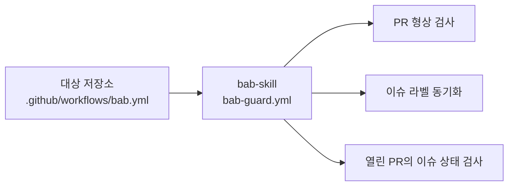
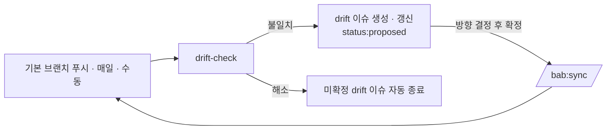
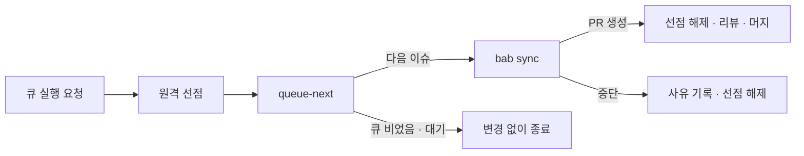

# bab 상세 가이드

이슈의 스펙을 wiki 명세에 반영하고, 코드를 명세에 맞추는 절차를 설명합니다. 처음 쓰는 경우 [한국어 빠른 시작](../README.ko.md#빠른-시작)부터 읽습니다.
기본 README는 [영문](../README.md)이며, [한국어 본문](../README.ko.md)을 별도로 제공합니다.

[선택 설정](#선택-설정) · [업데이트](#플러그인과-ci-업데이트) · [저장소 연결](#저장소-연결) · [시각화](#시각화) · [스킬 목록](workflow.md#스킬-목록)

[설치와 업데이트](#설치와-업데이트) · [스펙 예시](#스펙-예시) · [wiki 구조](#wiki-구조) · [코드 컨벤션 적용 기준](#코드-컨벤션-적용-기준)

[CI 가드레일](#ci-가드레일) · [드리프트 감시](#드리프트-감시) · [스펙 큐](#스펙-큐) · [현재 한계](#현재-한계) · [변경 이력](#변경-이력)

## 설치와 업데이트

[한국어 설치법](../README.ko.md#설치)에서 Claude Code 또는 Codex를 고릅니다. 두 마켓플레이스는 같은 `plugins/bab/`을 가리킵니다.

### 선택 설정

Codex의 setup은 `AGENTS.md`에 지침을 추가합니다. Claude Code는 기존 지침 파일을 사용합니다.
Claude Code에서 지침 파일을 지정하지 않으면 기존 `CLAUDE.md`, 기존 `AGENTS.md` 순서로 고릅니다. 둘 다 없으면 `CLAUDE.md`를 만듭니다.
두 에이전트를 함께 쓰면 두 파일에 같은 프로젝트 규칙 경로를 적습니다. setup은 코드 컨벤션이나 `GEMINI.md`를 만들지 않습니다.

GitHub 라벨 설치는 요청에 포함된 범위에서 진행합니다. 라벨을 설치하지 않거나 원격 쓰기 권한을 확인할 수 없으면 `--skip-labels`를 사용합니다.
저장소 간 연결이 필요하면 setup 요청에 관련 저장소를 지정하거나 [bab link](#저장소-연결)를 따로 사용합니다.

Husky는 커밋·푸시 전에 검사를 실행하는 Git 훅을 관리합니다.
저장소 루트에 `package.json`이 있고 Husky가 설치되지 않았으며 기존 Git 훅과 충돌하지 않으면 에이전트가 설치 여부를 묻습니다.
Husky가 이미 있으면 기존 훅을 유지합니다. 설치에 동의하면 적절한 기존 검사를 연결하고, 검사 명령이 없으면 무엇을 실행할지 묻습니다.
기존 `prepare` 스크립트와 Git 훅을 덮어쓰지 않습니다. [Husky 선택 절차](../plugins/bab/skills/setup/SKILL.md#선택-사항-husky-git-훅)에 상세 조건이 있습니다.

`setup.mjs`를 직접 실행하면 Husky 질문이나 패키지 설치를 하지 않습니다. 저장소 연결도 호출한 에이전트가 별도로 진행합니다.

### 플러그인과 CI 업데이트

Claude Code는 설치 범위를 확인한 뒤 같은 범위로 갱신합니다. 아래는 `user` 범위의 예시입니다.
기존 범위가 `project` 또는 `local`이면 해당 프로젝트에서 같은 범위를 사용합니다.

```bash
claude plugin list --json
claude plugin marketplace update bab-skill
claude plugin update bab@bab-skill --scope user
```

Codex는 마켓플레이스를 갱신하고 플러그인을 다시 추가합니다. 갱신 후 새 채팅에서 사용합니다.

```bash
codex plugin marketplace upgrade bab-skill
codex plugin add bab@bab-skill
```

마켓플레이스를 이전 태그에 고정했다면 고정 태그도 바꿉니다. Claude Code의 `--scope`는 기존 설치 범위를 사용합니다.

```bash
claude plugin marketplace add 'freevue/bab-skill#v1.0.2' --scope local
claude plugin update bab@bab-skill --scope local
```

```bash
codex plugin marketplace remove bab-skill
codex plugin marketplace add freevue/bab-skill --ref v1.0.2
codex plugin add bab@bab-skill
```

플러그인과 GitHub Actions는 따로 갱신합니다. 대상 저장소의 `.github/workflows/bab.yml`에서 `uses`와 `bab-ref`를 모두 `v1.0.2`로 맞춥니다.
이전 버전에서 갱신할 때는 [설치 템플릿](../plugins/bab/skills/setup/assets/workflows/bab.yml)의 이벤트와 권한도 대조합니다.

setup은 기존 지침과 템플릿을 덮어쓰지 않습니다. bab의 로컬 체크아웃에서 다음 명령으로 차이를 확인합니다.

```bash
node plugins/bab/skills/setup/scripts/setup.mjs /대상/저장소 --instructions AGENTS.md --skip-labels --dry-run
```

결과에는 플러그인 버전, 기존 파일·지침과 원본의 차이, CI의 `uses`·`bab-ref` 버전이 나옵니다. 필요한 변경을 확인한 뒤 직접 반영합니다.

### 호환성과 버전

스킬 이름, 이슈 상태 라벨, wiki 문서 종류·필수 섹션과 검사 상태 코드는 공개 계약입니다.
이 계약을 호환되지 않게 바꾸면 주 버전을 올립니다. 버전별 변경은 [변경 이력](#변경-이력)에 요약합니다.
배포별 검증 결과와 업데이트 방법은 [GitHub 릴리스](https://github.com/freevue/bab-skill/releases)에서 확인합니다.

### 로컬에서 개발하며 설치

아래 명령은 bab 저장소 루트에서 실행합니다.

```bash
claude plugin marketplace add "$PWD"
claude plugin install bab@bab-skill
```

```bash
codex plugin marketplace add "$PWD"
codex plugin add bab@bab-skill
```

### 제거

```bash
claude plugin uninstall bab@bab-skill
```

```bash
codex plugin remove bab@bab-skill
```

## 저장소 연결

관련 repo를 지정한 setup은 [bab link](../plugins/bab/skills/link/SKILL.md)를 재사용합니다.
이미 setup한 repo에서도 link를 독립적으로 사용할 수 있습니다. setup 파일과 GitHub 라벨을 다시 설치하지 않습니다.

```text
이 repo에 bab을 setup하고 example/api와 example/cms도 연결해줘.
```

```text
bab:link로 example/api가 관리하는 기존 연결 설정을 이 repo에도 적용해줘.
```

link는 `.bab/links.json`에 담당 영역과 공개 계약 위치를 등록합니다. 정본은 기존 repo 한 곳에 두고 다른 repo는 정본 주소를 참조합니다.
공개 계약이 없으면 연결 목록부터 등록하고 계약을 미확정으로 남깁니다. 전체 코드를 읽어 계약을 추측하지 않습니다.

spec은 등록된 후보의 필요한 계약 섹션만 읽습니다. 기존 계약으로 충분하면 참조만 남깁니다.
외부 변경이 필요하면 기존 이슈를 재사용하거나 제안 초안을 준비합니다. 원격 등록은 사용자 요청 범위를 따릅니다.
wiki의 `issues`는 내부 번호를 유지합니다. 외부 이슈와 계약 출처·커밋·조건은 별도 외부 연결 표에 적습니다.

파일 형식과 관계 표는 [공통 규약](../plugins/bab/skills/link/references/protocol.md)을 따릅니다.
판단·등록 절차는 [외부 계약·이슈 연결](../plugins/bab/skills/link/references/spec-links.md)에 있습니다.
읽기 도구는 선택한 섹션만 반환합니다. 에이전트의 관계 판단과 실제 원격 등록·통합 검증은 별도 근거로 확인합니다.

## 시각화

복잡한 동작이나 관계를 확인할 때 [시각화 기준](../plugins/bab/skills/wiki/references/visualization.md)을 읽습니다.
질문에 필요한 관점만 고릅니다.

| 관점 | 보여주는 정보 |
| --- | --- |
| 시나리오 | 실패 후 재시도에 성공하는 한 경로 |
| 상태 전이 | 대기·로딩·결과·오류 사이의 이동 조건 |
| 코드 실행 | 응답 처리 함수의 분기와 처리 순서 |
| 상호작용 | 화면·API·서비스·DB 사이의 요청과 응답 |
| 데이터 | 검색어와 조회 결과의 변환 |
| 구조·의존 | 화면·함수·타입이 서로 사용하는 관계 |
| 변경 영향 | 응답 타입을 바꿀 때 확인할 함수·화면·테스트 |
| 검증 범위 | 테스트 케이스(TC)별 실행 결과와 미검증 항목 |

```text
bab:wiki로 검색 기능의 상태표와 상태도를 작성해줘.
재시도·취소·늦은 응답을 포함하고 담당 유닛과 TC를 연결해줘.
```

[검색 기능의 여덟 예시](../plugins/bab/skills/wiki/references/visualization-examples.md)에서 관점별 입력과 출력을 비교합니다.

그림에는 대상·관점·근거·범위를 적습니다. 명세의 기대, 코드에서 읽은 처리와 실제로 관측한 실행을 구분합니다.
UI는 기존 기능의 `흐름`에 상태표와 상태도를 두고 담당 유닛·TC를 연결합니다.
spec은 빠진 결정을 묻고 audit은 그림·표·코드·검증 근거를 대조합니다. 그림의 표시 성공으로 실제 동작의 통과를 주장하지 않습니다.
서버·외부 의존성과 새 문서 종류는 필요하지 않습니다. [적용 검증 기록](verification/visualization.md)에 실제 결과와 미검증을 남깁니다.

## 스펙 예시

GitHub에서 스펙 템플릿으로 이슈를 열거나, 에이전트에게 부탁합니다.

```text
목록 화면에서 페이지 번호가 범위를 넘으면 마지막 페이지로 보내는 스펙 등록해줘
```

에이전트가 빈 항목을 질문으로 채우고, 초안을 보여 준 뒤 이슈를 등록합니다. 새 이슈는 `status:proposed` 상태입니다. 등록된 이슈 본문은 이런 모양입니다. 제목은 에이전트가 뜻을 정확히 읽도록 영어 h1로 쓰고, 내용은 한글로 씁니다. 옛 제목(한글, h3)으로 쓴 본문도 같은 항목으로 읽습니다.

| 제목 | 뜻 |
| --- | --- |
| `# Type` | 작업의 종류. 기능, 정책, 버그, 개선 |
| `# Why` | 이 작업이 필요한 이유 |
| `# What` | 바꿀 대상과 완료 후의 기대 동작 |
| `# How` | 합의한 해결 방향과 예상 영향(체크리스트) |
| `# Priority` | 처리 순서. `P0`~`P3` |
| `# Wiki` | 영향을 받는 wiki 페이지 경로 |
| `# Acceptance` | 완료를 판단하는 기준. 가능하면 TC ID |

```markdown
# Type

기능

# Why

목록에서 마지막 페이지보다 큰 번호로 이동하면 빈 화면이 나옵니다.
공유된 오래된 링크로 들어온 사용자가 이 화면을 봅니다.

# What

페이지 번호가 범위를 벗어나면 가장 가까운 유효 페이지를 보여 줍니다.

# How

- [ ] 목록을 조회하기 전에 범위를 벗어난 페이지 번호를 보정

# Priority

P1 (이번 주기)

# Wiki

wiki/unit/page/clampPage.md
wiki/feature/list.md
wiki/policy/paging.md

# Acceptance

- 범위를 벗어난 요청은 가장 가까운 페이지를 보여 줍니다. (FT-list-04, UT-clampPage-01~02)
- 조회할 페이지가 없으면 보정 결과는 1입니다. (UT-clampPage-03, UT-clampPage-07)
- 보정에는 정수만 사용합니다. (UT-clampPage-05~06)
```

## 상태와 라벨

| 상태 | GitHub 표현 | 누가 바꾸나 |
| --- | --- | --- |
| 등록 | Open + `status:proposed` | 사람 또는 에이전트 |
| 확정 | Open + `status:decided` | 사람 또는 에이전트 |
| 진행 | Open + `status:in-progress` | `/bab:sync` |
| 완료 | Closed as completed | PR 머지 (`Closes #N`) |
| 재오픈 | Open + `status:proposed`, 이후 다시 확정 | 사람 또는 에이전트 |
| 취소 | Closed as not planned | 사람 또는 에이전트 |

| 중요도 | 의미 |
| --- | --- |
| `P0` | 즉시 |
| `P1` | 이번 주기 |
| `P2` | 다음 주기 |
| `P3` | 여유 있을 때 |

중요도 라벨은 CI가 이슈 본문의 `# Priority` 값으로 자동으로 맞춥니다. 이슈가 닫히면 CI가 `status:*` 라벨을 뗍니다.

| 기타 라벨 | 의미 |
| --- | --- |
| `no-spec` | 이슈 없이 하는 작은 수정(오타, 문서 정리)의 PR. CI의 이슈 연결 검사를 건너뜁니다 |
| `drift` | 드리프트 감시가 등록한, wiki와 코드의 불일치 이슈 |
| `blocked` | `/bab:sync`가 중단한 이슈. 원인을 해결한 뒤 `status:decided` 상태에서 이 라벨을 떼면 큐에 다시 들어갑니다 |

### 기록 규칙

- 상태가 바뀔 때마다 사유를 코멘트로 남깁니다. 이슈 타임라인만 읽어도 스펙의 역사를 알 수 있습니다.
- 정확한 개발 형상은 wiki와 로컬 룰에 남깁니다. 실제 추가·변경·삭제와 검증 결과는 이슈에 연결한 PR에서 확인합니다.
- 커밋 순서는 wiki → 실패 테스트 → 코드입니다. 커밋을 차례로 읽으면 명세, 검증 기준, 구현이 순서대로 보입니다.

## wiki 구조

아래 예시는 스펙 #12의 페이지 번호 보정을 명세로 옮긴 것입니다. 시작 파일은 [wiki 템플릿](../plugins/bab/skills/wiki/templates/)에서 고릅니다.

```text
wiki/
├── index.md                     # 모든 페이지의 목록 (분류별 표)
├── log.md                       # 변경 기록 (아래에 계속 추가)
├── policy/{name}.md             # 정책
├── feature/{name}.md            # 기능
├── unit/{module}/{function}.md  # 유닛 (함수 하나)
├── type/{module}/{Name}.md      # 타입 (type · interface · enum 하나)
└── reference/{name}.md          # 참고 (조사·정보와 출처)
```

### 형상 명세 네 분류와 참고 문서

| 분류 | 담는 것 | 필수 섹션 | TC ID |
| --- | --- | --- | --- |
| 정책 | 제품과 시스템이 지켜야 할 규칙, 제약, 결정 | 규칙, 적용 기능 | `POL-{정책}-NN` (기능 TC가 참조) |
| 기능 | 사용자가 쓰는 동작. 유닛을 조합해 만듭니다 | 구성 유닛, 흐름, 관련 정책, TC | `FT-{기능}-NN` |
| 유닛 | 함수 하나의 정확한 명세 | 시그니처, 내부 로직, 사용법, 사용처, TC | `UT-{함수}-NN` |
| 타입 | 데이터의 모양. 선언 전체와 필드 | 정의, 필드, 사용처 | 없음 |
| 참고 | 조사 결과와 배경 정보. 코드 형상을 정하는 규칙은 담지 않습니다 | 내용, 출처 | 없음 |

기능의 `## 구성 유닛`과 유닛의 `## 사용처`는 서로 링크합니다. 기능 frontmatter의 `code`에는 그 기능을 구현한 파일을 적고, 구성 유닛은 그 파일이 실제로 쓰는 유닛과 같아야 합니다.

### 정책 페이지 예시

경로: `wiki/policy/paging.md`

```markdown
---
name: paging
type: policy
issues: [12]
code: []
---

# 페이지 범위

## 규칙

| ID | 규칙 | 근거 |
| --- | --- | --- |
| POL-paging-01 | 전체 페이지 수가 양수이면 요청 번호를 1 이상, 전체 페이지 수 이하로 보정합니다. 전체 페이지 수가 0 이하이면 보정 결과는 1입니다 | #12 |

## 적용 기능

| 기능 | 적용 규칙 |
| --- | --- |
| [목록](../feature/list.md) | POL-paging-01 |
```

### 기능 페이지 예시

경로: `wiki/feature/list.md`

```markdown
---
name: list
type: feature
issues: [12]
code: [src/list.ts]
---

# 목록

사용자가 항목을 페이지 단위로 넘겨 봅니다.

## 구성 유닛

| 유닛 | 역할 |
| --- | --- |
| [clampPage](../unit/page/clampPage.md) | 요청한 페이지 번호를 범위 안으로 맞춤 |

## 흐름

1. 요청한 페이지 번호를 범위 안으로 맞춥니다.
2. 보정된 페이지를 조회해 보여 줍니다.

## 관련 정책

[페이지 범위](../policy/paging.md)의 `POL-paging-01`을 따릅니다.

## TC

| ID | 조건 | 동작 | 기대 결과 |
| --- | --- | --- | --- |
| FT-list-04 | 전체 3페이지 | `?page=9`로 진입 | 3페이지를 보여 줌 |
```

### 유닛 페이지 예시

경로: `wiki/unit/page/clampPage.md`. 유닛은 관련 wiki와 로컬 룰만으로 재현할 수 있어야 합니다.

````markdown
---
name: clampPage
type: unit
module: src/page
issues: [12]
code: [src/page/clampPage.ts]
---

# clampPage

페이지 번호를 1부터 전체 페이지 수 사이로 맞춥니다.

## 시그니처

```typescript
export function clampPage(page: number, totalPages: number): number
```

| 매개변수 | 타입 | 기본값 | 의미 |
| --- | --- | --- | --- |
| page | number | 없음 | 요청한 페이지 번호. 절댓값이 9,007,199,254,740,991 이하인 정수 값 |
| totalPages | number | 없음 | 전체 페이지 수. `page`와 같은 범위의 정수 값. 0 이하는 조회할 페이지가 없다는 뜻 |

| 반환 | 의미 |
| --- | --- |
| number | 범위 안으로 보정한 정수 페이지 번호. 조회할 페이지가 없으면 1 |

## 내부 로직

아래 분기를 적힌 순서대로 둡니다. 조건을 충족한 단계에서 즉시 반환하거나 오류를 던집니다.

1. 두 입력이 모두 허용 범위의 정수 값인지 확인합니다. `3.0`처럼 정수 값인 숫자는 받습니다. 소수, 유한하지 않은 값, 숫자가 아닌 값과 범위 밖의 값은 입력 오류로 처리합니다. TypeScript는 `RangeError`, Python은 `ValueError`를 던집니다.
2. `totalPages`가 0 이하이면 1을 돌려줍니다.
3. `page`가 1보다 작으면 1을 돌려줍니다.
4. `page`가 `totalPages`보다 크면 `totalPages`를 돌려줍니다.
5. 나머지는 `page`를 그대로 돌려줍니다.

## 사용법

```typescript
clampPage(9, 3) // 3
```

## 사용처

[목록](../../feature/list.md)

## TC

| ID | 입력 | 기대 결과 |
| --- | --- | --- |
| UT-clampPage-01 | (0, 10) | 1 |
| UT-clampPage-02 | (11, 10) | 10 |
| UT-clampPage-03 | (5, 0) | 1 |
| UT-clampPage-04 | (3, 10) | 3 |
| UT-clampPage-05 | (1.5, 0) | 입력 오류 |
| UT-clampPage-06 | (0, 2.5) | 입력 오류 |
| UT-clampPage-07 | (5, -1) | 1 |
````

### 타입 페이지 예시

경로: `wiki/type/page/Page.md`

````markdown
---
name: Page
type: type
module: src/page
issues: [12]
code: [src/page/types.ts]
---

# Page

목록의 한 페이지를 나타냅니다.

## 정의

```typescript
export interface Page {
  index: number
  size: number
}
```

## 필드

| 필드 | 타입 | 필수 | 의미 |
| --- | --- | --- | --- |
| index | number | 예 | 1부터 시작하는 페이지 번호 |
| size | number | 예 | 한 페이지의 항목 수 |

## 사용처

[목록](../../feature/list.md)
````

### frontmatter 형식

페이지 맨 위의 frontmatter는 아래 형식을 읽습니다. 줄바꿈이 CRLF여도, 파일이 BOM으로 시작해도 같게 읽습니다.

| 형식 | 예 |
| --- | --- |
| 문자열 | `name: clampPage`, `name: "clampPage"`, `name: 'clampPage'` |
| 한 줄 목록 | `code: [src/a.ts, "src/b.ts"]`, `issues: []` |
| 여러 줄 목록 | `code:` 다음 줄부터 `  - src/a.ts` |
| 문자열 하나인 `code` | `code: src/a.ts`는 항목 하나인 목록으로 읽습니다 |
| 주석 | `# 메모`로 시작하는 줄과 값 뒤의 ` # 메모`는 무시합니다 |

### 참고 문서 예시

조사·정보 문서는 `wiki/reference/`에 두고 `wiki/index.md`의 `## 참고`에 한 번 연결합니다. 출처에는 확인한 자료나 검증 기록을 적습니다. 확인할 수 없는 정보는 추정이라고 표시합니다.

```markdown
---
name: browser-storage
type: reference
---

# 브라우저 저장소 조사

## 내용

재접속 시 확인한 저장 상태와 조사 범위를 적습니다.

## 출처

조사 날짜와 재현 절차 또는 확인한 자료를 적습니다.
```

참고 문서는 코드 시그니처나 TC의 기준이 아닙니다. frontmatter에 `code`를 지정하지 않습니다. 구현이 따라야 하는 계약과 규칙은 정책·기능·유닛·타입 명세에 적고 참고 문서에서 연결합니다.

### 코드 쪽 JSDoc

상세 설명의 원본은 wiki입니다. 같은 내용을 두 곳에서 관리하지 않도록 코드에는 한 줄 요약과 경로만 둡니다.

```typescript
/** 페이지 번호를 범위 안으로 맞춥니다. @see wiki/unit/page/clampPage.md */
export function clampPage(page: number, totalPages: number): number {
```

### TC ID 규칙

- 형식은 `UT-{함수}-NN`, `FT-{기능}-NN`, `POL-{정책}-NN`입니다.
- wiki 전체에서 하나뿐이어야 합니다. 지운 ID는 다시 쓰지 않습니다.
- 테스트 이름에 TC ID를 넣습니다. `audit`가 이 이름으로 wiki와 테스트를 짝짓습니다.

### 문서 완결성

문서 완결성은 기존 코드나 이슈를 읽지 않고 형상을 재현할 만큼 명세가 갖춰진 상태입니다. `drift-check`는 아래의 형식과 선언을 검사합니다. PR 검사, 드리프트 감시와 `/bab:audit`가 같은 검사기를 씁니다. 동작의 의미와 필수 분기 순서는 에이전트가 확인하고 테스트로 검증합니다.

| 페이지 | 검사 |
| --- | --- |
| 유닛 | 시그니처의 매개변수마다 `매개변수` 표에 같은 이름과 같은 타입의 행이 있고, 의미가 비어 있지 않습니다. 표에만 있는 행도 잡습니다 |
| 유닛 | `반환` 표의 타입이 시그니처의 반환 타입과 같습니다. 반환 타입이 `void`여도 적습니다 |
| 유닛 | `내부 로직`에 번호 목록, `사용법`에 코드 블록, `TC`에 행이 있습니다 |
| 타입 | `## 정의`의 필드나 enum 멤버마다 `필드` 표에 같은 이름과 같은 타입의 행이 있고, 의미가 비어 있지 않습니다 |
| 기능 · 정책 | 기능은 `구성 유닛` 링크와 `TC` 행이, 정책은 `규칙` 행이 있습니다 |
| 참고 | `내용`과 `출처`가 비어 있지 않습니다. 코드 형상은 대조하지 않습니다 |
| 모든 분류 페이지 | 템플릿 자리표시 `{...}`가 남아 있지 않습니다 |

`wiki/index.md`는 페이지를 정책·기능·유닛·타입·참고의 올바른 분류에 한 번씩 연결해야 합니다. 참고 문서는 `reference/` 경로와 `## 참고` 분류를 씁니다. 인덱스의 중복, 분류와 경로 오류, 누락 페이지는 검사에서 실패합니다. 일반 안내 항목의 링크는 분류 표로 세지 않습니다. UI 상태나 비동기 이벤트가 있으면 [기능 흐름 패턴](../plugins/bab/skills/wiki/references/ui-async-pattern.md)을 기능 페이지에 추가합니다. 함수 이름과 매개변수까지 쓰는 유닛 명세는 그대로 유지합니다.

표의 매개변수 이름에는 `?`와 `...`을 붙이지 않아도 됩니다. 타입은 공백과 구분자(`;`, `,`) 차이를 무시하고 비교합니다.

JavaScript 유닛은 실제 선언을 시그니처에 적고 타입 계약은 표로 정의합니다. 선언에 타입 표기가 없으면 선언과 표의 타입 비교는 미검증입니다. 이때 동작은 TC로 확인합니다.

### 작성 규칙

wiki 페이지, 이슈 본문, PR 본문, 커밋 메시지는 [한글 작성 규칙](../plugins/bab/skills/wiki/references/writing-rules.md)을 따릅니다. `simple-english`의 문서 규칙 중 한글에 적용할 수 있는 내용을 담았습니다. 용어표는 한 단어를 한 뜻으로 쓰도록 정합니다. `prose-check.mjs`는 일부 표현과 문장 길이를 검사합니다. 사용자에게 전하는 답변은 [최종 브리핑 규칙](#최종-브리핑-규칙)을 따릅니다.

이슈·PR·wiki·CI 로그에는 비밀값과 개인정보 원문을 넣지 않습니다. 검증 결과는 마스킹한 표본, 실행 명령과 요약으로 남깁니다. 자세한 기준은 [공개 기록의 민감정보](../plugins/bab/skills/wiki/references/writing-rules.md#공개-기록의-민감정보)를 따릅니다.

---

## 코드 컨벤션 적용 기준

프로젝트의 코드 컨벤션은 저장소 안의 공통 규칙 문서 한 곳에 둡니다. Claude Code와 Codex를 함께 쓴다면 루트의 `CLAUDE.md`와 `AGENTS.md`에 같은 상대 경로를 적습니다. 이미 공통 문서가 있다면 그 문서를 사용합니다. 이 저장소는 [프로젝트 공통 규칙](../.agent/rules/GEMINI.md#코드-컨벤션)에 Ponytail·YAGNI와 TypeScript 코어 규칙을 두고, 두 진입 파일을 다음처럼 연결합니다.

```markdown
작업을 시작하기 전에 [프로젝트 공통 규칙](.agent/rules/GEMINI.md)을 읽고 따릅니다.
```

[`bab audit`](../plugins/bab/skills/audit/SKILL.md)은 대상 경로의 규칙 문서와 도구 설정에서 채택을 확인한 항목만 검사합니다. 예를 들어 줄 수 상한이 200줄이면 200줄을 적용합니다. 네이밍 규칙을 정하지 않았다면 네이밍은 검사하지 않습니다. 규칙이 충돌하고 우선순위가 없으면 근거를 보고하고 판정을 보류합니다.

강제할 규칙은 저장소의 린터나 포매터 설정에도 반영합니다. `bab setup`은 코드 컨벤션을 자동으로 설치하지 않습니다. bab의 GitHub Actions는 wiki 형상과 이슈·PR 규칙을 검사합니다.

---

## CI 가드레일

에이전트가 검사를 건너뛰거나 사람이 직접 PR을 열어도, 같은 규칙이 GitHub Actions에서 자동으로 돕니다. `/bab:setup`이 `.github/workflows/bab.yml`을 설치합니다.

| 이벤트 | 검사 · 동작 | 실패 조건 · 결과 |
| --- | --- | --- |
| PR 열림 · 수정 · 푸시 · 라벨 변경 | 이슈 연결 | `no-spec` 라벨이 없으면 실제 이슈를 `Closes #N` 또는 `Refs #N`으로 연결해야 합니다. HTML 주석, 울타리 코드 블록, 인라인 코드는 검사에서 뺍니다 |
| 〃 | 확정 게이트 | `Closes`로 연결한 이슈가 닫혔거나 `status:decided`와 `status:in-progress` 라벨이 모두 없으면 실패합니다 |
| 〃 | 형상 일치 · 문서 완결성 | base와 PR에서 각각 `drift-check`를 실행합니다. 새 불일치나 문서 누락이 있거나 기존 `wiki/index.md`가 사라지면 실패합니다. 소스 문자열에만 있는 함수·타입 선언은 실제 선언으로 보지 않습니다 |
| 이슈의 `status:*` 라벨 변경 · 닫힘 · 다시 열림 | 열린 PR 재검사 | 현재 이슈 상태를 조회하고 연결된 PR의 최신 커밋에 `bab / issue gate` 결과를 갱신합니다 |
| 이슈 열림 · 수정 | 중요도 동기화 | 본문 `# Priority` 값으로 `P0`~`P3` 라벨을 맞춥니다 |
| 이슈 닫힘 | 상태 정리 | `status:*` 라벨을 뗍니다 |

이슈 검사에 실패하면 PR에 표시된 상태에서 Actions 실행 요약을 열어 원인을 확인할 수 있습니다. 같은 커밋을 쓰는 열린 PR이 여러 개면 모두 통과해야 그 커밋의 상태가 통과로 바뀝니다. GitHub Actions의 기본 토큰으로 라벨을 바꾸면 GitHub가 후속 실행을 시작하지 않을 수 있습니다. 이 경우 `bab` 워크플로를 수동 실행하면 모든 열린 PR을 다시 검사합니다. 예약 실행도 같은 검사를 합니다.

### 동작 방식

검사 로직은 이 저장소 한 곳에만 있습니다. 각 저장소는 재사용 워크플로를 호출하는 짧은 파일만 가집니다. 규칙을 고치면 새 태그를 만들고, 각 저장소의 참조를 올려 반영합니다.



```yaml
jobs:
  guard:
    uses: freevue/bab-skill/.github/workflows/bab-guard.yml@v1.0.2
    with:
      bab-ref: v1.0.2
```

> [!TIP]
> v0.7.3 이하에서 올릴 때는 [설치 템플릿](../plugins/bab/skills/setup/assets/workflows/bab.yml)의 이벤트와 권한도 함께 반영합니다. 이슈 연결·확정에 실패한 PR의 머지를 막으려면 `bab` 워크플로를 한 번 수동 실행합니다. 열린 PR에 새 검사 결과가 기록되면 브랜치 보호 규칙에 `guard / pr`(형상)과 `bab / issue gate`(이슈 연결·확정)를 모두 필수로 지정합니다.

---

## 드리프트 감시

wiki와 코드가 어긋난 것을 정기적으로 찾아 이슈로 등록합니다. `/bab:sync`를 거치지 않은 수정(핫픽스, 직접 수정)으로 생긴 어긋남을 잡는 장치입니다. GitHub Actions의 schedule이 loop 역할을 하므로, PC가 꺼져 있어도 돕니다.



### 언제 도나

| 트리거 | 시점 |
| --- | --- |
| 기본 브랜치 푸시 | 머지 직후 |
| schedule | 매일 00:00 UTC (한국 시간 09:00) |
| workflow_dispatch | Actions 탭에서 수동 실행 |

### 무엇을 찾나

| 종류 | 판정 |
| --- | --- |
| 시그니처 불일치 | 유닛 `## 시그니처`의 선언과 `code` 파일의 export 선언이 공백 정규화 후 다릅니다 |
| 타입 정의 불일치 | 타입 `## 정의`의 선언과 `code` 파일의 export 타입이 필드까지 비교해 다릅니다. 공백과 구분자(`;` · `,`) 차이는 무시합니다 |
| 코드에 없음 | `code` 파일이 없거나, 그 안에 유닛 · 타입 이름의 export가 없습니다 |
| 페이지 없는 export | 유닛 · 타입 페이지가 참조하는 코드 파일의 export 함수 · 타입에 페이지가 없습니다. 기능 `code` 파일의 export는 기능 자체이므로 보지 않습니다 |
| 구성 유닛 미사용 | 기능의 구성 유닛인데, 기능 `code` 파일이 그 유닛을 import · 호출 · JSX로 쓰지 않습니다 |
| 구성 유닛 누락 | 기능 `code` 파일이 유닛 페이지가 있는 함수를 쓰는데, 구성 유닛에 없습니다 |
| 사용처 불일치 | 기능의 구성 유닛과 유닛의 사용처가 서로 링크하지 않습니다 |
| 문서 완결성 | 매개변수 · 반환 · 필드 표의 누락, 초과, 타입 불일치, 빈 설명, 빈 섹션, 남은 템플릿 자리표시 |
| wiki 구조 | `wiki-check` 위반 |

드리프트 검사기는 테스트 존재 여부나 실행 결과를 보지 않습니다. 실제 동작은 각 저장소의 테스트가 검증합니다. 에이전트는 wiki의 TC와 실행 결과를 대조합니다. 참고 문서는 링크·인덱스·내용·출처를 검사하고, 명세 페이지 수와 따로 셉니다. 명세 페이지가 0건이고 구조 위반도 없으면 `검사 대상 없음`과 종료 코드 `3`을 돌려줍니다. 명세 페이지를 검사해 불일치가 없을 때만 `불일치 없음`이라고 표시합니다.

같은 검사를 로컬에서 실행할 수 있습니다. `/bab:audit`와 PR의 형상 일치 검사도 이 스크립트를 씁니다.

```bash
node plugins/bab/ci/drift-check.mjs <저장소 루트>
```

### 이슈는 어떻게 만들어지나

- 페이지(또는 코드 파일) 하나당 이슈 하나를 만듭니다. 이미 열린 이슈에서는 자동 검사 결과만 갱신하고, 사람이 작성한 해결 방향과 본문은 유지합니다. 이전 버전 이슈에는 `현재 드리프트 검사 결과`를 한 번 추가합니다.
- 이슈는 스펙 폼과 같은 형식이고, 라벨은 `status:proposed`, `P2`, `drift`입니다.
- 사람이나 에이전트가 이슈의 해결 방향을 고릅니다. 코드를 wiki에 맞추기로 확정하면 `/bab:sync`로 진행합니다. wiki를 바꾸면 스펙 변경이므로 이유를 코멘트로 남깁니다.
- 확정 전에 드리프트가 해소되면 CI가 이슈를 닫고 상태 라벨을 제거합니다. 이미 확정된 이슈는 닫지 않고 본문에 해소 표시를 남깁니다.
- 한 번 실행에 새 이슈는 최대 10개까지 만듭니다. 나머지는 실행 요약에만 남고, 다음 실행에서 이어서 만듭니다.
- 드리프트 작업은 한 번에 하나만 돕니다. 푸시와 정기 실행이 겹치면, 다음 실행은 앞 실행이 끝날 때까지 기다립니다. 그래서 같은 이슈가 두 번 만들어지지 않습니다.

> [!NOTE]
> 초기 wiki에 명세 페이지가 없고 참고 문서의 구조 위반도 없으면 검사는 `검사 대상 없음`으로 표시하고 이슈 동기화를 건너뜁니다. 참고 문서에 구조 위반이 있으면 불일치로 보고합니다. `wiki/index.md`를 확인할 수 없어도 이슈 동기화를 건너뜁니다. 코드 경로는 저장소 안의 일반 파일만 검사합니다.

---

## 스펙 큐

확정된 이슈를 정해진 순서로 하나씩 골라 bab sync를 실행합니다. 사용자가 요청한 경우에만 에이전트의 반복 실행 기능을 사용합니다.



### 실행

| 환경 | 실행 방법 |
| --- | --- |
| Claude Code | 한 번 실행하려면 `/bab:sync next`를 입력합니다 |
| Codex | `bab:sync`를 선택하고 `next`로 다음 이슈를 진행해 달라고 요청합니다 |
| 다른 에이전트 | bab sync의 `SKILL.md`를 읽고 `next` 절차를 적용합니다 |

GitHub 원격 변경이 승인된 작업은 `claim.mjs`로 저장소 전체를 선점한 뒤 큐에서 이슈를 고릅니다. 직접 이슈 번호를 작업할 때도 선점합니다. 선점한 SHA는 종료나 중단 때만 같은 SHA로 해제합니다. 에이전트가 비정상 종료되면 현재 작업이 멈췄는지 확인한 뒤 수동으로 해제합니다. 원격 변경이 없는 로컬 초안에는 동시 작업 보장이 없습니다.

### 선택 규칙

다음 이슈는 [`queue-next.mjs`](../plugins/bab/skills/sync/scripts/queue-next.mjs)가 고릅니다. 같은 상태면 항상 같은 이슈를 고릅니다.

| 순서 | 규칙 |
| --- | --- |
| 1 | 후보는 열린 `status:decided` 이슈입니다. `blocked` 이슈는 제외합니다 |
| 2 | 차단되지 않은 열린 `status:in-progress` 이슈가 상한(기본 1)에 닿으면 대기합니다 |
| 3 | 진행 중 이슈와 `# Wiki`가 겹치는 후보는 건너뜁니다. 차단된 진행 이슈의 경로도 보호합니다 |
| 4 | 중요도(`P0` → `P3`, 라벨 없으면 맨 뒤), 같은 중요도는 오래된 순서로 고릅니다 |

> [!IMPORTANT]
> 기본 상한은 차단되지 않은 진행 이슈 1건입니다. 상한을 바꾸려면 `--max-in-progress N`을 지정합니다.

### 중단과 `blocked`

작업 시작 전 게이트가 실패하면 이슈를 바꾸지 않습니다. 시작한 뒤 아래 조건에서 멈추면, 이슈 변경이 승인된 경우에만 `blocked` 라벨과 사유를 남깁니다.

- 같은 원인으로 세 번 실패
- 이슈 범위를 벗어나야 해결되는 문제, 또는 스펙 변경이 필요한 CI 실패

원인을 해결한 뒤 `blocked`를 뗍니다. 이미 `status:in-progress`였던 이슈를 큐에서 다시 시작하려면 상태를 `status:decided`로 돌립니다.

---

## 최종 브리핑 규칙

에이전트는 결과, 변경 이유, 검증 결과를 짧은 문단으로 전합니다. 마지막에는 생략하거나 확인하지 않은 범위와 남은 위험을 적습니다. 자세한 변경 표와 TC 결과는 PR에 남깁니다.

[공통 브리핑 규칙과 예시](../plugins/bab/skills/setup/assets/claude-section.md#최종-브리핑)가 정본입니다. bab setup은 이 규칙을 선택한 지침 파일에 추가합니다. 기존 bab 섹션이 있으면 갱신하지 않으므로, 새 규칙이 필요할 때 정본과 비교해 반영합니다.

---

## 전역 설정

bab은 현재 에이전트에 적용되는 지침과 저장소 규칙을 따릅니다. 다른 에이전트의 전역 파일을 설치할 필요는 없습니다. GitHub 변경과 푸시 권한은 사용자가 승인한 범위를 따릅니다.

---

## 다른 에이전트에서 쓰기

플러그인 설치를 지원하지 않는 에이전트에서는 마크다운 스킬과 Node 스크립트를 직접 사용합니다. 스킬의 상대 경로가 유지되도록 `plugins/bab/` 전체를 사용합니다.

| 쓰고 싶은 것 | 방법 |
| --- | --- |
| 저장소 셋업 | `setup.mjs`를 직접 실행합니다. 아래 명령을 봅니다 |
| wiki 구조 검사 | `wiki-check.mjs`를 직접 실행합니다. 깨진 링크, index 누락, 필수 섹션 누락, TC ID 중복을 찾습니다 |
| 작업 절차 | `plugins/bab/skills/*/SKILL.md`는 일반 마크다운입니다. 다른 에이전트의 지침 파일(`AGENTS.md` 등)에서 경로로 연결해 읽게 합니다 |

```bash
node plugins/bab/skills/setup/scripts/setup.mjs <저장소 루트> --instructions AGENTS.md --skip-labels --dry-run
```

```bash
node plugins/bab/skills/setup/scripts/setup.mjs <저장소 루트> --instructions AGENTS.md --skip-labels
```

```bash
node plugins/bab/skills/audit/scripts/wiki-check.mjs <wiki 폴더>
```

| 옵션 · 종료 코드 | 뜻 |
| --- | --- |
| `--instructions` | `AGENTS.md` 또는 `CLAUDE.md`를 지정합니다 |
| `--dry-run` | 바꾸지 않고 결과만 미리 봅니다 |
| `--skip-labels` | GitHub 라벨 생성을 건너뜁니다 |
| `0` | 성공 또는 위반 없음 |
| `1` | 설치 경로가 안전하지 않거나 라벨 작업이 실패했거나 wiki 위반이 있습니다 |
| `2` | 경로나 옵션이 올바르지 않습니다 |

---

## 현재 한계

> [!WARNING]
> 아래 항목은 아직 자동화되지 않았거나 검증되지 않았습니다.

| 한계 | 영향 | 지금 할 수 있는 일 |
| --- | --- | --- |
| 코드 검증은 범위 밖 | bab CI는 이슈 연결 · 확정 게이트 · 형상 일치만 봅니다. 테스트 실행과 테스트 존재 여부는 보지 않습니다 | 저장소의 기존 테스트 워크플로를 유지합니다 |
| 드리프트가 인식하는 선언 형태가 제한적 | 함수는 `export function`, `export const ... =>`, `export const ... = function`, 타입은 `export type` · `interface` · `enum`만 봅니다. 클래스와 재export는 보지 않습니다 | `/bab:audit`의 판단 검사로 확인합니다 |
| frontmatter는 YAML 일부만 읽음 | 문자열, 목록, 주석만 읽습니다. 중첩 객체와 여러 줄 문자열은 읽지 않습니다 | bab의 frontmatter 키(`name`, `type`, `module`, `issues`, `code`)는 이 형식으로 충분합니다 |
| 구조 분해 매개변수는 원문으로 비교 | `{ a, b }: Options` 같은 매개변수는 이름 하나로 나눌 수 없어, 표의 이름 칸에 원문(`{ a, b }`)을 적어야 합니다 | 템플릿 주석과 wiki 스킬에 적힌 규칙을 따릅니다 |
| 관계는 기능 → 유닛만 판정 | 유닛이 다른 유닛을 호출하는 관계는 판정하지 않습니다. 사용 여부는 이름으로 판단하므로, 다른 모듈의 같은 이름 함수를 구분하지 못합니다 | 리뷰에서 확인합니다 |
| 내부 로직의 의미는 검사하지 않음 | wiki의 내부 로직 순서와 실제 동작이 같은지는 스크립트가 판단하지 않습니다 | 리뷰와 `/bab:audit`의 판단 검사로 확인합니다 |
| 원격 선점은 자동 만료하지 않음 | 작업 중 에이전트가 종료되면 다음 sync가 대기합니다 | `claim.mjs status`로 확인하고, 중단된 작업의 SHA만 해제합니다 |
| setup이 기존 섹션을 갱신하지 않음 | 이미 셋업한 저장소에는 새 규칙이 자동 적용되지 않습니다 | `setup --dry-run`의 차이와 원본을 비교해 직접 반영합니다 |

---

## 저장소 구조

```text
bab-skill/
├── .agent/rules/GEMINI.md         # 두 에이전트가 공유하는 프로젝트 규칙
├── .agents/plugins/marketplace.json  # Codex 마켓플레이스
├── .claude-plugin/
│   └── marketplace.json          # Claude Code 마켓플레이스
├── .github/
│   ├── workflows/bab-guard.yml   # CI 가드레일 재사용 워크플로 (모든 저장소가 호출)
│   └── ...                       # 이 저장소에 적용한 이슈 폼, PR 템플릿, 호출 워크플로
├── wiki/                         # bab의 기능·유닛 명세와 변경 기록
├── test/                         # bab 스크립트 회귀 테스트
├── AGENTS.md, CLAUDE.md           # 공통 규칙으로 연결하는 진입 파일
└── plugins/bab/
    ├── plugin.json               # 공용 플러그인 매니페스트
    ├── .claude-plugin/plugin.json
    ├── ci/                       # CI가 실행: pr-guard, issue-sync, drift-check, drift-report, drift/
    └── skills/
        ├── setup/
        │   ├── SKILL.md
        │   ├── scripts/          # setup.mjs (진입점), steps.mjs (설치 단계)
        │   └── assets/           # 이슈 폼, PR 템플릿, 호출 워크플로, 라벨, wiki 골격, 지침 섹션
        ├── spec/SKILL.md         # 이슈 등록 · 확인 · 상태 전이
        ├── issues/SKILL.md       # 이슈 목록 · 상태별 조회
        ├── wiki/
        │   ├── SKILL.md
        │   ├── templates/        # policy.md, feature.md, unit.md, type.md, reference.md
        │   └── references/writing-rules.md  # 한글 작성 규칙과 용어표
        ├── sync/
        │   ├── SKILL.md          # 이슈 → wiki → 코드 → PR, 큐 모드
        │   ├── scripts/queue-next.mjs  # 스펙 큐의 다음 이슈 선택
        │   └── references/principles.md
        ├── audit/
        │   ├── SKILL.md
        │   └── scripts/          # wiki-check.mjs, frontmatter.mjs, prose-check.mjs
        └── simple-english/       # 쉬운 영어 작성 규칙
```

bab 저장소에서 Node 20으로 회귀 테스트를 실행합니다. GitHub Actions도 같은 명령을 실행합니다.

```bash
node --test
```

---

## 자주 묻는 질문

### 이미 코드가 많은 프로젝트에도 적용할 수 있나요?

네. `/bab:setup` 후 `/bab:wiki`의 ingest 모드로 기존 코드를 처음 한 번 문서화합니다. 예를 들어 `src/page 기존 코드 문서화해줘`라고 요청합니다.

- 이때만 코드 → wiki 방향입니다.
- 테스트가 없는 함수는 `TC 미정`으로 표시합니다.
- 코드에서 드러난 규칙은 정책 후보로만 남깁니다. 정책 확정은 사람이 합니다.
- ingest가 끝난 범위부터는 이슈 → wiki → 코드 방향만 씁니다.

### PR 리뷰 중에 스펙이 바뀌면요?

`/bab:sync`는 작업 도중에 스펙을 고치지 않습니다.

1. 사람이나 에이전트가 `/bab:spec` 규칙대로 이슈 본문과 코멘트에 바뀐 스펙을 적습니다.
2. 이슈를 다시 확정합니다.
3. `/bab:sync`를 다시 실행하면 같은 브랜치에서 wiki 갱신부터 다시 진행합니다.

이미 닫힌 이슈라면 사유 코멘트를 먼저 남기고 재오픈합니다. 상태 라벨은 `status:proposed` 하나로 맞춘 뒤 다시 확정합니다.

### 스펙 업데이트는 PR에 어떻게 연결하나요?

| 상황 | PR 본문 | 결과 |
| --- | --- | --- |
| 스펙을 완성하는 PR | `Closes #N` | 머지되면 이슈가 닫힙니다 |
| 일부만 구현하거나 후속 수정인 PR | `Refs #N` | 이슈 상태를 바꾸지 않고 PR에서 참조합니다 |

커밋 본문 마지막 항목에도 `#N`을 적습니다. 이슈 타임라인에 PR과 커밋이 함께 쌓입니다.

PR의 변경 표에는 실제 추가·변경·삭제를 적습니다. 삭제는 이전 경로나 diff 링크를 남깁니다. 검증 표에는 완료 기준별로 wiki 규칙 또는 TC와 실행 근거를 연결합니다. 계속 적용할 결정은 정책이나 관련 문서에 반영합니다. [bab audit](../plugins/bab/skills/audit/SKILL.md)는 이 연결을 양방향으로 대조합니다.

> [!NOTE]
> 지금 `/bab:sync`는 `Closes #N`만 씁니다. `Refs #N` 흐름은 사람이 PR을 열 때 쓰는 규칙입니다.

### 테스트 도구가 없는 저장소는요?

실패 테스트 단계를 `건너뜀`으로 기록합니다. 검증 단계에서 wiki의 TC를 직접 실행해 확인하고, 결과는 PR의 Verification 표에 TC ID별로 남깁니다.

### 오타 수정 같은 작은 일도 이슈부터 만들어야 하나요?

아닙니다. 이슈 없는 요청은 평소처럼 진행합니다. bab의 절차는 스펙이 있는 작업에만 적용됩니다. PR에는 `no-spec` 라벨을 붙여 CI의 이슈 연결 검사를 건너뜁니다. 다만 동작이 바뀌는 수정이면 이슈로 남깁니다. 그래야 나중에 왜 바뀌었는지 찾을 수 있습니다.

---

## 변경 이력

v0.1.0에는 태그가 없습니다. 태그는 v0.2.0부터 있습니다. 다른 저장소의 호출 워크플로는 가장 최근 태그를 참조합니다.

| 버전 | 종류 | 내용 |
| --- | --- | --- |
| v0.1.0 | 새 기능 | 스킬 6개, 셋업 스크립트, wiki 구조 검사, 이슈 폼, PR 템플릿. 최종 브리핑 규칙 |
| v0.2.0 | 새 기능 | CI 가드레일: 이슈 연결, 확정 게이트, wiki 구조, 중요도 라벨 동기화, 닫힌 이슈의 상태 정리 |
| v0.3.0 | 새 기능 | 드리프트 감시: 기본 브랜치 푸시, 매일, 수동 실행에서 불일치를 찾아 `drift` 이슈로 등록 |
| v0.4.0 | 새 기능 | 스펙 큐: `/bab:sync next`, `blocked` 라벨 |
| v0.5.0 | 새 기능 | PR 형상 가드: PR이 새로 만든 불일치만 실패. 테스트 TC 대조는 드리프트에서 제외 |
| v0.6.0 | 새 기능 | 형상 모델 확장: 타입 페이지, 기능의 구성 유닛과 유닛의 사용처 대조 |
| v0.6.1 | 수정 | 줄바꿈으로 구분한 타입 필드를 불일치로 판정하던 오류 |
| v0.6.2 | 수정 | CRLF, BOM, 따옴표 값, 여러 줄 목록에서 생기던 오탐과 크래시. 드리프트 작업의 동시 실행 |
| v0.6.3 | 정리 | 한글 작성 규칙과 `prose-check.mjs`, `audit`의 문서 검사와 `any` 규칙, 스캐너 정리 |
| v0.7.0 | 새 기능 | 문서 완결성 검사(최종 검증). 이슈는 투두, 확정 · 클로즈 · 캔슬은 사람 또는 에이전트. 이슈 템플릿을 h1 Markdown(`spec.md`)으로 교체 |
| v0.7.1 | 정리 | 이슈 본문 제목을 영어 키(`Type`, `Why`, `What`, `How`, `Priority`, `Wiki`, `Acceptance`)로 바꿈. 옛 한글 제목도 계속 읽음 |
| v0.7.2 | 수정 | wiki 인덱스 삭제 감지, 코드 경로 제한, 드리프트 이슈의 결정 보존 및 종료 라벨 정리, 차단 이슈의 큐 상한 제외, PR 이슈 참조 검증. 회귀 테스트 13개를 CI에 추가 |
| v0.7.3 | 새 기능·수정 | Claude Code와 Codex가 같은 스킬을 설치합니다. 셋업에서 지침 파일을 지정하고, 설치 경로와 wiki의 심볼릭 링크를 검사합니다. 회귀 테스트를 22개로 늘렸습니다 |
| v0.7.4 | 수정 | 형상 검사에서 문자열 속 선언을 제외합니다. 이슈 상태가 바뀌면 연결된 열린 PR을 다시 검사합니다. 회귀 테스트를 26개로 늘렸습니다 |
| v0.7.5 | 문서·스킬 | `AGENTS.md`와 `CLAUDE.md`가 같은 프로젝트 규칙을 참조하는 방법을 정리했습니다. `bab audit`은 프로젝트가 채택한 코드 컨벤션만 검사합니다 |
| v0.7.6 | 문서·스킬 | 이슈·wiki·PR의 역할을 구분했습니다. PR에 실제 추가·변경·삭제와 검증 근거를 남깁니다. `audit`에 문서만으로 유닛을 재현하는 절차를 추가했습니다. 문서·브리핑 기준과 README를 정리했습니다 |
| v0.7.7 | 수정·명세 | 재오픈 상태와 스펙 본문 조회를 보완했습니다. 설치 범위·고정 태그 안내와 설치본 링크를 고쳤습니다. 이슈 라벨 wiki와 두 언어의 유닛 재현 근거를 추가했습니다. 회귀 테스트를 56개로 늘렸습니다 |
| v0.7.8 | 문서 | README에 스펙 등록·확정·구현·PR 생성의 요청 예시를 추가했습니다. 셋업, 기존 코드 문서화, 감사와 유닛 재현 예시도 제공합니다. 설치본 README에서 사용 예시로 이동할 수 있습니다 |
| v0.8.0 | 문서·스킬 | README 앞부분에 `setup → spec → sync` 순서와 `sync` 내부 작업을 정리했습니다. 설명 없이 `spec`을 호출하면 작업 내용을 먼저 묻습니다. 가이드 예시를 wiki 템플릿과 맞췄습니다 |
| v0.8.1 | 문서 | README의 문장과 사용 순서를 간결하게 정리했습니다. 처음 하는 셋업과 이슈마다 반복하는 작업을 네 단계로 설명합니다 |
| v0.9.0 | 스킬·검사 | 이슈 현황 표, 선택형 Husky 안내와 원격 작업 선점을 추가했습니다. 명세가 없는 검사 결과를 분리하고 wiki 인덱스·업데이트 차이·민감정보 기록 규칙을 보완했습니다. UI·비동기 흐름 명세 패턴도 추가했습니다 |
| v0.9.1 | 긴급 수정 | `reference` 조사·정보 문서 템플릿과 구조 검사를 추가했습니다. 참고 문서와 형상 명세의 검사 건수를 구분합니다 |
| v1.0.0 | 정식 릴리스 | 스킬 이름, 이슈 상태, wiki 문서 종류·필수 섹션, 드리프트 검사 상태 코드를 공개 계약으로 정했습니다. 화면 상태 예시와 audit의 UI 검증 근거 대조를 보강했습니다 |
| v1.0.1 | 저장소 연결 | 독립 link와 setup 재사용, 공개 계약·이슈 연결 규약을 추가했습니다. spec·wiki·sync·audit이 필요한 외부 계약과 관계를 구분하도록 정리했습니다 |
| v1.0.2 | 시각화 | 여덟 관점과 근거 표시, UI 상태표·상태도·유닛·TC 연결을 추가했습니다. spec·audit 적용 절차와 README를 정리했습니다 |

v0.6.0을 참조하는 저장소는 v0.6.1 이상으로 올립니다. v0.6.0에는 줄바꿈 구분 필드의 오류가 있습니다.

---

## 로드맵

- [x] CI 가드레일: 이슈 연결, 확정 게이트, wiki 구조 검사, 중요도 라벨 동기화, 닫힌 이슈의 상태 정리 (v0.2.0)
- [ ] npx 설치기: `setup.mjs`를 감싸 npm으로 배포합니다.
- [x] Codex 마켓플레이스와 `AGENTS.md` 셋업 지원.
- [x] 드리프트 감시: wiki와 코드의 불일치를 매일 찾아 `drift` 이슈로 등록합니다 (v0.3.0)
- [x] 스펙 큐: 확정된 이슈를 중요도 순으로 하나씩 `/bab:sync`합니다 (v0.4.0)
- [x] PR 형상 가드: PR이 새로 만든 wiki와 코드의 불일치를 머지 전에 막습니다 (v0.5.0)
- [x] 형상 모델 확장: 타입 페이지와 기능 구성 관계를 판정합니다 (v0.6.0)
- [x] 문서 완결성: 함수 이름과 매개변수 하나까지 문서에 적혔는지 검사합니다 (v0.7.0)

## 라이선스

이 프로젝트는 [MIT 라이선스](../LICENSE)로 배포합니다. [`principles.md`](../plugins/bab/skills/sync/references/principles.md)의 원칙 요약은 [pstack](https://github.com/cursor/plugins/tree/main/pstack)(MIT, Lauren Tan)을 참고했습니다.
