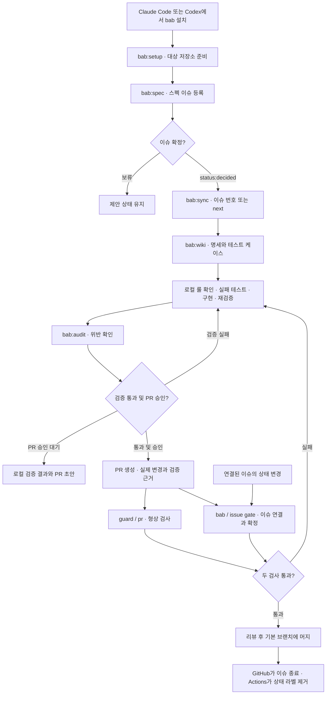

# bab 스킬과 흐름도

Claude Code와 Codex는 같은 스킬, wiki 템플릿, Node 검사기를 사용합니다. [설치법과 호출 예시](../README.ko.md#설치)는 한국어 README에 있습니다.

## 스킬 목록

| 스킬 | 언제 쓰나요? | 결과 |
| --- | --- | --- |
| [`bab:setup`](../plugins/bab/skills/setup/SKILL.md) | 저장소에 처음 적용할 때 | wiki 골격, 이슈·PR 템플릿, 워크플로, 에이전트 지침을 만듭니다. 승인된 경우 라벨을 설치하고, Node 프로젝트에서는 Husky 훅 설치 여부를 묻습니다 |
| [`bab:issues`](../plugins/bab/skills/issues/SKILL.md) | 등록된 이슈를 훑어볼 때 | 열린 이슈를 상태와 중요도별 표로 보여 줍니다. 이슈를 변경하지 않습니다 |
| [`bab:spec`](../plugins/bab/skills/spec/SKILL.md) | 도메인 변경을 기록하거나 상태를 확인할 때 | 이슈에 합의와 변경 이력, 영향을 받는 wiki를 남깁니다 |
| [`bab:wiki`](../plugins/bab/skills/wiki/SKILL.md) | 개발 형상의 기준을 작성할 때 | 로컬 룰과 함께 형상을 재현할 수 있도록 정책, 기능, 유닛, 타입과 테스트 케이스를 기록합니다 |
| [`bab:sync`](../plugins/bab/skills/sync/SKILL.md) | 확정된 이슈를 작업할 때 | wiki, 실패 테스트, 코드, 검증을 순서대로 진행합니다. 승인 범위에서 푸시하고 PR을 엽니다 |
| [`bab:audit`](../plugins/bab/skills/audit/SKILL.md) | 합의·형상·검증 근거를 대조할 때 | 이슈, wiki와 로컬 룰, 코드, PR을 대조합니다. 요청 시 문서만으로 유닛 하나를 재현합니다 |
| [`bab:simple-english`](../plugins/bab/skills/simple-english/SKILL.md) | 영문 문서를 읽기 쉽게 다듬을 때 | 영문 문장을 정리합니다. 이슈 진행과 별도로 쓸 수 있습니다 |

`bab:setup`과 `bab:sync`는 직접 호출합니다. `bab:audit`는 대상 파일을 바꾸지 않고 검사합니다. 재현을 요청하면 별도 임시 위치에서 구현을 확인합니다.

`bab:issues`는 어느 단계에서든 현재 이슈를 읽을 때 쓸 수 있습니다. 목록을 본 뒤 이슈 내용을 바꾸려면 `bab:spec`, 확정된 이슈를 진행하려면 `bab:sync`를 호출합니다.

## 이슈에서 머지까지

`next`는 확정 이슈를 하나 고릅니다. 원격 변경이 승인된 sync는 먼저 저장소를 선점해 두 에이전트가 같은 이슈를 진행하지 않게 합니다. 작업이 끝나거나 중단되면 선점한 SHA로 해제합니다. GitHub Actions의 [드리프트 감시](guide.md#드리프트-감시)는 wiki와 코드가 어긋나면 제안 이슈를 만들거나 갱신합니다. 이 이슈도 같은 확정 절차를 거칩니다.

이슈 재검사를 적용하는 방법과 필수 검사 설정은 [CI 가드레일](guide.md#ci-가드레일)을 참고합니다.
