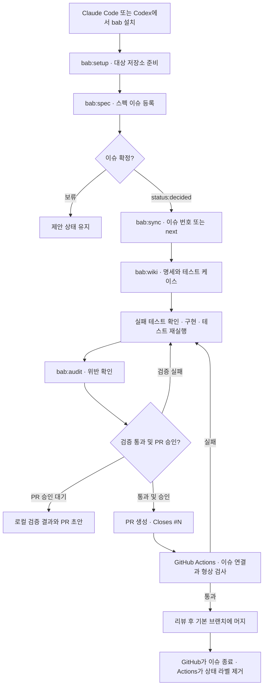

# bab 스킬과 흐름도

Claude Code와 Codex는 같은 스킬, wiki 템플릿, Node 검사기를 사용합니다. [설치법과 호출 예시](../README.md#설치)는 README에 있습니다.

## 스킬 목록

| 스킬 | 언제 쓰나요? | 결과 |
| --- | --- | --- |
| [`bab:setup`](../plugins/bab/skills/setup/SKILL.md) | 저장소에 처음 적용할 때 | wiki 골격, 이슈·PR 템플릿, 워크플로, 에이전트 지침을 만듭니다. 승인된 경우 라벨도 설치합니다 |
| [`bab:spec`](../plugins/bab/skills/spec/SKILL.md) | 스펙을 기록하거나 상태를 확인할 때 | 등록 초안을 작성하고, 승인된 등록·확정·종료·재오픈의 근거를 이슈에 남깁니다 |
| [`bab:wiki`](../plugins/bab/skills/wiki/SKILL.md) | 스펙을 구현할 명세로 옮길 때 | 정책, 기능, 유닛, 타입과 테스트 케이스를 기록합니다. 최초 문서화에서는 기존 코드에서 시작할 수 있습니다 |
| [`bab:sync`](../plugins/bab/skills/sync/SKILL.md) | 확정된 이슈를 작업할 때 | wiki, 실패 테스트, 코드, 검증을 순서대로 진행합니다. 승인 범위에서 푸시하고 PR을 엽니다 |
| [`bab:audit`](../plugins/bab/skills/audit/SKILL.md) | 규칙과 구현의 일치를 확인할 때 | 저장소 규칙, wiki와 코드, 이슈와 PR 연결, 문서 작성 규칙의 위반을 보고합니다 |
| [`bab:simple-english`](../plugins/bab/skills/simple-english/SKILL.md) | 영문 문서를 읽기 쉽게 다듬을 때 | 영문 문장을 정리합니다. 이슈 진행과 별도로 쓸 수 있습니다 |

`bab:setup`과 `bab:sync`는 직접 호출합니다. `bab:audit`는 변경 없이 독립적으로 실행할 수 있습니다.

## 이슈에서 머지까지

`next`는 확정 이슈를 하나 고릅니다. GitHub Actions의 [드리프트 감시](guide.md#드리프트-감시)는 wiki와 코드가 어긋나면 제안 이슈를 만들거나 갱신합니다. 이 이슈도 같은 확정 절차를 거칩니다.
