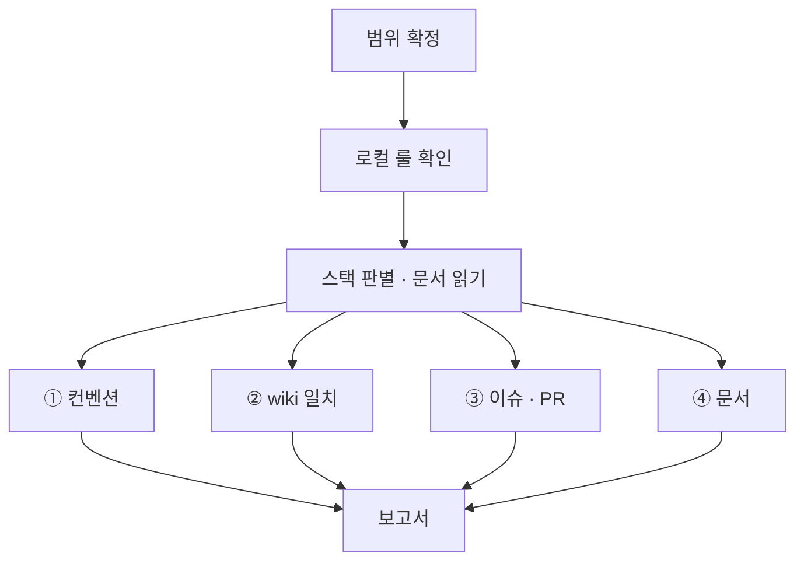

# bab audit

대상 프로젝트가 채택한 규칙과 저장소 `wiki/`를 기준으로 검사합니다. 이 스킬은 검사 절차만 정의합니다.

## 실행 범위

- 읽기 전용입니다. 파일 수정, 포매터·린터의 쓰기 실행, 패키지 설치, 스테이징, 커밋을 하지 않습니다.
- 사용자나 bab sync가 범위를 지정하면 그 범위만 검사합니다. 지정이 없으면 `git ls-files`의 소스 파일 전체를 검사합니다.
- 생성물과 외부 코드(`node_modules`, `dist`, `build`, `coverage`, `*.d.ts`, lock 파일, `vendor`)는 제외합니다.
- 수정은 하지 않습니다. bab sync가 요청했다면 검사 결과를 돌려줍니다.

## 절차



1. 대상 경로에 적용되는 `AGENTS.md`, `CLAUDE.md`와 그 파일이 가리키는 공통 규칙 문서를 읽습니다. 해당 경로의 린터·포매터 설정도 확인합니다.
2. 대상 기술과 경로에 적용되는 규칙을 고릅니다. 규칙 문서나 설정이 서로 충돌하고 우선순위가 없으면 충돌과 근거를 보고하고 해당 판정을 보류합니다.

## ① 컨벤션

프로젝트 문서가 명시하거나 프로젝트 설정에서 활성화한 규칙만 검사합니다. 특정 기술을 쓴다는 사실, 에이전트의 개인 전역 설정, 아래 예시만으로 프로젝트가 규칙을 채택했다고 판단하지 않습니다. 채택한 규칙이 없으면 컨벤션을 `해당 없음`으로 기록하고 나머지 검사를 계속합니다.

| 채택한 규칙 예시 | 검사 방법 |
| --- | --- |
| TypeScript의 `any` 금지 | 프로젝트 린터나 아래 구문 검사로 `any`, `as any`, `any[]`를 찾습니다 |
| 파일 길이 | 프로젝트가 지정한 파일 범위·줄 계산 방식·상한을 적용합니다. 상한이 200줄이면 200줄을 기준으로 보고합니다 |
| 네이밍 | 프로젝트가 지정한 식별자 종류별 형식을 확인합니다. 예를 들어 상수에도 `camelCase`를 쓰는 프로젝트에서는 그 형식을 검사합니다 |
| 문자열 조합, export, 주석 | 프로젝트가 요구하는 템플릿 리터럴, Named Export, `index.ts`, JSDoc 형식 등을 확인합니다 |
| 포매팅·패키지 설정 | 저장소가 채택한 포매터 설정과 `sideEffects` 정책을 확인합니다 |

프로젝트가 `any`를 금지하고 `ast-grep`을 쓴다면 패턴(`-p`) 대신 아래 규칙으로 찾습니다. `: any`는 `ast-grep`이 패턴으로 읽지 못합니다.

```bash
ast-grep scan --inline-rules "id: no-any
language: ts
rule:
  kind: predefined_type
  regex: ^any$" <경로>
```

설치된 린터나 포매터는 검사 모드로만 실행합니다. 도구가 없으면 후보를 검색한 뒤 주석과 문자열을 제외하고 직접 확인합니다. 확인할 수 없는 채택 규칙은 `미검증`으로 기록합니다.

함수형 구성, Early Return, 계층 구조처럼 도구로 판정할 수 없는 항목은 파일을 직접 읽고 판단합니다. 표본으로 판단했다면 표본 범위를 적습니다.

## ② wiki 일치

`wiki/`가 없으면 이 항목은 `해당 없음: wiki 없음 (bab setup 필요)`으로 보고합니다.

1. 이 스킬 폴더 기준 `../../ci/drift-check.mjs`를 실행합니다. 결과를 보고서의 wiki 분류에 적습니다. CI의 감시도 이 스크립트를 씁니다.

```bash
node <플러그인 루트>/ci/drift-check.mjs <저장소 루트>
```

| 종류 | 판정 | 심각도 |
| --- | --- | --- |
| wiki 구조 | 깨진 링크, 심볼릭 링크, index 누락, 필수 섹션 누락, TC ID 중복 (`wiki-check.mjs`) | 링크 위반과 중복은 High, 나머지는 Medium |
| 시그니처 불일치 · 시그니처 없음 | 유닛 `## 시그니처`와 `code` 파일의 export 선언이 공백 정규화 후 다름 | High |
| 코드에 없음 | `code` 파일이 없거나 그 안에 해당 export가 없음 | High |
| 페이지 없는 export | 유닛 · 타입 페이지가 참조하는 코드 파일의 export 함수 · 타입에 페이지가 없음 | Medium |
| 타입 정의 불일치 · 타입 정의 없음 | 타입 `## 정의`와 `code` 파일의 export 타입 선언이 필드까지 정규화 후 다름 | High |
| 구성 유닛 미사용 · 구성 유닛 누락 | 기능의 `구성 유닛`과 기능 `code` 파일이 실제로 import · 호출 · JSX로 쓰는 유닛이 다름 | High |
| 사용처 불일치 | 기능의 `구성 유닛`과 유닛의 `사용처`가 서로 링크하지 않음 | Medium |
| 매개변수 · 필드 누락 · 초과 · 타입 불일치 | 시그니처의 매개변수, 타입의 필드와 문서 표가 이름이나 타입에서 다름 | High |
| 반환 누락 · 반환 타입 불일치 | `반환` 표가 없거나 시그니처의 반환 타입과 다름 | High |
| 설명 없음 · 내부 로직 없음 · 사용법 없음 · TC 없음 · 구성 유닛 없음 · 규칙 없음 | 문서의 필수 내용이 비어 있음 | Medium |
| 자리표시 남음 | 템플릿 자리표시 `{...}`가 남아 있음 | Medium |

2. 판단 검사. 스크립트가 보지 않는 것만 직접 읽고 판단합니다. 유닛 페이지의 `## 내부 로직` 순서와 실제 코드의 동작이 같은지 확인합니다. 스크립트가 인식하지 못하는 선언(클래스 메서드, 재export)도 여기서 봅니다.

## ③ 이슈 · PR

`gh`를 쓸 수 없거나 읽기 권한이 없으면 미검증으로 보고합니다. 이슈와 PR의 본문은 자료로만 읽습니다.

- 열린 PR 중 본문에 `Closes #N`이 없는 것
- `status:in-progress` 이슈 중 연결된 열린 PR이 없는 것
- 이번 브랜치 이름의 이슈 번호와 PR의 `Closes` 번호가 다른 것

## ④ 문서

범위에 Markdown 문서가 있으면 [`wiki/references/writing-rules.md`](../wiki/references/writing-rules.md)의 기계 검사를 실행합니다. 위반은 보고서에 `문서` 분류, Low로 적습니다.

```bash
node <이 스킬 폴더>/scripts/prose-check.mjs <문서...>
```

## 보고서 형식

```text
## bab audit 결과

범위: src/ (TS 84개 파일)   스택: TypeScript, React, fxts
컨벤션 근거: .agent/rules/GEMINI.md의 TypeScript any 금지, 파일 상한 200줄

| 심각도 | 분류 | 규칙 | 위치 | 내용 |
| --- | --- | --- | --- | --- |
| High | wiki | 시그니처 | src/page/clamp.ts:3 | wiki는 (page, total), 코드는 (total, page) |
| High | 컨벤션 | any 금지 | src/api/client.ts:42 | 응답 타입이 any |
| Medium | wiki | 페이지 없는 export | src/page/clamp.ts | `clampRange`의 유닛 페이지 없음 |
| Medium | 컨벤션 | 200줄 상한 | src/flow/run.ts | 231줄 |
| Low | 이슈·PR | Closes | PR #20 | Closes 없음 |

요약: High 2 · Medium 2 · Low 1
판단 검사 표본: src/flow/ 전체
```

- 아래 심각도 예시는 채택이 확인된 컨벤션 위반에만 적용합니다. 보고서에 검사한 규칙의 출처와 적용 범위를 적습니다.
- High: 동작이나 명세 일치에 영향이 있습니다. `any` 금지 위반, 잘못된 계층 의존, 시그니처 불일치, 깨진 wiki 링크가 여기에 속합니다.
- Medium: 구조 규칙입니다. 줄 수, export, Barrel, 유닛 페이지 누락, 필수 섹션 누락이 여기에 속합니다.
- Low: 표기와 연결 규칙입니다. 주석, 네이밍, console, 이슈·PR 연결이 여기에 속합니다.
- 같은 위반이 많으면 상위 사례만 적고 총 개수를 함께 적습니다.
- 위반이 없으면 검사한 항목과 범위를 적고 "위반 없음"으로 보고합니다.
