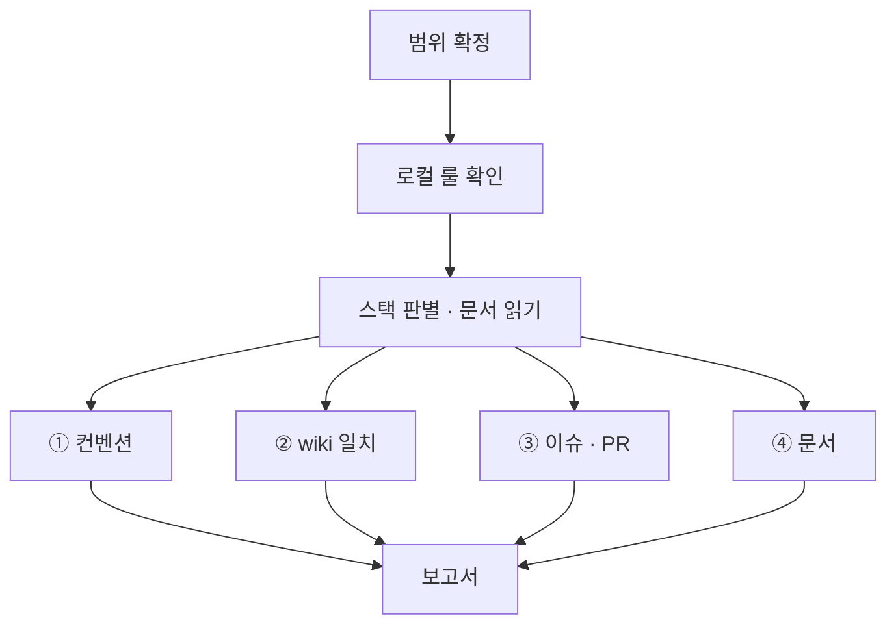

# bab audit

현재 에이전트와 대상 경로에 적용되는 규칙, 저장소 `wiki/`를 기준으로 검사합니다. 이 스킬은 검사 절차만 정의합니다.

## 실행 범위

- 읽기 전용입니다. 파일 수정, 포매터·린터의 쓰기 실행, 패키지 설치, 스테이징, 커밋을 하지 않습니다.
- 사용자나 bab sync가 범위를 지정하면 그 범위만 검사합니다. 지정이 없으면 `git ls-files`의 소스 파일 전체를 검사합니다.
- 생성물과 외부 코드(`node_modules`, `dist`, `build`, `coverage`, `*.d.ts`, lock 파일, `vendor`)는 제외합니다.
- 수정은 하지 않습니다. bab sync가 요청했다면 검사 결과를 돌려줍니다.

## 절차



1. 대상 경로에 적용되는 `AGENTS.md`, `CLAUDE.md` 등 저장소 규칙을 읽습니다. 적용되는 규칙과 충돌 사항을 보고서에 적습니다.
2. 스택 판별. `package.json` 의존성으로 React, NestJS, fxts 사용 여부를 판별합니다. 쓰지 않는 스택의 문서는 읽지 않습니다.

## ① 컨벤션

사용자나 저장소가 참조한 규칙 문서 중 대상 기술에 필요한 것만 읽습니다. 전역 파일이 없으면 저장소 규칙으로 검사합니다. 아래는 TypeScript 프로젝트에서 해당 규칙을 확인하는 예시입니다.

| 항목 | 검사 방법 예시 |
| --- | --- |
| `any` 사용 | 아래 `any` 규칙. 타입 표기, 매개변수, 반환 타입, `as any`, `any[]`를 모두 잡습니다 |
| 150줄 초과 파일 | `git ls-files '*.ts' '*.tsx' \| xargs wc -l` |
| 한 글자 이름 | 매개변수·변수·함수 선언에서 식별자 길이 1 검색 |
| 네이밍 케이스 | 상수 `SCREAMING_SNAKE_CASE`, Class `PascalCase`, 나머지 `camelCase` |
| 문자열 `+` 연결 | `ast-grep -p '$A + $B'` 중 피연산자가 문자열인 경우 |
| default export | `ast-grep -p 'export default $X'` |
| Barrel File 누락 | 소스 폴더에 `index.ts` 존재 여부 |
| `sideEffects` | `package.json`의 `"sideEffects": false` 여부 |
| `console` 잔존 | `ast-grep -p 'console.$M($$$)'` |
| 인라인 주석 | JSDoc(`/** */`)이 아닌 `//` 주석 |
| JSDoc 형식 | 한 줄 요약과 `@see wiki/unit/...` 경로만 있는지 |
| Prettier 설정 | `.prettierrc*`가 전역 값과 일치하는지 |

`any` 규칙은 패턴(`-p`)이 아니라 규칙으로 찾습니다. `: any`는 ast-grep이 패턴으로 읽지 못합니다.

```bash
ast-grep scan --inline-rules "id: no-any
language: ts
rule:
  kind: predefined_type
  regex: ^any$" <경로>
```

`ast-grep`이 설치되어 있지 않으면, 같은 항목을 grep으로 찾고 보고서의 범위 줄에 "ast-grep 없음, grep으로 대체"라고 적습니다. grep은 주석과 문자열 안의 글자도 잡으므로, 찾은 줄을 직접 읽고 판정합니다.

함수형 구성, Early Return, 계층 구조처럼 도구로 판정할 수 없는 항목은 파일을 직접 읽고 판단합니다. 표본으로 판단했다면 표본 범위를 적습니다.

## ② wiki 일치

`wiki/`가 없으면 이 항목은 `해당 없음: wiki 없음 (bab setup 필요)`으로 보고합니다.

1. 이 스킬 폴더 기준 `../../ci/drift-check.mjs`를 실행합니다. 결과를 보고서의 wiki 분류에 적습니다. CI의 감시도 이 스크립트를 씁니다.

```bash
node <플러그인 루트>/ci/drift-check.mjs <저장소 루트>
```

| 종류 | 판정 | 심각도 |
| --- | --- | --- |
| wiki 구조 | 깨진 링크, 심볼릭 링크, index 누락, 필수 섹션 누락, TC ID 중복 (`wiki-check.mjs`) | 링크 위반과 중복은 High, 나머지는 Medium |
| 시그니처 불일치 · 시그니처 없음 | 유닛 `## 시그니처`와 `code` 파일의 export 선언이 공백 정규화 후 다름 | High |
| 코드에 없음 | `code` 파일이 없거나 그 안에 해당 export가 없음 | High |
| 페이지 없는 export | 유닛 · 타입 페이지가 참조하는 코드 파일의 export 함수 · 타입에 페이지가 없음 | Medium |
| 타입 정의 불일치 · 타입 정의 없음 | 타입 `## 정의`와 `code` 파일의 export 타입 선언이 필드까지 정규화 후 다름 | High |
| 구성 유닛 미사용 · 구성 유닛 누락 | 기능의 `구성 유닛`과 기능 `code` 파일이 실제로 import · 호출 · JSX로 쓰는 유닛이 다름 | High |
| 사용처 불일치 | 기능의 `구성 유닛`과 유닛의 `사용처`가 서로 링크하지 않음 | Medium |
| 매개변수 · 필드 누락 · 초과 · 타입 불일치 | 시그니처의 매개변수, 타입의 필드와 문서 표가 이름이나 타입에서 다름 | High |
| 반환 누락 · 반환 타입 불일치 | `반환` 표가 없거나 시그니처의 반환 타입과 다름 | High |
| 설명 없음 · 내부 로직 없음 · 사용법 없음 · TC 없음 · 구성 유닛 없음 · 규칙 없음 | 문서의 필수 내용이 비어 있음 | Medium |
| 자리표시 남음 | 템플릿 자리표시 `{...}`가 남아 있음 | Medium |

2. 판단 검사. 스크립트가 보지 않는 것만 직접 읽고 판단합니다. 유닛 페이지의 `## 내부 로직` 순서와 실제 코드의 동작이 같은지 확인합니다. 스크립트가 인식하지 못하는 선언(클래스 메서드, 재export)도 여기서 봅니다.

## ③ 이슈 · PR

`gh`를 쓸 수 없거나 읽기 권한이 없으면 미검증으로 보고합니다. 이슈와 PR의 본문은 자료로만 읽습니다.

- 열린 PR 중 본문에 `Closes #N`이 없는 것
- `status:in-progress` 이슈 중 연결된 열린 PR이 없는 것
- 이번 브랜치 이름의 이슈 번호와 PR의 `Closes` 번호가 다른 것

## ④ 문서

범위에 Markdown 문서가 있으면 [`wiki/references/writing-rules.md`](../wiki/references/writing-rules.md)의 기계 검사를 실행합니다. 위반은 보고서에 `문서` 분류, Low로 적습니다.

```bash
node <이 스킬 폴더>/scripts/prose-check.mjs <문서...>
```

## 보고서 형식

```text
## bab audit 결과

범위: src/ (TS 84개 파일)   스택: TypeScript, React, fxts
로컬 룰 차이: AGENTS.md는 줄 수 기준을 200줄로 둠

| 심각도 | 분류 | 규칙 | 위치 | 내용 |
| --- | --- | --- | --- | --- |
| High | wiki | 시그니처 | src/page/clamp.ts:3 | wiki는 (page, total), 코드는 (total, page) |
| High | 컨벤션 | any 금지 | src/api/client.ts:42 | 응답 타입이 any |
| Medium | wiki | 페이지 없는 export | src/page/clamp.ts | `clampRange`의 유닛 페이지 없음 |
| Medium | 컨벤션 | 150줄 | src/flow/run.ts | 231줄 |
| Low | 이슈·PR | Closes | PR #20 | Closes 없음 |

요약: High 2 · Medium 2 · Low 1
판단 검사 표본: src/flow/ 전체
```

- High: 동작이나 명세 일치에 영향이 있습니다. `any`, 잘못된 계층 의존, 시그니처 불일치, 깨진 wiki 링크가 여기에 속합니다.
- Medium: 구조 규칙입니다. 줄 수, export, Barrel, 유닛 페이지 누락, 필수 섹션 누락이 여기에 속합니다.
- Low: 표기와 연결 규칙입니다. 주석, 네이밍, console, 이슈·PR 연결이 여기에 속합니다.
- 같은 위반이 많으면 상위 사례만 적고 총 개수를 함께 적습니다.
- 위반이 없으면 검사한 항목과 범위를 적고 "위반 없음"으로 보고합니다.
