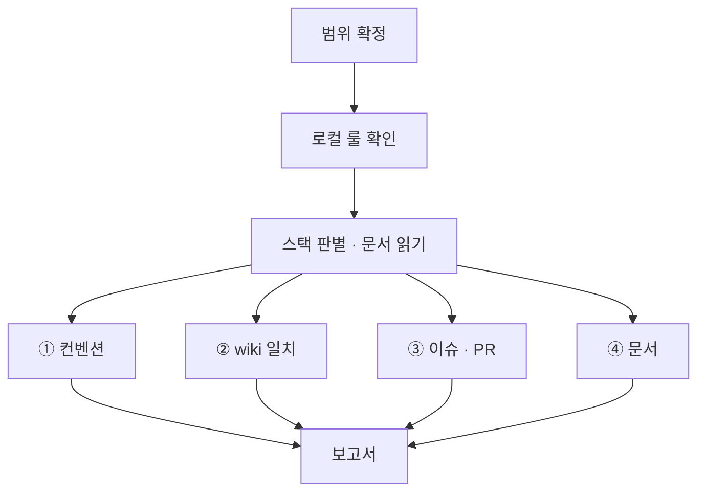

# bab audit

이슈는 도메인 결정 이력입니다. wiki와 로컬 룰은 개발 형상의 기준입니다. PR은 실제 변경과 검증 근거를 모으는 창구입니다. 이 세 기록을 대조합니다.

## 실행 범위

- 검사 대상 파일은 읽기 전용입니다. 포매터·린터의 쓰기 실행, 패키지 설치, 스테이징, 커밋을 하지 않습니다. 요청받은 재현의 임시 구현은 아래 절차를 따릅니다.
- 사용자나 bab sync가 범위를 지정하면 그 범위만 검사합니다. 지정이 없으면 `git ls-files`의 소스 파일 전체를 검사합니다.
- 생성물과 외부 코드(`node_modules`, `dist`, `build`, `coverage`, `*.d.ts`, lock 파일, `vendor`)는 제외합니다.
- 수정은 하지 않습니다. bab sync가 요청했다면 검사 결과를 돌려줍니다.

## 절차



1. 대상 경로에 적용되는 `AGENTS.md`, `CLAUDE.md`와 그 파일이 가리키는 공통 규칙 문서를 읽습니다. 해당 경로의 린터·포매터 설정도 확인합니다.
2. 대상 기술과 경로에 적용되는 규칙을 고릅니다. 규칙 문서나 설정이 서로 충돌하고 우선순위가 없으면 충돌과 근거를 보고하고 해당 판정을 보류합니다.

## ① 컨벤션

프로젝트 문서가 명시하거나 프로젝트 설정에서 활성화한 규칙만 검사합니다. 특정 기술을 쓴다는 사실, 에이전트의 개인 전역 설정, 아래 예시만으로 프로젝트가 규칙을 채택했다고 판단하지 않습니다. 채택한 규칙이 없으면 컨벤션을 `해당 없음`으로 기록하고 나머지 검사를 계속합니다.

| 채택한 규칙 예시 | 검사 방법 |
| --- | --- |
| TypeScript의 `any` 금지 | 프로젝트 린터나 아래 구문 검사로 `any`, `as any`, `any[]`를 찾습니다 |
| 파일 길이 | 프로젝트가 지정한 파일 범위·줄 계산 방식·상한을 적용합니다. 상한이 200줄이면 200줄을 기준으로 보고합니다 |
| 네이밍 | 프로젝트가 지정한 식별자 종류별 형식을 확인합니다. 예를 들어 상수에도 `camelCase`를 쓰는 프로젝트에서는 그 형식을 검사합니다 |
| 문자열 조합, export, 주석 | 프로젝트가 요구하는 템플릿 리터럴, Named Export, `index.ts`, JSDoc 형식 등을 확인합니다 |
| 포매팅·패키지 설정 | 저장소가 채택한 포매터 설정과 `sideEffects` 정책을 확인합니다 |

프로젝트가 `any`를 금지하고 `ast-grep`을 쓴다면 패턴(`-p`) 대신 아래 규칙으로 찾습니다. `: any`는 `ast-grep`이 패턴으로 읽지 못합니다.

```bash
ast-grep scan --inline-rules "id: no-any
language: ts
rule:
  kind: predefined_type
  regex: ^any$" <경로>
```

설치된 린터나 포매터는 검사 모드로만 실행합니다. 도구가 없으면 후보를 검색한 뒤 주석과 문자열을 제외하고 직접 확인합니다. 확인할 수 없는 채택 규칙은 `미검증`으로 기록합니다.

함수형 구성, Early Return, 계층 구조처럼 도구로 판정할 수 없는 항목은 파일을 직접 읽고 판단합니다. 표본으로 판단했다면 표본 범위를 적습니다.

## ② wiki 일치

`wiki/`가 없으면 이 항목은 `해당 없음: wiki 없음 (bab setup 필요)`으로 보고합니다.

1. 이 스킬 폴더 기준 `../../ci/drift-check.mjs`를 실행합니다. 결과를 보고서의 wiki 분류에 적습니다. CI의 감시도 이 스크립트를 씁니다. 종료 코드 `3`과 `status: no-target`은 형상 명세가 없어 코드 대조 대상이 없다는 뜻입니다. 참고 문서가 있어도 이 상태를 정상 판정으로 쓰지 않습니다.

```bash
node <플러그인 루트>/ci/drift-check.mjs <저장소 루트>
```

| 종류 | 판정 | 심각도 |
| --- | --- | --- |
| wiki 구조 | 깨진 링크, 심볼릭 링크, index 누락, 인덱스 중복·분류 오류, 필수 섹션 누락, TC ID 중복 (`wiki-check.mjs`) | 링크 위반과 중복·분류 오류는 High, 나머지는 Medium |
| 참고 문서 | `reference`의 내용·출처, 링크와 정확한 인덱싱. 코드 형상과 TC는 검사하지 않음 | 누락은 Medium |
| 시그니처 불일치 · 시그니처 없음 | 유닛 `## 시그니처`와 `code` 파일의 export 선언이 공백 정규화 후 다름 | High |
| 코드에 없음 | `code` 파일이 없거나 그 안에 해당 export가 없음 | High |
| 페이지 없는 export | 유닛 · 타입 페이지가 참조하는 코드 파일의 export 함수 · 타입에 페이지가 없음 | Medium |
| 타입 정의 불일치 · 타입 정의 없음 | 타입 `## 정의`와 `code` 파일의 export 타입 선언이 필드까지 정규화 후 다름 | High |
| 구성 유닛 미사용 · 구성 유닛 누락 | 기능의 `구성 유닛`과 기능 `code` 파일이 실제로 import · 호출 · JSX로 쓰는 유닛이 다름 | High |
| 사용처 불일치 | 기능의 `구성 유닛`과 유닛의 `사용처`가 서로 링크하지 않음 | Medium |
| 매개변수 · 필드 누락 · 초과 · 타입 불일치 | 시그니처의 매개변수, 타입의 필드와 문서 표가 이름이나 타입에서 다름 | High |
| 반환 누락 · 반환 타입 불일치 | `반환` 표가 없거나 시그니처의 반환 타입과 다름 | High |
| 설명 없음 · 내부 로직 없음 · 사용법 없음 · TC 없음 · 구성 유닛 없음 · 규칙 없음 | 문서의 필수 내용이 비어 있음 | Medium |
| 자리표시 남음 | 템플릿 자리표시 `{...}`가 남아 있음 | Medium |

2. 판단 검사. 스크립트가 보지 않는 것만 직접 읽고 판단합니다. 유닛 페이지의 `## 내부 로직` 순서와 실제 코드의 동작이 같은지 확인합니다. 스크립트가 인식하지 못하는 선언(클래스 메서드, 재export)도 여기서 봅니다. 드리프트 검사만으로 동작 의미나 테스트 통과를 주장하지 않습니다.

## ③ 이슈 · wiki · PR 대조

이슈 본문과 결정 코멘트, wiki와 로컬 룰, PR 본문과 diff를 읽습니다. PR을 열기 전이면 로컬 diff와 검증 기록을 사용합니다. 읽을 수 없는 자료나 실행하지 않은 검사는 `미검증`으로 기록합니다.

1. `Closes #N`은 완료할 이슈에, `Refs #N`은 일부 구현이나 후속 수정에 연결됐는지 봅니다. 이슈 없는 작은 수정의 `no-spec`은 연결 검사에서 뺍니다.
2. 이슈의 완료 기준마다 관련 wiki 명세와 검증 기록을 찾습니다. 동작은 TC와 실행 결과로 확인합니다. 화면 기능이면 [UI·비동기 패턴](../wiki/references/ui-async-pattern.md)에 따라 명세한 상태·키보드·포커스·화면 크기·늦은 응답 중 해당 항목을 실제 화면과 검증 근거에 대조합니다. 실행하지 않은 화면 검사는 `미검증`으로 남깁니다. 같은 변경을 검사했는지와 완료 기준을 입증하는지 봅니다. 일부 구현은 이번 범위와 남은 기준을 구분합니다.
3. 반대로 실제 diff에서 형상에 추가·변경·삭제된 대상을 찾습니다. 각 항목에 이슈의 합의 근거와 PR 기록이 있는지 봅니다. 삭제된 대상은 이전 경로나 diff에서 확인합니다. 계속 적용할 결정은 정책이나 관련 문서에 반영됐는지 봅니다.
4. 충족을 입증하지 못했으면 완료로 판정하지 않습니다. 끊어진 지점과 필요한 근거를 보고합니다.
5. 이슈·PR·wiki·로그에 비밀값과 개인정보 원문이 없는지 확인합니다. 표본과 실행 결과는 [`writing-rules.md`](../wiki/references/writing-rules.md#공개-기록의-민감정보)에 따라 마스킹합니다.

### 문서만으로 유닛 재현

요청이 있을 때 유닛 하나를 골라 관련 wiki 페이지와 적용되는 로컬 룰만으로 재현합니다. 가능하면 해당 자료만 받은 별도 세션을 사용합니다. 재현이 끝날 때까지 이슈, PR, 기존 구현과 테스트를 보지 않습니다. 임시 구현은 검사 대상과 분리된 임시 위치에만 작성합니다.

재현 후 이름과 입출력 계약, 타입 제약, 유닛 관계, 필수 분기 순서와 경계·실패 결과를 명세와 대조합니다. 문서의 TC를 실행할 수 있으면 실행합니다. 추측이 필요했던 조건과 미검증 범위를 보고합니다. 임시 구현 없이 문서만 읽었다면 문서 검토로 기록합니다.

## ④ 문서

범위에 Markdown 문서가 있으면 [`wiki/references/writing-rules.md`](../wiki/references/writing-rules.md)의 기계 검사를 실행합니다. 위반은 보고서에 `문서` 분류, Low로 적습니다.

```bash
node <이 스킬 폴더>/scripts/prose-check.mjs <문서...>
```

## 보고

[공통 브리핑 규칙](../setup/assets/claude-section.md#최종-브리핑)을 따릅니다. 먼저 완료를 막는 문제를 말합니다. 각 문제에 위치, 규칙의 근거, 영향과 필요한 조치를 적습니다.

같은 위반은 대표 사례와 총개수로 묶습니다. 검사 범위와 미검증 항목을 밝힙니다. 위반이 없으면 확인한 범위에서 없다고 보고합니다.

예시:

```text
유닛 명세와 구현의 매개변수 순서가 달라 완료로 판단할 수 없습니다.

src/page/clamp.ts:3은 (total, page)를 받지만 wiki는 (page, total)로 정의합니다. 호출자가 명세의 순서대로 값을 보내면 두 값이 뒤바뀝니다. 구현을 명세에 맞추고 해당 TC를 다시 실행해야 합니다.

이번 확인은 src/page/에 한정했습니다. 실제 화면 동작은 미검증입니다.
```

상세 보고서를 요청하면 `심각도 | 위치 | 근거 | 영향 | 필요한 조치` 표를 씁니다. 컨벤션 위반은 프로젝트가 채택한 규칙에만 적용합니다.

| 심각도 | 기준 | 예 |
| --- | --- | --- |
| High | 동작이나 명세 일치에 영향 | 시그니처 불일치, 깨진 wiki 링크, 채택한 `any` 금지 위반 |
| Medium | 구조 규칙 위반 | 파일 길이 상한, 유닛 페이지 또는 필수 섹션 누락 |
| Low | 표기와 연결 규칙 위반 | 주석, 네이밍, 이슈·PR 연결 |
