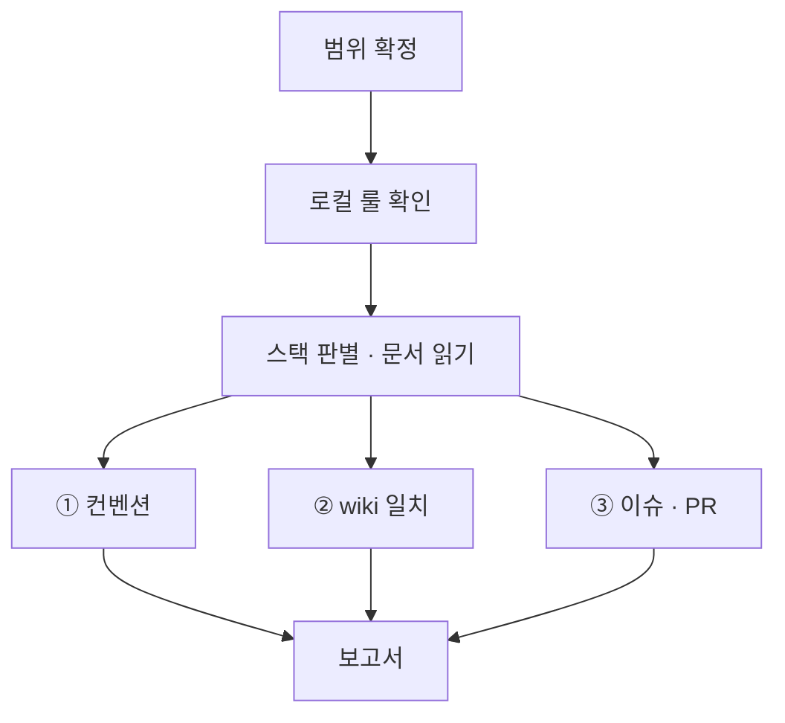

# bab audit

규칙의 원본은 `~/.claude/CLAUDE.md`, `~/.claude/conventions/`, 저장소 `wiki/`입니다. 이 스킬은 규칙을 복제하지 않고 검사 절차만 정의합니다.

## 실행 범위

- **읽기 전용**입니다. 파일 수정, 포매터·린터의 쓰기 실행, 패키지 설치, 스테이징, 커밋을 하지 않습니다.
- 사용자나 `/bab:sync`가 범위를 지정하면 그 범위만 검사합니다. 지정이 없으면 `git ls-files`의 소스 파일 전체를 검사합니다.
- 생성물과 외부 코드(`node_modules`, `dist`, `build`, `coverage`, `*.d.ts`, lock 파일, `vendor`)는 제외합니다.
- 보고 후 수정은 하지 않습니다. 단 `/bab:sync`가 호출했다면 결과를 sync에 돌려주고 sync가 고칩니다.

## 절차



1. **로컬 룰 확인.** `CLAUDE.md`, `AGENTS.md`, `.claude/rules/`를 읽습니다. 로컬 룰이 전역과 다르면 로컬을 우선하고 보고서에 차이를 적습니다.
2. **스택 판별.** `package.json` 의존성으로 React, NestJS, fxts 사용 여부를 판별합니다. 쓰지 않는 스택의 문서는 읽지 않습니다.

## ① 컨벤션

| 문서 | 읽는 조건 |
| --- | --- |
| `~/.claude/CLAUDE.md` 상시 적용 핵심 규칙 | 항상 |
| `~/.claude/conventions/code/CODE_ARCHITECTURE.md`, `CODE_CONVENTIONS.md`, `FX_CONVENTIONS.md` | TypeScript 프로젝트 |
| `~/.claude/conventions/react/REACT_CONVENTIONS.md`, `REACT_ARCHITECTURE.md` | React 의존성이 있을 때 |
| `~/.claude/conventions/nest/NEST_ARCHITECTURE.md` | NestJS 의존성이 있을 때 |
| `~/.claude/conventions/document/RULE_CONVENTIONS.md` | Rule·Skill markdown이 범위에 있을 때 |

| 항목 | 검사 방법 예시 |
| --- | --- |
| `any` 사용 | `ast-grep -p ': any' -l ts`, `as any`, `<any>`, `any[]` |
| 150줄 초과 파일 | `git ls-files '*.ts' '*.tsx' \| xargs wc -l` |
| 한 글자 이름 | 매개변수·변수·함수 선언에서 식별자 길이 1 검색 |
| 네이밍 케이스 | 상수 `SCREAMING_SNAKE_CASE`, Class `PascalCase`, 나머지 `camelCase` |
| 문자열 `+` 연결 | `ast-grep -p '$A + $B'` 중 피연산자가 문자열인 경우 |
| default export | `ast-grep -p 'export default $X'` |
| Barrel File 누락 | 소스 폴더에 `index.ts` 존재 여부 |
| `sideEffects` | `package.json`의 `"sideEffects": false` 여부 |
| `console` 잔존 | `ast-grep -p 'console.$M($$$)'` |
| 인라인 주석 | JSDoc(`/** */`)이 아닌 `//` 주석 |
| JSDoc 형식 | 한 줄 요약과 `@see wiki/unit/...` 경로만 있는지 |
| Prettier 설정 | `.prettierrc*`가 전역 값과 일치하는지 |

함수형 구성, Early Return, 계층 구조처럼 도구로 판정할 수 없는 항목은 파일을 직접 읽고 판단합니다. 표본으로 판단했다면 표본 범위를 적습니다.

## ② wiki 일치

`wiki/`가 없으면 이 항목은 `해당 없음: wiki 없음 (/bab:setup 필요)`으로 보고합니다.

1. **구조 검사.** `node <이 스킬 폴더>/scripts/wiki-check.mjs <저장소>/wiki`를 실행합니다. 깨진 링크, index에 없는 페이지, 유닛·기능의 필수 섹션 누락, TC ID 중복을 잡습니다.
2. **시그니처.** 유닛 페이지의 `## 시그니처` 코드 블록과 frontmatter `code` 파일의 실제 선언을 ast-grep으로 비교합니다. 이름, 매개변수 순서와 타입, 반환 타입이 같아야 합니다.
3. **누락 페이지.** 범위 안 공개(export) 함수 중 유닛 페이지가 없는 것을 찾습니다.
4. **TC 대응.** wiki의 `UT-*`, `FT-*` ID마다 이름에 그 ID가 들어간 테스트가 있는지 찾습니다. 테스트에만 있고 wiki에 없는 ID도 보고합니다.

## ③ 이슈 · PR

`gh`를 쓸 수 없으면 `해당 없음`으로 보고합니다.

- 열린 PR 중 본문에 `Closes #N`이 없는 것
- `status:in-progress` 이슈 중 연결된 열린 PR이 없는 것
- 이번 브랜치 이름의 이슈 번호와 PR의 `Closes` 번호가 다른 것

## 보고서 형식

```text
## bab audit 결과

범위: src/ (TS 84개 파일)   스택: TypeScript, React, fxts
로컬 룰 차이: AGENTS.md는 줄 수 기준을 200줄로 둠

| 심각도 | 분류 | 규칙 | 위치 | 내용 |
| --- | --- | --- | --- | --- |
| High | wiki | 시그니처 | src/page/clamp.ts:3 | wiki는 (page, total), 코드는 (total, page) |
| High | 컨벤션 | any 금지 | src/api/client.ts:42 | 응답 타입이 any |
| Medium | wiki | TC 대응 | wiki/unit/page/clampPage.md | UT-clampPage-03 테스트 없음 |
| Medium | 컨벤션 | 150줄 | src/flow/run.ts | 231줄 |
| Low | 이슈·PR | Closes | PR #20 | Closes 없음 |

요약: High 2 · Medium 2 · Low 1
판단 검사 표본: src/flow/ 전체
```

- **High**: 동작이나 명세 일치에 영향이 있습니다. `any`, 잘못된 계층 의존, 시그니처 불일치, 깨진 wiki 링크가 여기에 속합니다.
- **Medium**: 구조 규칙입니다. 줄 수, export, Barrel, 유닛 페이지 누락, TC 테스트 누락, 필수 섹션 누락이 여기에 속합니다.
- **Low**: 표기와 연결 규칙입니다. 주석, 네이밍, console, 이슈·PR 연결이 여기에 속합니다.
- 같은 위반이 많으면 상위 사례만 적고 총 개수를 함께 적습니다.
- 위반이 없으면 검사한 항목과 범위를 적고 "위반 없음"으로 보고합니다.
