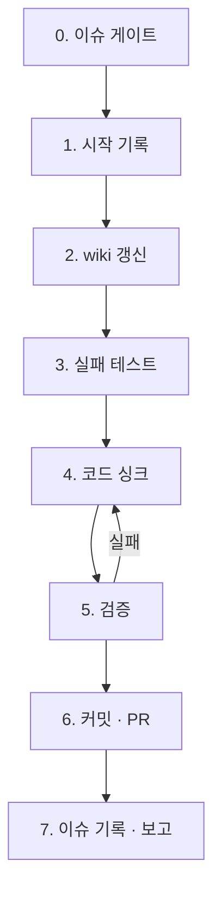

# bab sync

확정된 스펙 하나를 코드까지 내려보냅니다. 방향은 항상 **이슈 → wiki → 코드**입니다.

## 범위와 권한

- `status:decided` 이슈로 이 스킬을 실행하면 **그 이슈의 범위가 곧 요청 범위**입니다. 이 범위 안에서는 각 단계마다 확인을 받지 않습니다.
- 이 범위에는 브랜치 생성, 이 이슈로 바꾼 파일의 스테이징과 커밋, 푸시, PR 생성, 이 이슈의 라벨·코멘트 변경이 포함됩니다.
- 범위 밖에서 필요한 일을 발견하면 하지 않습니다. PR 본문 `Scope`와 최종 보고에 적습니다.
- 다음은 하지 않습니다. 머지, force-push, 다른 이슈 변경, `status:decided` 라벨 부착, 기본 브랜치에 직접 커밋.
- 판단 기준은 [`references/principles.md`](references/principles.md)의 원칙 6개입니다. 시작할 때 읽습니다.

## 절차

### 0. 이슈 게이트

`gh issue view <N> --json number,title,body,labels,state,comments`로 읽습니다. 아래 중 하나라도 해당하면 **아무것도 바꾸지 않고 중단**하고 이유를 보고합니다.

- Open이 아니다.
- `status:decided` 라벨이 없다.
- `/bab:spec`의 필수 항목(왜, 무엇을, 어떻게, 관련 wiki, 검증 기준, 중요도)이 비어 있다.
- 작업 트리에 이 이슈와 무관한 변경이 있다(`git status --porcelain`).

코멘트도 모두 읽습니다. 본문 이후에 합의된 변경은 코멘트에 있습니다. 본문과 코멘트가 충돌하면 중단하고 보고합니다.

### 1. 시작 기록

1. 기본 브랜치를 최신으로 받고 `<prefix>/<N>-<slug>` 브랜치를 만듭니다. prefix는 전역 커밋 규칙의 `new`·`feat`·`fix`·`refactor` 중 하나입니다.
2. `status:decided`를 떼고 `status:in-progress`를 붙입니다.
3. 이슈에 시작 코멘트를 남깁니다. 브랜치 이름과 고칠 wiki 페이지 목록을 적습니다.

### 2. wiki 갱신

`/bab:wiki`의 spec 모드를 그대로 따릅니다. 코드보다 먼저 끝냅니다. 이 단계가 끝나면 wiki만 보고 코드와 테스트를 쓸 수 있어야 합니다.

### 3. 실패 테스트

1. 이번에 추가하거나 바꾼 TC(`UT-*`, `FT-*`)마다 테스트를 씁니다. 테스트 이름에 TC ID를 넣습니다.
2. 실행해서 **실패하는 것을 확인**합니다. 실패 이유가 "아직 구현 안 됨"이 아니면 테스트를 고칩니다.
3. 테스트 도구가 없는 저장소면 이 단계는 `건너뜀: <이유>`로 기록하고, 5단계에서 TC를 직접 실행해 확인합니다.

### 4. 코드 싱크

- wiki 유닛 페이지의 시그니처, 내부 로직 순서, 사용처를 그대로 따릅니다.
- 전역 코드 컨벤션(`~/.claude/CLAUDE.md`와 `~/.claude/conventions/`)을 따릅니다.
- JSDoc은 한 줄 요약과 유닛 페이지 경로만 둡니다.
- 코드를 쓰다 wiki가 틀렸다는 것을 알게 되면 코드로 우회하지 않습니다. 2단계로 돌아가 wiki를 고치고, 이슈 범위를 벗어나면 중단하고 보고합니다.

### 5. 검증

모두 통과해야 다음 단계로 갑니다.

1. 3단계 테스트가 모두 통과합니다. 기존 테스트도 통과합니다.
2. `/bab:audit`를 이번 변경 범위로 실행합니다. High 위반이 없어야 합니다.
3. 이슈의 `검증 기준`을 하나씩 확인합니다.

같은 원인으로 두 번 실패하면 가정을 다시 확인합니다. 세 번째에도 실패하면 중단하고 보고합니다.

### 6. 커밋 · PR

1. 이 이슈로 바꾼 파일만 스테이징합니다. 커밋은 전역 Commit 규칙의 형식을 따르고, 본문 마지막 항목에 `#N`을 적습니다.
2. 커밋은 검증 단위로 나눕니다. 순서는 wiki → 실패 테스트 → 코드입니다.
3. 푸시하고 `gh pr create`로 PR을 엽니다. 본문은 저장소의 PR 템플릿을 채웁니다.
   - `관련 이슈`: `Closes #N`
   - `Why`: 이슈의 왜를 1~3문장으로
   - `What`: 바뀐 것 1~3개
   - `Scope`: 포함한 것과 일부러 뺀 것
   - `변경된 wiki`: 페이지와 변경 요약
   - `Verification`: TC ID별 결과
4. PR의 CI(`bab` 워크플로)가 끝날 때까지 기다립니다(`gh pr checks <PR> --watch`). 실패하면 실패한 규칙을 이슈 범위 안에서 고치고 다시 푸시합니다. 스펙을 바꿔야 고칠 수 있으면 중단하고 보고합니다.

### 7. 이슈 기록 · 보고

1. 이슈에 PR 링크와 검증 결과 요약을 코멘트로 남깁니다. 라벨은 `status:in-progress`로 둡니다. 머지되면 `Closes #N`이 이슈를 닫습니다.
2. 사용자에게 보고합니다. 형식은 로컬 지침 파일의 `### 최종 브리핑`을 따릅니다. 이슈·PR 링크, 바뀐 wiki 페이지, TC 결과 표, 범위 밖에서 발견한 일을 반드시 넣습니다.

## 스펙이 바뀌었을 때

PR 리뷰 중에 스펙이 바뀌면 이 스킬이 스펙을 고치지 않습니다. 사람이 이슈 본문과 코멘트를 고치고 `status:decided`를 다시 확인하면, 같은 브랜치에서 2단계부터 다시 실행합니다.
