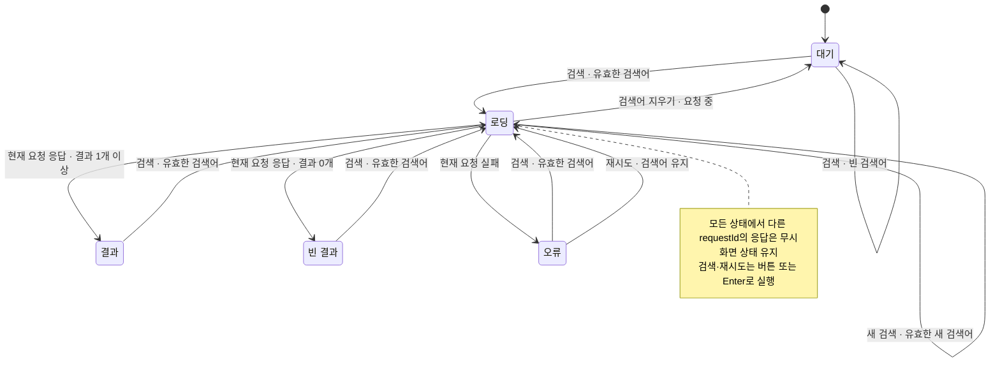

# UI와 비동기 흐름 명세 패턴

기능에 화면 상태나 비동기 이벤트가 있으면 `feature.md`의 `## 흐름`에 필요한 표를 추가합니다. 화면에서 보이는 결과는 기능 페이지에, 함수 이름·매개변수·반환 타입·분기와 실패 결과는 유닛 페이지에 적습니다. 대상 저장소에 `DESIGN.md`나 로컬 UI 룰이 있으면 그 규칙을 따릅니다. 화면 고유의 값은 기능 페이지에 적습니다. 이 패턴은 별도 문서 종류나 경량 명세가 아닙니다.

[시각화 기준](visualization.md)에 따라 관점과 근거를 표시합니다. 상태가 둘 이상이고 상태에 따라 표시·허용 조작이 달라지면 상태표와 상태도를 함께 둡니다.
상태도는 `stateDiagram-v2`로 작성합니다. 한글 표시 이름은 큰따옴표로 묶고 ASCII 별칭을 지정합니다.
상태 이름·이벤트·조건은 표와 대응시키고 초기 진입을 표시합니다.
상태 유지도 전이로 다룹니다. 공통 규칙은 적용 상태·조건을 밝힌 보이는 주석으로 묶을 수 있습니다.
표에만 있는 전이와 그림에만 있는 조건을 만들지 않습니다. 명세에 없는 종료 상태도 추가하지 않습니다.
담당 유닛은 구성 유닛의 페이지에 연결하고, 관련 TC는 같은 기능의 TC에서 찾을 수 있어야 합니다.

## 화면 상태

해당하는 상태의 최초 진입값, 로딩·결과·빈 결과·오류, 재시도와 취소 경로를 적습니다. 버튼과 키보드가 같은 동작을 하는지, 포커스와 화면 읽기 도구에 무엇을 알리는지도 적습니다. 화면 크기에 따라 동작이나 배치가 달라지면 기준 너비와 결과를 적습니다. 담당 유닛은 `## 구성 유닛`의 링크와 일치시킵니다.

## 비동기 이벤트

| 순서 | 이벤트 | 입력과 식별자 | 성공 결과 | 실패·취소 결과 | 담당 유닛 |
| --- | --- | --- | --- | --- | --- |
| 1 | 검색 요청 | `requestId`, `query` | 대기 상태 표시 | 요청 생성 실패 표시 | `startSearch` |
| 2 | 응답 수신 | `requestId`, `items` | 현재 요청만 결과 반영 | 오래된 응답 무시 | `applySearchResult` |

동시 요청의 순서, 재시도 횟수, 시간 제한과 중복 처리 규칙을 적습니다. 각 경계는 기능 TC와 유닛 TC로 확인합니다. 실제 값이나 개인 식별자는 표본에 넣지 않습니다.

## 예시: 검색 결과 화면

아래는 가상 프로젝트의 `wiki/feature/search-results.md`에 넣을 흐름 일부입니다. 검색 버튼과 Enter는 같은 요청을 시작합니다. 새 검색을 시작하면 이전 결과를 숨깁니다. `requestId`가 현재 요청과 다른 응답은 화면에 반영하지 않습니다.

관점은 UI 상태 전이입니다. 근거는 가상 기능 명세이며 범위는 초기 진입부터 검색·재검색·응답·재시도·취소까지입니다.
화면은 대기로 진입합니다. 아래 함수와 TC 이름은 가상 프로젝트에서 작성할 유닛·TC의 예시입니다.

| 현재 상태 | 이벤트와 입력 | 조건 | 다음 상태 | 화면 결과 | 담당 유닛 | 관련 TC |
| --- | --- | --- | --- | --- | --- | --- |
| 대기 | 검색 버튼 또는 Enter | 검색어가 비어 있음 | 대기 | 요청하지 않고 입력 오류 표시 | `validateQuery` | FT-search-07 |
| 대기·결과·빈 결과·오류 | 검색 버튼 또는 Enter | 유효한 검색어 | 로딩 | 이전 결과를 숨기고 로딩 표시 | `startSearch` | FT-search-01 |
| 로딩 | 새 검색 버튼 또는 Enter | 유효한 새 검색어 | 로딩 | 이전 요청을 취소하고 새 로딩 표시 | `startSearch` | FT-search-08 |
| 로딩 | 응답 수신 | 현재 `requestId`, 결과 1개 이상 | 결과 | 결과 목록과 건수 표시 | `applySearchResult` | FT-search-02 |
| 로딩 | 응답 수신 | 현재 `requestId`, 결과 0개 | 빈 결과 | 빈 결과 안내 표시 | `applySearchResult` | FT-search-03 |
| 로딩 | 요청 실패 | 현재 `requestId` | 오류 | 오류 안내와 재시도 버튼 표시 | `applySearchResult` | FT-search-04 |
| 오류 | 재시도 버튼 또는 Enter | 검색어 유지 | 로딩 | 같은 검색어로 새 요청 시작 | `startSearch` | FT-search-04 |
| 로딩 | 검색어 지우기 | 요청 중 | 대기 | 요청 취소, 안내 표시 | `cancelSearch` | FT-search-05 |
| 모든 상태 | 이전 요청의 응답 | 다른 `requestId` | 현재 상태 유지 | 화면 변경 없음 | `applySearchResult` | FT-search-05 |

Mermaid가 표시되지 않아도 표에서 같은 조건·결과를 읽을 수 있습니다. 표시 확인과 화면 동작 검증은 구분합니다.

이슈의 완료 기준에는 빈 검색어, 결과 유무, 실패 후 재시도, 취소 후 늦은 응답의 기대 동작을 적습니다. 기능 TC에는 각각 관찰 가능한 결과를 적습니다. `validateQuery`, `startSearch`, `applySearchResult`, `cancelSearch`의 시그니처·매개변수·분기·반환값과 TC는 각각 유닛 페이지에 적습니다. 상태 데이터의 필드와 허용 값은 타입 페이지에 적고, 기능·유닛·타입 페이지를 `wiki/index.md`의 정확한 분류에 연결합니다.

가상 프로젝트의 화면 규칙이 `480px` 이하에서 입력과 버튼을 세로로 배치하고, 그보다 넓을 때 가로로 배치한다고 가정합니다. 기능 페이지에는 이 기준과 결과를 적습니다. 검색 입력에는 보이는 레이블을 붙이고, Enter와 버튼으로 같은 검색을 실행합니다. 결과 건수와 오류는 화면 읽기 도구에 알립니다. 검색 후 포커스는 입력에 남고, 재시도 버튼은 Tab으로 이동할 수 있습니다. 실제 프로젝트에서는 합의한 화면 규칙과 디자인 토큰으로 값을 바꿉니다.

PR에는 각 기능 TC에 대응하는 테스트 또는 수동 확인 기록을 남깁니다. 아래는 검증 근거의 예시이며 실행 결과가 아닙니다.

| 기능 TC | 확인할 결과 | PR에 남길 근거 |
| --- | --- | --- |
| `FT-search-01` | Enter와 버튼이 같은 검색을 시작함 | 키보드·클릭 테스트 결과 |
| `FT-search-02` | 결과가 있으면 목록과 건수가 표시됨 | 화면 테스트 결과와 실행 환경 |
| `FT-search-03` | 결과가 없으면 빈 결과 안내가 표시됨 | 화면 테스트 결과와 실행 환경 |
| `FT-search-04` | 실패 뒤 같은 검색어로 재시도할 수 있음 | 실패·재시도 테스트 결과 |
| `FT-search-05` | 취소 뒤 늦은 응답이 화면을 바꾸지 않음 | 응답 순서를 바꾼 테스트 결과 |
| `FT-search-06` | 레이블·알림·포커스와 `480px` 안팎 배치가 명세와 일치함 | 접근성·화면 크기별 확인 기록 |
| `FT-search-07` | 빈 검색어를 요청하지 않고 입력 오류를 표시함 | 요청 횟수·입력 오류 확인 기록 |
| `FT-search-08` | 로딩 중 새 검색이 이전 요청을 취소하고 새 요청만 반영함 | 요청·응답 순서를 바꾼 테스트 결과 |

`drift-check`는 문서 구조와 일부 선언만 검사합니다. 화면 동작과 접근성, 반응형 배치는 대상 저장소의 테스트와 `bab:audit`에서 확인하고, 실행하지 않은 검사는 `미검증`으로 남깁니다.
