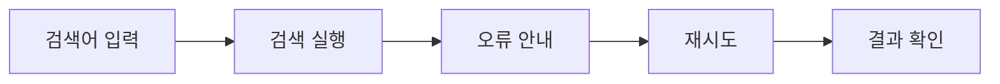
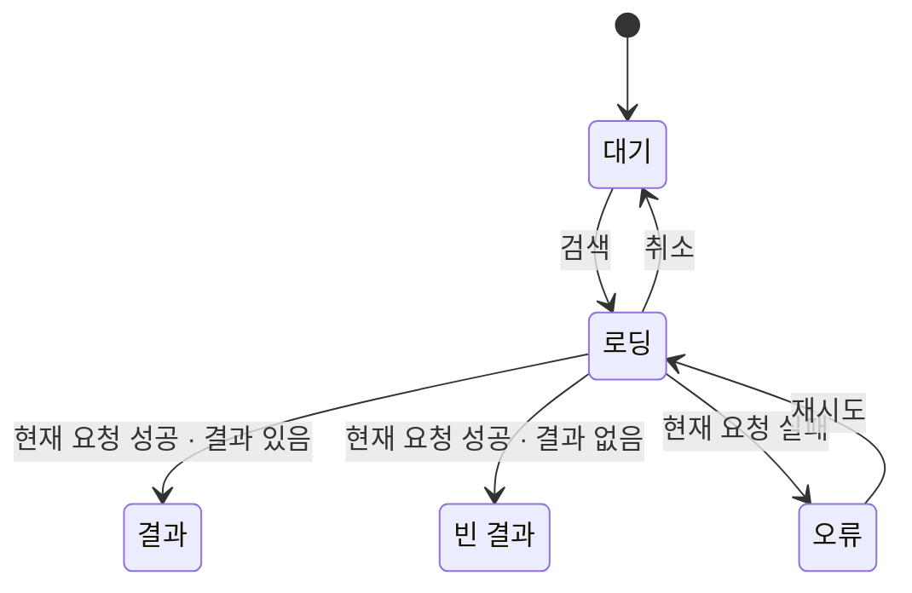
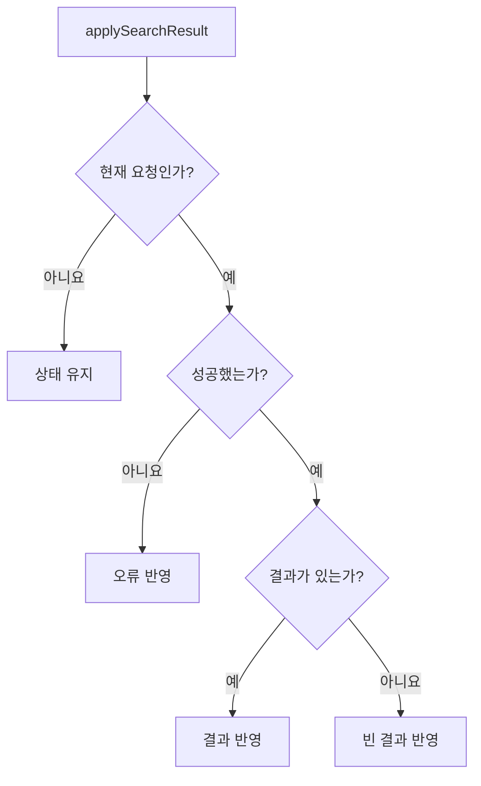
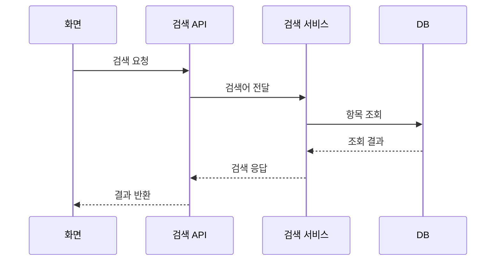
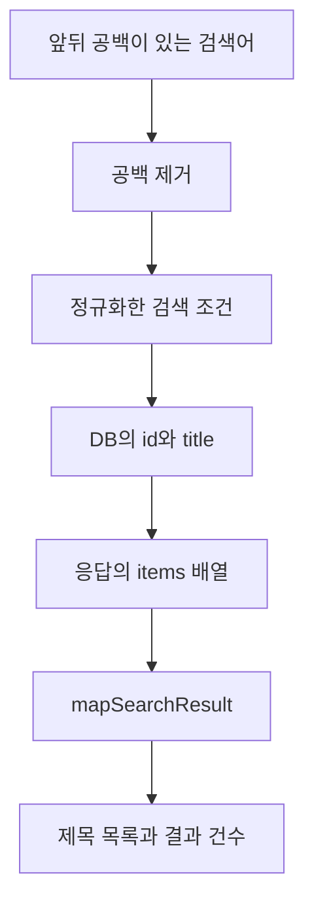
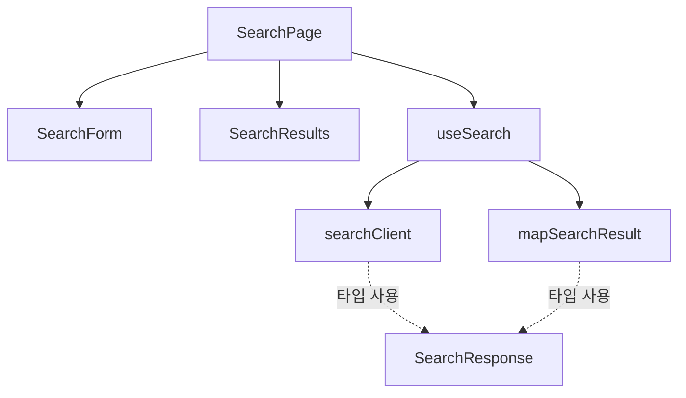
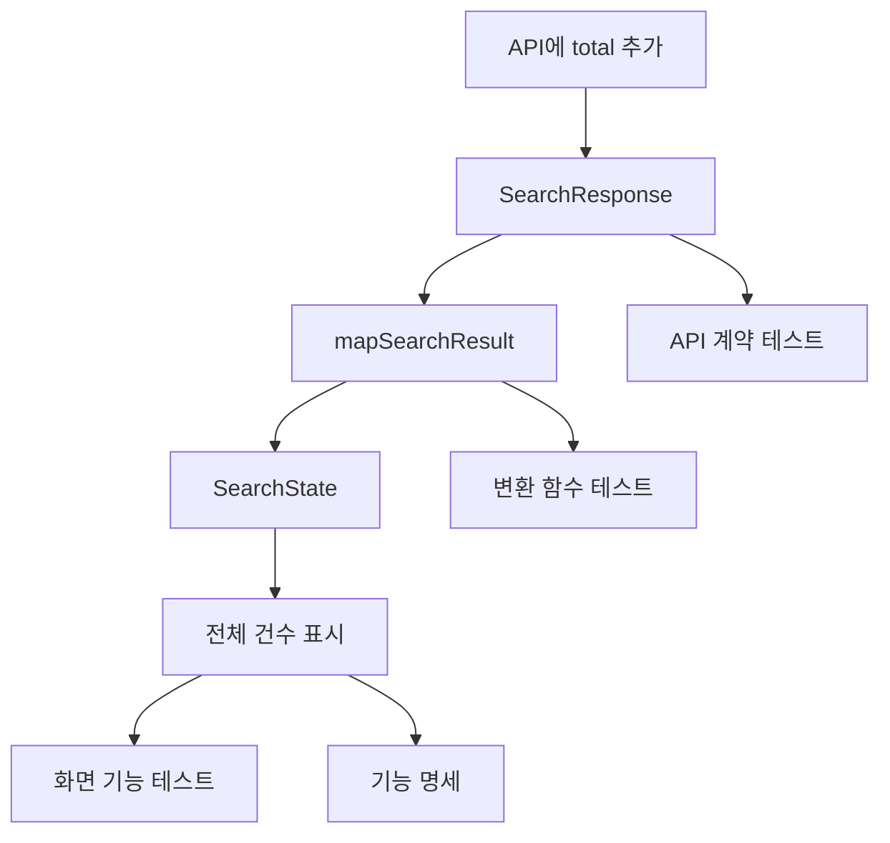

# 검색 기능의 여덟 시각화

모두 가상 예시입니다. 실제 코드 해석이나 실행 결과가 아닙니다. 일부 경로로 관점의 차이를 보여줍니다.
공통 작성 기준은 [시각화 기준](visualization.md)을 따릅니다. 상태표·유닛·TC까지 연결한 예시는 [UI 패턴](ui-async-pattern.md)에 있습니다.

## 시나리오

관점은 시나리오입니다. 근거는 가상 명세이며 범위는 실패 뒤 재시도에 성공하는 한 경로입니다.
사용자는 검색어를 입력하고 검색합니다. 오류 안내 뒤 재시도하고 결과를 확인합니다.

## 상태 전이

관점은 상태 전이입니다. 근거는 가상 명세이며 범위는 최초 검색의 응답 분기와 재시도·취소입니다.
대기에서 검색하면 로딩합니다. 현재 요청의 응답으로 결과·빈 결과·오류를 표시합니다. 재시도는 로딩으로, 취소는 대기로 이동합니다.

## 코드 실행

관점은 코드 실행입니다. 근거는 가상 유닛 명세이며 범위는 `applySearchResult`의 분기입니다.
현재 요청이 아니면 상태를 유지합니다. 현재 요청이면 성공 여부와 결과 유무에 따라 상태를 반영합니다.

## 상호작용

관점은 상호작용입니다. 근거는 가상 명세이며 범위는 성공한 요청 하나의 메시지 순서입니다.
화면이 API에 요청합니다. 서비스가 DB를 조회하고 결과가 역순으로 화면에 반환됩니다.

## 데이터

관점은 데이터 흐름입니다. 근거는 가상 명세이며 범위는 검색어와 조회 결과의 변환입니다.
입력의 앞뒤 공백을 제거해 검색 조건으로 씁니다. 조회 결과를 응답과 화면 데이터로 변환합니다.

## 구조·의존

관점은 구조·의존입니다. 근거는 가상 설계이며 범위는 화면 구성과 타입 사용입니다.
화살표는 사용하는 쪽에서 사용되는 쪽으로 향합니다. 실행 순서를 뜻하지 않습니다.

## 변경 영향

관점은 변경 영향입니다. 근거는 가상 변경안이며 범위는 전체 건수 표시의 영향 후보입니다.
API의 `total`을 타입·변환·상태·화면에 반영합니다. 실제 영향 범위는 사용처를 읽고 확인합니다.

## 검증 범위

관점은 검증 범위입니다. 아래 결과는 설명용 가정이며 실제 실행 근거로 사용할 수 없습니다.
실제 기록에서는 실행 환경·시점과 로그 위치를 적고, 실행하지 않은 동작은 미검증으로 남깁니다.

| 동작 | TC | 가상 결과 | 가상 근거 또는 남은 확인 |
| --- | --- | --- | --- |
| 결과 목록 표시 | FT-search-02 | 통과 | 로컬 화면 테스트 로그가 있다고 가정 |
| 실패 후 재시도 | FT-search-04 | 실패 | 재시도 때 검색어가 초기화된다고 가정 |
| 취소 후 늦은 응답 무시 | FT-search-05 | 미검증 | 실행하지 않았다고 가정 |
