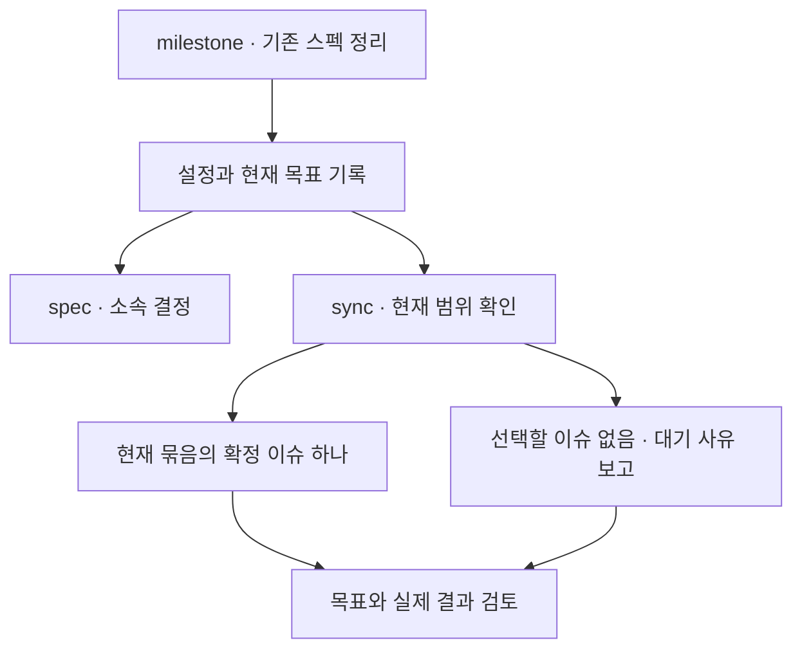

# 마일스톤 관리

사용자는 기존 스펙을 목표별로 정리하고 현재 마일스톤을 기준으로 다음 작업을 선택합니다.

## 구성 유닛

| 유닛 | 역할 |
| --- | --- |
| [readMilestoneConfig](../unit/milestone/readMilestoneConfig.md) | 선택형 프로젝트 설정 검증 |
| [inspectMilestones](../unit/milestone/inspectMilestones.md) | 대상 저장소와 현재 원격 목표 확인 |
| [pickNext](../unit/sync/pickNext.md) | 현재 후보 선택과 전체 저장소 충돌 보호 |
| [listIssues](../unit/sync/listIssues.md) | 큰 응답을 이슈별로 읽고 전체 페이지 성공 확인 |
| [readWikiPaths](../unit/sync/readWikiPaths.md) | 이슈의 wiki 경로 수집 |
| [priorityRank](../unit/sync/priorityRank.md) | 중요도 순위 계산 |
| [parseArgs](../unit/sync/parseArgs.md) | 기존 큐 옵션 읽기 |

## 흐름

1. milestone은 기존 열린 스펙과 마일스톤을 읽습니다. 목표, 범위, 완료 기준과 이슈 소속의 정리안을 준비합니다.
2. 승인된 범위에서 GitHub에 반영한 뒤 `.bab/milestones.json`을 기록하고 읽기 도구로 검사합니다.
3. spec은 같은 규약으로 소속을 정합니다. issues는 현재 묶음, 다른 묶음과 미배정 이슈를 구분합니다.
4. sync는 `inspectMilestones`로 현재 목표를 확인합니다. 직접 번호는 소속을 대조하고 next는 `pickNext`로 한 이슈를 고릅니다.
5. 큐는 `listIssues`로 후보와 전체 진행 상태를 스트림으로 읽습니다. 두 조회가 모두 성공해야 `pickNext`를 호출합니다.
6. `pickNext`는 전체 진행 상한과 wiki 충돌을 보호하고 현재 묶음 안에서 중요도와 오래된 순서로 선택합니다.
7. 설정과 원격 오류는 실패입니다. 현재 번호 미지정, 닫힘과 선택할 이슈 없음은 대기입니다.
8. 열린 항목이 없으면 사람의 목표·화면 검토를 안내합니다. 다음 묶음으로 자동 이동하지 않습니다.

설정과 스킬별 절차는 [공통 규약](../../plugins/bab/skills/milestone/references/protocol.md)을 따릅니다.

## 관련 정책

| 정책 | 규칙 |
| --- | --- |
| [마일스톤](../policy/milestones.md) | POL-milestones-01~12 |

## TC

| ID | 조건 | 동작 | 기대 결과 |
| --- | --- | --- | --- |
| FT-milestones-01 | 기존 열린 스펙과 마일스톤이 있음 | 셋업과 재실행 | 목표별 정리, 기존 소속·본문 보존과 중복 없음 |
| FT-milestones-02 | 설정이 없음 | spec·sync·issues 실행 | 기존 동작 유지, 마일스톤 원격 조회 없음 |
| FT-milestones-03 | 현재 묶음 P2와 다른 묶음 P0가 있음 | next 실행 | 현재 묶음 P2 선택 |
| FT-milestones-04 | 다른 묶음에 진행 중 작업이 있음 | next 실행 | 전체 상한과 wiki 충돌 보호 유지 |
| FT-milestones-05 | 현재 번호 미지정, 닫힘 또는 열린 항목 없음 | next 실행 | 사유별 대기, 다른 묶음 선택 없음 |
| FT-milestones-06 | 현재 묶음에 확정 이슈가 없음 | next 실행 | 대기 사유 보고, 전역 우회 없음 |
| FT-milestones-07 | 잘못된 설정이나 원격 실패 | 읽기와 next 실행 | 오류, 이슈 변경과 후보 선택 없음 |
| FT-milestones-08 | 활성 프로젝트에서 새 스펙 등록 | 목표와 소속 확인 | 적합한 소속 또는 미배정 후보, 확정 자동 변경 없음 |
| FT-milestones-09 | 현재 범위 밖의 직접 번호 요청 | sync 게이트 | 범위 차이를 보고하고 시작하지 않음 |
| FT-milestones-10 | 활성 프로젝트의 이슈 조회 | issues 실행 | 현재·다른 묶음·미배정 그룹과 상태·중요도 표시 |
| FT-milestones-11 | 열린 항목이 없음 | 결과 확인 | 목표·화면 검토를 안내하고 종료·다음 선택을 자동 수행하지 않음 |
| FT-milestones-12 | 전체 응답 또는 단일 레코드가 1 MiB 초과 | 활성·비활성 CLI 실행 | ENOBUFS 없이 전체 페이지에서 후보 선택 |
| FT-milestones-13 | 큰 목록과 다른 묶음의 진행 상태 | CLI 실행 | 전체 상한과 blocked 진행 이슈의 wiki 경로 보호 유지 |
| FT-milestones-14 | 앞 페이지 뒤 원격·JSON 실패 | CLI 실행 | 코드 2, 선택 JSON과 부분 성공 없음 |

FT-milestones-01, 08~11의 에이전트 판단과 실제 GitHub 쓰기는 자동 테스트와 구분합니다.
[검증 기록](../../docs/verification/milestones.md)에 실행 범위와 미검증 항목을 남깁니다.
